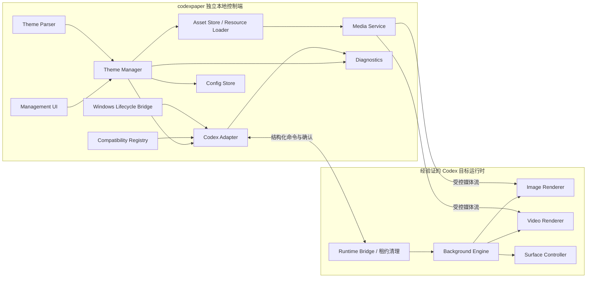
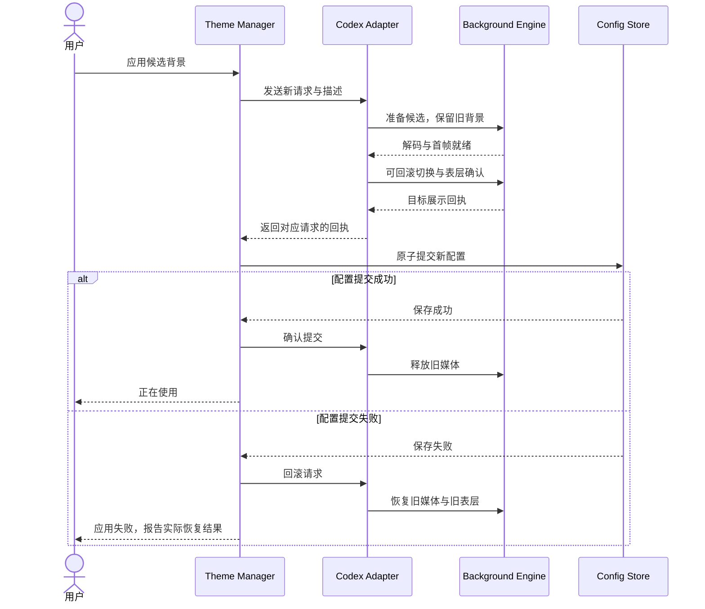
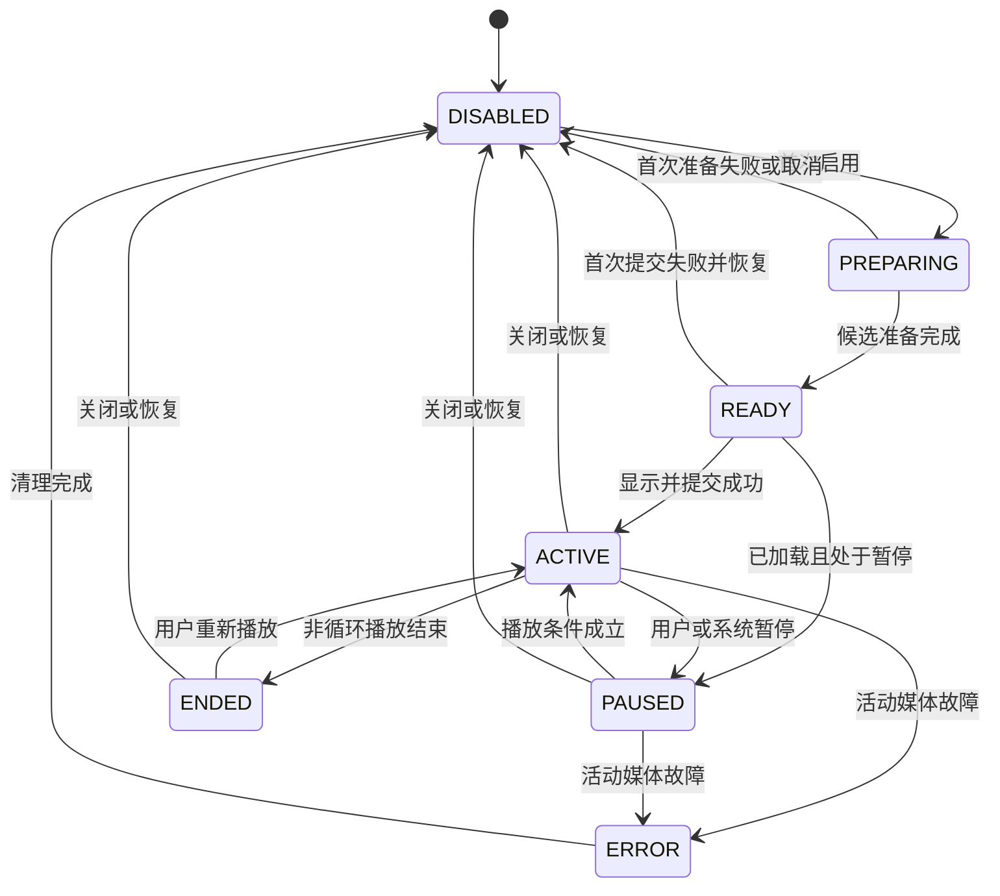

# Codex Theme Engine 技术架构设计文档 v1.0

| 项目 | 内容 |
| --- | --- |
| 产品名称 | codexpaper |
| 架构名称 | Codex Theme Engine |
| 文档版本 | v1.0 |
| 编写日期 | 2026-10-14 |
| 文档性质 | 技术架构设计与开发基线；候选接入方案须通过技术验证 |
| 首个目标平台 | Windows 上的 Codex 桌面客户端 |
| 对应产品版本 | V1 开放背景导入版；预留 V2 主题规范与 V3 主题生态 |
| 需求依据 | [codexpaper 产品需求文档 PRD v1.0](https://github.com/rgrnb/codex_dynamic_paper/blob/main/codexpaper_PRD_v1.0.docx) |
| PRD 内容标识 | Git blob SHA：`237f3129ff80ef5d615a03744cc43eb26e0f642e` |
| 建议仓库位置 | `docs/Architecture/Codex-Theme-Engine-Architecture-v1.0.md` |

本文定义 codexpaper 的模块边界、运行时接入、媒体渲染、数据模型、主题生命周期与版本演进方式。系统采用独立主题引擎架构：本地控制端管理资源与用户设置，Codex Adapter 隔离宿主差异，Background Engine 在经过验证的宿主运行时中显示背景。所有运行时更改必须可撤销，所有持久数据写入产品自己的用户目录。

产品名称沿用 PRD 中的 **codexpaper**，Codex Theme Engine 用于表示本技术架构。本文版本与产品发布版本分别管理。本文中的接口、技术选型和数值目标是设计要求，不代表代码已经实现或已通过测试。

## 目录

- [1 项目概述与架构约束](#1-项目概述与架构约束)
- [2 总体架构设计](#2-总体架构设计)
- [3 模块划分与职责](#3-模块划分与职责)
- [4 模块契约与数据模型](#4-模块契约与数据模型)
- [5 Codex 接入与兼容设计](#5-codex-接入与兼容设计)
- [6 全窗口背景渲染方案](#6-全窗口背景渲染方案)
- [7 图片与视频资源管线](#7-图片与视频资源管线)
- [8 动态壁纸设计](#8-动态壁纸设计)
- [9 主题生命周期与事务](#9-主题生命周期与事务)
- [10 本地存储安全与故障恢复](#10-本地存储安全与故障恢复)
- [11 V1 范围与开发顺序](#11-v1-范围与开发顺序)
- [12 V2 与 V3 扩展规划](#12-v2-与-v3-扩展规划)
- [13 性能验收与质量保障](#13-性能验收与质量保障)
- [14 开发原则与关键决策](#14-开发原则与关键决策)
- [15 待验证事项与技术参考](#15-待验证事项与技术参考)

## 1 项目概述与架构约束

### 1.1 产品定位

codexpaper 是面向 Codex Windows 桌面客户端的第三方主题与背景系统。用户直接导入本地图片或视频，将其显示为主窗口连续背景，并自行控制面板不透明度、背景适配方式与视频播放。

产品以本地背景能力起步，逐步发展为可迁移的主题包与主题分享安装生态。Wallpaper Engine、VS Code Theme 与创意工坊是体验和生态方向的参考；具体格式互通与运行时兼容需要另行设计和验证。

官方设置文档已经描述基础主题、颜色、字体与自定义主题分享能力，本架构围绕图片和视频背景及其资源管理扩展。已查阅的设置说明未提供足以实现本文全窗口媒体背景的第三方接入契约，因此宿主接入仍是开发前的技术验证项。[OpenAI 官方设置文档](https://learn.chatgpt.com/docs/reference/settings)

### 1.2 必须保持的产品基线

| 基线 | 技术要求 |
| --- | --- |
| 不修改官方安装文件 | 不改写 `app.asar`、主脚本、官方资源、安装目录或更新文件；不通过重打包宿主完成接入 |
| 独立主题引擎 | 管理界面、配置、资源库与适配器由 codexpaper 独立维护；Codex 保持正常工作和升级能力 |
| V1 开放图片与视频导入 | 文件选择器保留“所有文件”入口，不设置扩展名白名单；按文件内容与实际解码判断可用性 |
| 全窗口连续背景 | 同一背景坐标系覆盖主窗口客户区的侧栏、主内容、顶部应用区域与输入区域 |
| 用户决定视觉效果 | 不强制遮罩，不自动调暗、模糊、改色或调整文字颜色；默认四个区域面板不透明度均为 0% |
| 可撤销与可恢复 | 关闭背景、恢复原界面、退出和故障均有清理路径；保留宿主当前官方外观设置 |
| 后续生态扩展 | 内部描述、包解析、宿主适配和媒体类型分别解耦，支持 V2/V3 沿用核心管线 |

开放导入不等于所有文件都能显示。文件扩展名、容器、编码与目标运行时是不同条件；无法解码的文件必须报告原因，不能显示为已应用。相关区别参见 [MDN 媒体容器说明](https://developer.mozilla.org/en-US/docs/Web/Media/Guides/Formats/Containers)。

### 1.3 全窗口范围

V1 P0 覆盖一个用户选择的 Codex 主工作窗口客户区。宿主网页绘制的标题栏属于顶部区域；操作系统原生非客户区、系统菜单、文件选择器、独立子窗口和内嵌浏览器页面内部不属于这项覆盖承诺。

全窗口要求是背景连续铺在主窗口各区域下方。浮层、菜单和审批对话框保留宿主表层样式，避免背景影响其交互。四个主区域中任一个无法完成覆盖，就不能将该宿主构建列为完整支持 V1。

## 2 总体架构设计

### 2.1 架构模式

采用**独立本地控制端 + 受控资源服务 + 宿主运行时适配器**。业务模块按模块化单体组织，V1 不引入云服务、微服务或独立数据库服务器。

“独立”指程序部署、控制逻辑和数据独立；背景的显示仍依赖宿主提供或允许的接入能力。独立进程本身无法保证穿透不透明的 Codex 窗口。



### 2.2 三条协作路径

| 路径 | 流程 | 设计目的 |
| --- | --- | --- |
| 控制路径 | 管理界面 → Theme Manager → Codex Adapter → Background Engine | 业务层只表达操作意图，宿主细节集中维护 |
| 资源路径 | Asset Store → Media Service → 目标媒体元素 | 大文件不经过控制消息，不以整文件 Base64 注入 |
| 确认路径 | 目标首帧与样式确认 → 控制端提交配置 → 管理界面更新 | “正在使用”以目标渲染和持久化成功为条件 |

资源和配置处理无需调用模型服务，也不需要 OpenAI API 密钥。V1 核心流程离线可用；V3 下载服务只负责取得主题包，安装后沿用本地播放流程。

### 2.3 进程与权限边界

| 执行位置 | 职责 | 权限边界 |
| --- | --- | --- |
| 管理界面渲染进程 | 选择、预览与展示状态 | 通过窄接口访问控制端；不能执行任意系统命令或任意文件读取 |
| 本地控制端 | 导入、索引、配置、兼容检测和连接 | 读取用户选定文件，写入产品数据目录；日常使用不要求管理员权限 |
| 可取消的媒体检查任务 | 类型识别、解码预检和元信息提取 | 隔离任务、设定预算与超时；不在界面线程执行大文件检查 |
| Windows 生命周期桥接 | 最小化、锁屏和休眠事件 | 只观测选定目标及系统事件，不读取宿主业务内容 |
| Codex 目标运行时 | 媒体展示、面板覆盖和租约清理 | 仅装载产品自有渲染逻辑；不将 Node.js 或系统权限开放给主题资源 |

### 2.4 建议实现选型

建议 V1 使用 TypeScript 编写控制契约、主题业务与浏览器渲染模块，采用 Electron 作为独立管理程序的候选外壳，JSON 文件作为本地索引和配置。该选择用于减少跨模块数据结构差异，不代表目标 Codex 构建一定提供 Electron 调试能力。

具体运行时和依赖版本在 M0 后冻结，记录于锁文件和发布说明。管理程序外壳可以替换，核心模块不得依赖其窗口组件。视频优先使用目标运行时的媒体元素与原生解码能力；V1 不自建逐帧 JavaScript 播放器或自动转码服务。

## 3 模块划分与职责

### 3.1 Theme Manager 主题管理器

负责本地资源条目、有效主题描述、用户覆盖设置、应用事务、启用关闭、删除、启动恢复与迁移协调。它是应用状态的业务入口，所有“应用到 Codex”操作必须经过它。

V1 管理本地背景条目，不要求用户制作主题包。V2 增加主题安装、作品版本和导入导出。Theme Manager 不编写宿主选择器、不自行播放视频，也不处理市场账号。

核心操作为 `importLocalFile()`、`listEntries()`、`activate()`、`updateSettings()`、`disable()`、`restore()`、`removeEntry()`。V2 再增加 `installPackage()` 与 `exportPackage()`。

### 3.2 Background Engine 背景引擎

负责目标窗口内的候选预加载、活动背景、播放状态、渲染确认与释放。每个窗口有独立会话，最多保留一个活动媒体和一个正在准备的候选媒体。

内部由 Image Renderer、Video Renderer、Surface Controller 和 Lifecycle Controller 组成。媒体渲染器统一实现 `prepare()`、`mount()`、`update()`、`dispose()`；Surface Controller 管理四个区域的面板背景表层；Lifecycle Controller 合并用户暂停与系统暂停原因。

### 3.3 Theme Parser 主题解析器

将来源数据解析为不带宿主细节的 `ThemeDescriptor`。V1 解析内部条目与用户参数，验证类型、范围和版本；V2 增加包清单与 JSON Schema 校验。

解析器是无宿主副作用的模块。它不启动 Codex、不执行主题代码，也不直接把包路径交给媒体元素。包内资源经 Asset Store 注册后转换为内部资产标识，再进入应用流程。

### 3.4 Asset Store 与 Resource Loader

Asset Store 管理复制、内容哈希、去重、索引、引用关系和受控删除；Resource Loader 负责类型识别、预算检查、解码预检和元信息。

默认复制原始字节到托管目录。资源以 SHA-256 内容哈希标识，名称相同但内容不同不会覆盖，用户重命名条目也不会改变资产标识。删除条目只有在没有其他条目、主题版本或运行会话引用时才删除共享资产。

### 3.5 Media Service 媒体资源服务

按资产 ID 提供当前会话允许的媒体读取，支持视频范围请求。默认候选方案使用仅本机回环可达的服务、随机端口与短期访问标识。

服务不提供目录列表、任意路径读取、通用代理或上传接口。它不承担主题解析、播放控制或调试接口鉴权。最终传输方式必须通过目标页面的内容安全策略与媒体实测。

### 3.6 Codex Adapter 宿主适配层

负责目标身份识别、兼容匹配、连接、运行时桥接、区域映射、命令确认、上下文重建和恢复。CDP Adapter 是候选实现，未来正式扩展入口可以使用另一适配器实现相同契约。

宿主构建差异集中在适配器及其区域配置中，业务模块不能依赖页面类名、调试端口或 Codex 内部对象。适配器只操作产品所属节点与明确验证的表层区域。

### 3.7 支撑模块

| 模块 | 职责 |
| --- | --- |
| Management UI | 区分预览与正在使用，显示连接和错误，提供随时可达的恢复入口 |
| Compatibility Registry | 维护宿主构建、适配器版本、区域配置和实测媒体能力的匹配记录 |
| Config Store | 配置版本、备份、原子写入与迁移；不保存聊天或凭证 |
| Windows Lifecycle Bridge | 补充页面可见性无法准确表达的锁屏、休眠和目标最小化事件 |
| Runtime Bridge | 接收结构化命令，返回确认，维护会话所有权和失联租约 |
| Diagnostics | 本地阶段日志、错误码、性能记录和用户主动发起的脱敏导出 |

## 4 模块契约与数据模型

### 4.1 核心模型

| 模型 | 关键字段 | 持久化与职责 |
| --- | --- | --- |
| `AssetRecord` | assetId、contentHash、mediaType、size、width、height、duration、importedAt、status | 记录托管媒体及其实测能力 |
| `LibraryEntry` | entryId、displayName、assetId、descriptor、legacy、createdAt | V1 本地条目，名称与媒体内容分离 |
| `ThemeDescriptor` | descriptorVersion、id、name、background、ui | 内部规范化表示，不是 V1 对外主题标准 |
| `UserConfig` | configVersion、enabled、activeResourceId、overrides、pauseIntent、restoreOnStart、pausePolicy | 保存最后成功配置和本机行为偏好 |
| `RuntimeSession` | sessionId、targetId、contextGeneration、requestId、activeState、candidateState、leaseDeadline、playbackPosition | 仅会话内保存，不能进入共享包 |
| `CompatibilityRecord` | hostBuild、adapterVersion、selectorVersion、regions、mediaCapabilities、validatedAt | 发布兼容依据；可附测试报告标识 |

资产索引保存最后已知媒体状态，连接和播放状态由当前会话确认，不以旧索引冒充当前可用状态。绝对托管路径由 Asset Store 内部解析，不能作为共享主题字段。

### 4.2 V1 内部描述示例

```json
{
  "descriptorVersion": 1,
  "id": "local-7f2c",
  "name": "我的动态背景",
  "background": {
    "type": "video",
    "assetId": "sha256:example",
    "fit": "cover",
    "loop": true,
    "muted": true
  },
  "ui": {
    "sidebarOpacity": 0,
    "panelOpacity": 0,
    "topbarOpacity": 0,
    "inputOpacity": 0
  }
}
```

`assetId` 为说明值，实际由导入内容计算。`fit` 为 `cover`、`contain` 或 `stretch`。不透明度在内部使用 0 至 1，界面显示 0% 至 100%；0 表示完全透明，1 表示完全不透明。

`enabled`、目标窗口、启动恢复、暂停意图与后台策略属于用户配置。播放位置只在当前会话恢复，不承诺进程重启后接续原时间点。

### 4.3 适配器接口

以下为建议 TypeScript 契约，具体传输方式不向业务层暴露：

```typescript
interface CodexAdapter {
  detect(): Promise<HostTarget[]>;
  connect(targetId: string): Promise<HostCapabilities>;
  apply(command: ApplyCommand): Promise<ApplyReceipt>;
  update(command: UpdateCommand): Promise<StateReceipt>;
  restore(command: RestoreCommand): Promise<RestoreReceipt>;
  disconnect(sessionId: string): Promise<void>;
}

interface ApplyCommand {
  sessionId: string;
  targetId: string;
  contextGeneration: number;
  requestId: string;
  descriptor: ThemeDescriptor;
}

interface ApplyReceipt {
  sessionId: string;
  targetId: string;
  contextGeneration: number;
  requestId: string;
  firstFrameConfirmed: boolean;
  surfacesConfirmed: boolean;
  state: "ACTIVE" | "PAUSED" | "ENDED";
}
```

`apply()` 成功表示候选已在目标显示且可回滚，Theme Manager 完成配置提交后才宣布业务成功并通知引擎释放旧媒体。实现层另设准备、提交确认和回滚消息，不能将接口返回等同于持久化完成。

能力声明至少包含：目标构建、适配器版本、四个区域覆盖结果、支持的参数、媒体读取方式、播放能力和恢复能力。不能将控制端预览成功视为目标媒体能力。

### 4.4 命令与事件规则

事件至少包括 `connected`、`disconnected`、`ready`、`playing`、`paused`、`ended`、`restored` 与 `error`。操作事件携带 sessionId、targetId、contextGeneration、requestId、状态及错误信息；连接类事件携带对应会话与目标标识。

每个目标使用独立递增请求序号，重载时递增上下文代次。过期代次、已取消请求和旧会话的消息不得更新活动配置或界面。相同请求的重试必须幂等，暂停、关闭、恢复和释放可重复执行。

命令负载通过结构化参数传递，不能把名称、路径或清单字段拼接为可执行脚本文本。适配器只调用产品自有固定入口，不把运行时执行能力开放给用户媒体或主题作者。

复制、解码、应用、更新和恢复分别设置超时与取消信号。超时进入结果核实或恢复路径，不能直接标记成功，也不能无限重试。

## 5 Codex 接入与兼容设计

### 5.1 接入路线

优先验证宿主正式扩展入口能否满足全窗口媒体背景与恢复要求。若不能，评估受控运行时连接：在用户选择的本地目标中装载产品自有渲染代码和覆盖样式。

Electron 通用文档描述 `remote-debugging-port`，CDP 提供运行时执行、上下文事件等能力；这些资料只说明候选技术机制，不证明 Codex 某个发布构建开放该入口。主进程 `inspect` 与渲染页面调试目标必须分别识别。[Electron 命令行说明](https://www.electronjs.org/docs/latest/api/command-line-switches)、[CDP Runtime 参考](https://chromedevtools.github.io/devtools-protocol/tot/Runtime/)

通过调试接口装载自有逻辑属于运行时适配，仍需验证稳定性和暴露范围。不得通过修改宿主脚本、关闭沙箱、绕过内容安全策略或扩大监听地址获得接入。

### 5.2 M0 技术验证门槛

| 验证项 | 必须取得的证据 |
| --- | --- |
| 宿主身份 | 确认进程、安装来源、构建、窗口与页面目标对应关系；排除普通浏览器及无关页面 |
| 接入可用性 | 发布构建可连接，已有实例和特殊启动流程行为明确，不自动终止用户工作 |
| 本机访问边界 | 核实调试和资源服务的实际监听地址、启停与关闭方式；无网络暴露 |
| 客户区渲染 | 四个主区域、网页标题栏和层叠结构可映射，背景连续且不影响交互 |
| 媒体加载 | 目标页面允许选定传输方式，图片解码、视频首帧与范围请求实际通过 |
| 生命周期 | 重载、路由变化、最小化、锁屏、休眠与窗口关闭行为可观测 |
| 正常恢复 | 清理所属覆盖后保留宿主当前主题、文字、窗口控制和交互 |
| 异常恢复 | 控制端被终止后租约清理可触发，残留启动脚本与重连不会重新应用旧会话 |
| 安装完整性 | 在关闭自动更新的测试环境比较前后受保护安装文件哈希，内容一致 |

若接入或资源加载失败，记录不支持的构建并停止发布该构建适配。外置窗口叠在 Codex 上方会影响视觉与层级，放在不透明窗口后方又无法显示，因此不能充当全窗口客户区背景的默认替代实现。

### 5.3 连接与重连

首次连接展示目标窗口与支持状态。未检测到宿主、未连接、已连接、版本不支持和连接中断分别表示。发现多个主窗口时由用户选择，V1 P0 只管理一个目标。

需要特殊启动或重启时，管理界面说明用途，由用户主动执行。已有 Codex 实例不得被自动关闭。应用功能只有在身份、构建和能力确认后开放。

连接中断按 1、2、4、8、15 秒退避，后续间隔不超过 15 秒，总重试窗口最多 60 秒；耗尽后等待用户重试。目标窗口关闭后释放会话，不主动重启 Codex。重连必须重新检查身份与能力，再恢复最后成功配置。

### 5.4 版本化兼容

适配器与宿主分别版本化。兼容记录绑定具体构建及区域配置，不以“Electron 通用可用”推断所有 Codex 版本支持。未知构建默认停止应用，保留本地导入、预览和恢复入口。

区域定位优先使用稳定的语义标记，回退选择器按版本维护，不能把易变的构建类名散落在业务代码中。检测到区域缺失或多个主题工具所有权冲突时，停止新应用并说明原因。适配器更新需重新完成兼容验收。

## 6 全窗口背景渲染方案

### 6.1 渲染层次

从底到顶按以下关系组织：宿主当前基础背景色 → 唯一媒体层 → 四个区域的 UI 背景表层 → 宿主文字、按钮及交互内容 → 菜单和对话框。

媒体层覆盖主窗口客户区，使用固定坐标系，脱离正常文档布局；窗口尺寸变化不改变内容高度。侧栏与主面板共享同一个媒体元素，不能各自铺图或重复播放视频。

以下 CSS 仅描述产品所属媒体层的通用要求，最终挂载位置和层级由适配器实测确定：

```css
[data-codexpaper-owner] .codexpaper-media-root {
  position: fixed;
  inset: 0;
  overflow: hidden;
  pointer-events: none;
  user-select: none;
}

[data-codexpaper-owner] .codexpaper-media {
  width: 100%;
  height: 100%;
  object-position: center;
}
```

不得盲目使用极大的或负的 `z-index`。必须确认宿主的定位、变换、裁剪与层叠上下文，证明媒体在 UI 下方可见且窗口拖动区域正常。媒体节点不参与键盘聚焦，标记为装饰性内容，不提供背景右键菜单或原生播放器控件。

### 6.2 背景适配方式

| 设置 | 图片和视频语义 | 下层与边界 |
| --- | --- | --- |
| 填充 `cover` | 保持比例，默认居中，铺满客户区 | 允许裁切 |
| 适应 `contain` | 保持比例，完整显示资源 | 留白使用宿主当前基础背景色 |
| 拉伸 `stretch` | 宽高分别贴合客户区 | 实现映射为媒体元素的 `object-fit: fill` |

默认填充，不永久裁剪或加工原文件。透明图片保留透明通道，透出基础背景色。跨显示器和 DPI 变化时重新核对客户区尺寸，不能把系统缩放误用为媒体文件尺寸。

### 6.3 面板不透明度

四个独立参数为 `sidebarOpacity`、`panelOpacity`、`topbarOpacity` 与 `inputOpacity`，缺省均为 0。调整只作用于面板背景色表层，不能对整个父节点设置 `opacity`，否则文字、图标和按钮也会变透明。

适配器使用区域标记和所属 CSS 变量覆盖经验证的表层背景，保留宿主当前文字、边框、悬停、选中和焦点样式。不得对所有 `div`、所有背景色或所有浮层执行全局透明规则。V1 不提供任意 CSS 编辑器，也不自动执行对比度分析。

### 6.4 路由变化与布局观察

媒体根尽量挂载在不会随聊天路由重建的稳定容器。窗口尺寸与必要区域变化分别观察，限定观察范围并合并频繁通知，禁止高频扫描整个页面。

普通路由变化只更新区域映射；执行上下文重建则重新连接并创建新代次。重复挂载前检查所有权，清理旧候选、监听和标记，防止出现重复视频或重复背景层。

## 7 图片与视频资源管线

### 7.1 单文件导入

1. 用户选择文件；取消选择不改变当前条目或活动背景。
2. 检查读取权限、文件大小、剩余空间和任务预算，将原始字节复制到本次暂存位置，同时计算内容哈希。
3. 根据内容识别类型，在可取消隔离任务中读取元信息并尝试解码；扩展名只用于显示和辅助诊断。
4. 验证成功后原子发布托管文件和索引条目；重复内容复用资产，不覆盖不同内容的同名文件。
5. 在管理界面预览，用户点击应用后再执行目标窗口加载与确认。

复制、识别或预检失败只清理本次暂存副本，不删除导入来源、不生成可应用的半成品记录。托管后的源媒体不因缓存清理被删除。V1 不提供自动转码，不接受纯音频充当视频背景。

预检与实际应用分别验证：控制端可解码不保证目标运行时可解码。目标失败时保留已导入条目，记录目标能力错误并允许重新选择资源。

### 7.2 媒体类型能力

发行说明提供已验证格式、编码与尺寸样本；至少覆盖 PNG、JPEG、静态 WebP、可解码 GIF、MP4 H.264 和 WebM VP9，其中编码支持以目标构建实测为准。这是能力报告，不能变成 V1 文件选择器白名单。

动画图片仍由 Image Renderer 管理。V1 允许解码成功的动画图展示，但不承诺其逐帧暂停；用户可关闭背景停止展示。视频必须具有可解码的视频轨并实际显示首帧。

### 7.3 资源传输

候选 Media Service 仅绑定已验证的回环地址，按会话资产标识解析托管文件。授权资源列表、短期令牌与 Origin 检查共同收窄访问；Origin 检查不能单独作为鉴权，资源令牌也不能保护调试接口。

视频响应应正确处理 `Content-Type`、`Content-Length`、`Accept-Ranges`、`Range`、`Content-Range`、`206` 和无效范围的 `416`，满足 seek 与循环所需读取。文件复制和请求处理使用流式读取，不在控制端保留完整高清视频字节数组。

目标 CSP、混合内容规则、特殊来源与对象 URL 支持均在 M0 核实。如回环服务不能加载，评估宿主允许的协议或受控对象 URL；该方案须重新验证内存、释放与大文件行为。不使用 `setBypassCSP`、关闭 Web 安全或巨型执行参数绕过限制。

### 7.4 图片与视频准备完成条件

图片准备完成要求实际解码、宽高有效、目标媒体节点可展示。视频准备完成要求元信息有效、首个视频帧可用并完成目标展示确认，不能仅依赖 `loadedmetadata`。

优先使用目标支持的视频帧回调；缺少该能力时采用经实测的帧就绪与展示确认组合，并记录确认方式。准备超时可取消，旧背景继续有效；首次应用失败保持宿主原界面。

## 8 动态壁纸设计

### 8.1 默认行为与操作语义

默认静音、循环开启，应用后尝试播放。用户主动取消静音后才允许输出声音；没有音轨时显示对应说明并禁用静音控件。自动播放遭宿主阻止时进入已加载暂停状态，提示点击播放，不无限重试。

| 操作 | 行为 |
| --- | --- |
| 暂停 | 保留当前视频帧，记录用户暂停意图 |
| 播放 | 从当前会话位置继续；结束后主动播放从起点开始 |
| 关闭循环 | 当前轮播放结束后进入 ENDED，停留最后帧 |
| 关闭背景 | 停止并释放媒体，移除面板覆盖；保留本地资源与参数 |
| 恢复原界面 | 完整清理所属节点、样式、标记、会话与资源 |

循环与静音按本机条目保存；用户暂停意图持久化。新主题或共享主题缺省静音，本机曾取消静音的选择只用于本机该条目恢复，不导出为跨机器声音授权。

### 8.2 播放意图与暂停原因

不能用单个 `paused` 布尔值同时表示用户选择和系统状态。Lifecycle Controller 分别保存播放意图、暂停原因集合与播放结束状态。

有效播放条件为：背景已启用、目标连接有效、用户意图为播放、无最小化/锁屏/休眠等暂停原因，且媒体未因关闭循环而结束。某个系统原因解除时，只移除该原因；多个原因同时存在时不提前恢复播放。

| 事件 | 默认策略 |
| --- | --- |
| 最小化目标窗口 | 暂停视频，保留会话位置 |
| 系统锁屏或休眠 | 暂停视频；恢复时先验证租约、会话与目标 |
| 普通失去焦点 | 继续播放 |
| 用户已主动暂停 | 窗口恢复或解锁不能自动播放 |
| 目标页面重载 | 释放旧上下文资源，再按最后成功配置与暂停意图恢复 |
| 目标窗口关闭 | 释放会话，不重新启动宿主 |

页面 `visibilitychange` 只作为辅助信号，锁屏、休眠与窗口事件由 Windows 生命周期桥接补充。不能依赖页面可见性准确表达所有系统状态。

### 8.3 解码与资源占用

使用目标运行时媒体元素、原始帧率和其可用的硬件解码路径。GPU 加速属于实测能力，不承诺所有设备或编码都使用硬件解码。性能不足时提示暂停或更换资源，不静默降帧、降分辨率或加工媒体。

管理界面预览离开后释放，应用期间默认停止管理端动态预览，避免双重解码。静态图片不维持逐帧循环。每个目标最多两个短期媒体实例，旧媒体在提交确认后立即释放。

释放包括暂停媒体、清空来源、结束网络读取、撤销对象 URL、移除媒体节点与回调、取消观察器和定时器。关闭背景后不得以隐藏播放器继续解码。

## 9 主题生命周期与事务

### 9.1 生命周期

| 阶段 | V1 行为 | V2/V3 演进 |
| --- | --- | --- |
| 导入或安装 | 单文件托管、识别、预检与索引 | 包校验、解包、主题版本注册 |
| 预览 | 只改变管理界面候选参数 | 展示作者、许可、兼容信息与预览图 |
| 激活 | 准备目标媒体、可回滚切换、配置提交 | 使用相同激活事务 |
| 更新参数 | 校验白名单值并等待目标确认 | 合并作者默认与用户覆盖 |
| 暂停或继续 | 合并用户意图与生命周期原因 | 同一播放契约 |
| 禁用或恢复 | 清理运行时，保留本地库 | 同一恢复契约 |
| 删除或卸载 | 只删除条目及无引用托管副本 | 按主题版本和资产引用清理 |
| 版本更新 | 配置迁移与兼容复查 | 新包验证后提交，保留旧版本回滚 |

### 9.2 两阶段应用

准备阶段保持旧背景有效，新请求校验描述、授权资产、加载候选和准备区域覆盖。提交阶段在目标确认首帧及表层后显示候选，并暂时保留旧媒体供回滚；控制端原子保存配置成功后，才确认新状态并释放旧媒体。



切换中旧视频暂停并停止声音输出，保证只有一个媒体对用户可见和有声。旧播放位置、暂停原因和表层配置保留至提交成功，回滚时恢复。

用户取消或候选失败不会把仍正常展示的活动背景标为 ERROR。若回滚本身失败，执行完整恢复并显示实际状态，不能声称旧背景仍在显示。

### 9.3 并发与崩溃一致性

每个目标只有一个候选，新请求取消旧候选；使用请求序号与上下文代次拒绝延迟结果。最终切换、持久化与确认由短提交锁串行保护，避免较早请求在较新请求之后覆盖配置。提交锁内到达的新意图排队，退出提交阶段后立即处理最新意图。

控制端保留最近有效配置和备份。若进程在目标切换后、配置提交前退出，渲染端租约清理临时状态，重启后以磁盘最后成功配置恢复。若配置已保存但释放旧媒体确认丢失，重连核实后幂等确认或重建，不能因旧回执重新覆写配置。

参数修改也要可回滚：目标参数回读与持久化成功后才更新已应用记录。管理界面候选值与已应用值分离，取消预览不影响宿主。

### 9.4 引擎状态



上图表示首次启用及活动状态。已有背景的切换另存 `candidateState`，不将活动背景整体变为 PREPARING。候选失败只结束候选请求；连接状态由适配器单独维护，不混入媒体状态。

## 10 本地存储安全与故障恢复

### 10.1 数据目录与仓库结构

产品数据沿用 PRD 路径，与代码仓库和 Codex 安装目录分离：

```text
%LOCALAPPDATA%/codexpaper/
├── config.json
├── config.backup.json
├── library/
│   └── index.json
├── assets/<content-hash>/source
├── themes/<theme-id>/<version>/    V2 启用
├── cache/previews/
├── adapters/
├── logs/
└── temp/
```

建议仓库结构如下；`themes/examples` 为可分发示例，不存放用户的运行时资源库：

```text
repository/
├── README.md
├── docs/
│   ├── PRD/
│   ├── Architecture/
│   └── roadmap.md
├── src/
│   ├── management-ui/
│   ├── core/theme-manager/
│   ├── core/theme-parser/
│   ├── core/config-store/
│   ├── assets/
│   ├── media-service/
│   ├── host-adapters/
│   ├── host-runtime/
│   ├── platform/windows/
│   ├── compatibility/
│   └── diagnostics/
├── themes/examples/
└── tests/
    ├── integration/
    ├── compatibility/
    └── fixtures/
```

### 10.2 持久化与迁移

配置使用临时文件写入、校验与同目录原子替换，保留最近有效备份。资源发布在索引引用前完成；中断后的无引用暂存资源可清理，但不能误删正式资产。删除索引后再回收无引用文件，磁盘删除失败标记待清理。

`configVersion`、`descriptorVersion`、主题 `schemaVersion`、作品 `version`、引擎和适配器版本分别管理。迁移前备份配置与索引，顺序迁移成功后再替换；失败保留原数据并提供恢复。旧程序遇到较新配置应拒绝覆写。

V1 默认安装后背景关闭；首次成功应用后开启。启动恢复默认开启，仅在用户启动 codexpaper 且宿主兼容验证通过后恢复最后成功资源。系统登录自启动默认关闭，作为 P1 可选项。资源缺失时保持原界面，不自动选择其他壁纸替代。

### 10.3 样式所有权与正常恢复

每个会话使用唯一所有权标识。优先添加独立覆盖样式和所属节点，避免改写宿主原有样式。确需修改属性时记录原值与本次写入值，恢复只撤销仍由本会话持有的修改，不能覆盖用户期间通过官方设置作出的新变化。

清理顺序为：停止候选与活动媒体 → 取消监听、观察器和定时任务 → 移除所属样式及区域标记 → 移除媒体节点 → 撤销资源授权、对象 URL 和连接句柄。恢复不把主题重置为固定浅色或深色，不删除本地库。

恢复接口以目标回读确认清理完成。连接失效时显示“等待自动恢复”或“恢复未确认”，不能仅根据消息发送成功显示完成。正常退出默认恢复；用户主动清理全部数据时再删除产品目录内明确列出的资源。

### 10.4 异常退出与租约

控制端建议每 2 秒续租，渲染端在连续 10 秒未续租时触发幂等清理。租约与会话标识、目标代次绑定；延迟续租不能复活已过期会话。页面重建时未经新会话握手不能自动应用旧描述。

租约清理必须在目标运行时自行执行，不能只依赖已经退出的控制端。如果注册页面启动脚本，需记录注册标识，正常恢复时移除；残留脚本缺少有效新会话必须立即停止。

渲染线程挂起或系统休眠可能停止计时器，恢复后须先检查已失效租约，再处理播放和重连。不能宣称在运行时完全停止执行期间已完成清理；M0 必须验证后台计时和故障恢复能否满足 PRD 的 10 秒触发要求，未满足则继续改进或暂缓该构建支持。页面重载只作为用户可执行的最后恢复手段，不默认关闭其工作窗口。

### 10.5 安全隐私与诊断

V1 不上传媒体、路径、聊天内容或诊断，不启用遥测。只访问用户明确导入的资源，不通过运行时适配读取聊天、工作目录、凭证或输入内容。

调试接口本身可能具有广泛权限，必须单独验证仅本机可达的条件；不能用资源服务令牌代替调试接口隔离。媒体检查与后续包解析设置可取消任务、超时和内存预算，大资源不能阻塞界面。

诊断记录阶段、耗时、媒体类型、尺寸、状态、请求标识和错误码，默认不记录完整来源路径、媒体字节、聊天正文和会话令牌。日志建议保留 7 天或最多 20 MiB，到限轮转。导出由用户主动发起，先显示范围并执行脱敏。

## 11 V1 范围与开发顺序

### 11.1 版本边界

V1 是**开放背景导入版**，图片和视频均属于 P0。静态图片可以先作为内部里程碑完成，但不能将图片原型宣称为完成全部 V1 产品范围。

| 范围 | V1 必须交付的行为 | PRD 对应 |
| --- | --- | --- |
| 宿主与兼容 | 检测、用户选择单个目标、连接与能力判断 | FR 001 |
| 导入与资源 | 单文件开放导入、托管、预检、图片与视频首帧确认 | FR 002–004 |
| 渲染与设置 | 四区域连续背景、三种适配、启用关闭与切换 | FR 005–007 |
| 视频与表层 | 播放暂停、循环静音、四区域面板不透明度 | FR 008–009 |
| 本地管理 | 简单列表、重命名、删除、预览与取消 | FR 010–011 |
| 持久化与恢复 | 最后成功配置、重载重连、完整恢复、故障提示、后台暂停与释放 | FR 012–016 |

P1 包括拖放、批量导入、搜索收藏、托盘、快捷键、预览卡片、系统自启动和多窗口便利能力。V1 不交付市场、云同步、账号收费、标准主题包导出、自动转码、Wallpaper Engine 工程运行、网页/脚本壁纸或第三方代码执行。

### 11.2 开发里程碑

| 阶段 | 技术交付物 | 进入下一阶段的条件 |
| --- | --- | --- |
| M0 接入验证 | 首个宿主构建记录、四区域映射、媒体传输、样式恢复和异常租约原型 | 全窗口、视频加载、交互、恢复和安装完整性均有证据 |
| M1 图片管线 | 托管与索引、图片渲染、适配和面板参数 | 4K 图片、DPI、窗口变化与交互通过 |
| M2 视频管线 | 首帧、静音循环、播放控制和生命周期桥接 | 1080p30 连续播放、暂停恢复与释放通过 |
| M3 管理与事务 | 列表预览、准备提交回滚、持久化、迁移和错误处理 | 全部 P0 用户流程与故障路径完成 |
| M4 验证与发布 | 兼容矩阵、性能报告、恢复说明与安装包 | PRD P0、AT 01–20 和 NFR 准入通过 |

PRD 的粗略工作量为 23 至 35 个开发工作日，属于计划估算。M0 不通过时重新评估，本文不承诺固定发布日期。

## 12 V2 与 V3 扩展规划

### 12.1 V2 标准主题包

V2 在 V1 核心渲染与恢复稳定后交付标准包、作者元数据、白名单 UI 配置、导入导出和本地版本管理。扩展名暂定 `.codextheme`，采用 ZIP 兼容容器，是本项目格式；冻结前检查名称冲突。

```text
dragon-girl.codextheme
├── theme.json
├── background/video.webm
├── preview/cover.png
├── ui/colors.json       可选白名单配置
└── LICENSE.txt          可选许可正文
```

`theme.json` 为唯一必需清单；作者、版本和许可元数据统一放在清单中，不另设可能冲突的 `metadata.json`。许可字段必需，自定义许可对应文本按其引用约定提供。

```json
{
  "schemaVersion": 1,
  "id": "studio.dragon-girl",
  "name": "Dragon Girl",
  "version": "1.0.0",
  "author": { "name": "Theme Studio" },
  "license": "LicenseRef-Custom",
  "compatibility": { "engine": ">=2.0.0 <3.0.0" },
  "background": {
    "type": "video",
    "path": "background/video.webm",
    "fit": "cover",
    "loop": true,
    "muted": true
  },
  "ui": {
    "baseTheme": "dark",
    "sidebarOpacity": 0.25,
    "panelOpacity": 0.35,
    "topbarOpacity": 0.25,
    "inputOpacity": 0.35
  },
  "preview": "preview/cover.png"
}
```

包路径统一为根目录内相对路径，禁止绝对路径、`..`、远程 URL、外部依赖、符号链接和路径冲突。白名单 Schema 校验字段、版本和数值，拒绝未知顶层字段与 UI 参数；扩展字段须有正式 Schema 或命名空间定义。

导入流程为：限额检查 → 安全解包到暂存目录 → 清单、文件与媒体规范校验 → 规范化资产注册 → 原子安装 → 预览 → 用户应用。目录穿越、重复清单、大小写冲突、解压炸弹和损坏包必须在正式库写入前拒绝。

包安装不要求宿主已连接。缺少目标时完成本地规范校验，记录目标兼容性待验证；激活时必须执行目标媒体能力与首帧确认。有目标时可提前检查其兼容能力，但不能以控制端预览代替最终应用确认。

PRD 候选资源规范为 PNG/静态 WebP，以及 WebM VP9/MP4 H.264 视频；尺寸、帧率、像素格式和音轨组合在 V2 编码矩阵验证后冻结。候选包限制为压缩后 500 MiB、解包后 1 GiB、100 个文件、100 倍解压倍率、64 KiB 清单；这些数值不用于限制 V1 原始单文件入口。

包不接受 JavaScript、HTML、可执行文件、动态库或任意 CSS。颜色与基础主题只通过经验证的白名单运行时覆盖，恢复后仍保留用户当前官方外观。

### 12.2 V1 资源迁移与配置合并

V1 条目升级后保留为 `legacy` 资源，不强制转换或删除。用户主动创建标准主题时，合规资源复制到新主题，不合规资源提示转换或继续旧模式；转换输出新文件，保留原条目和原媒体。维护旧条目不能成为新主题绕过规范的入口。

最终视觉配置优先级为：用户对该主题的本地覆盖 → 作者包默认 → 引擎默认。启用、目标、恢复和后台策略始终归用户；共享主题缺省静音，声音授权仅在本机保存。

导出区分作者默认与包含当前视觉设置，不携带绝对路径、目标窗口 ID、暂停位置、缓存、日志、诊断或令牌。跨机器往返导入导出与旧资源可用性是 V2 验收条件。

### 12.3 V3 主题生态

V3 增加主题发现、下载、安装、作者发布和更新。网络目录与下载模块只产出 V2 标准包，继续使用 Theme Parser、Asset Store 和同一应用事务，不另创仅供市场使用的包格式。

下载完成不自动激活；校验、预览后由用户应用。更新保留上一可用主题版本，新版验证与提交成功后再变更索引。断网、下载中断、校验或安装失败继续使用旧版本；本地已安装主题离线可用。

内容哈希用于完整性，不能证明作者身份。若引入签名，需另定发布者身份、信任根、密钥轮换与撤销方案。账号、收费、评分、托管和分发治理在 V3 立项时确认，不预先绑定到渲染核心。

### 12.4 外部生态适配

预留两个独立扩展方向：宿主适配器负责“显示在哪里”，媒体提供器负责“显示什么”。能力声明约束新提供器的准备、播放、暂停、释放和离线行为，不能让主题执行任意代码。

Wallpaper Engine 的视频、网页与场景工程分别评估，不能承诺其全部资源可直接运行。VS Code 颜色主题可研究白名单 Token 映射，不直接执行扩展。外部生态研究不阻塞 V3 基础主题分发上线，须独立完成格式、技术和授权验证。

## 13 性能验收与质量保障

### 13.1 性能目标与口径

沿用 PRD 基准：Windows 11 x64、至少四核 CPU、16 GiB 内存、SSD、记录型号的集成 GPU；1920 × 1080 单窗口。图片样本为不超过 20 MiB 的 4K 静态图；视频为不超过 200 MiB、60 秒、1080p30 样本。

与同一 Codex 场景关闭背景的基线比较。应用时延排除文件选择和复制，分别报告冷缓存与热缓存；热缓存每样本测 20 次，以 p95 判断。以下全部为验收目标，不能当作已测结果。

| PRD 编号 | 指标 | V1 目标 |
| --- | --- | --- |
| NFR 001 | 已托管图片应用到确认显示 | 热缓存 p95 ≤ 2 秒 |
| NFR 002 | 已托管视频首帧显示 | 热缓存 p95 ≤ 3 秒 |
| NFR 003 | 适配与面板参数反馈 | p95 ≤ 200 毫秒 |
| NFR 004 | 固定输入与滚动场景 | p95 延迟相对基线增幅 ≤ 20% |
| NFR 005 | 整机 CPU 平均额外占用 | 图片 ≤ 5 个百分点；视频 ≤ 10 个百分点 |
| NFR 006 | 控制端与目标进程合计额外内存 | 图片 ≤ 150 MiB；视频 ≤ 350 MiB |
| NFR 007 | 30 分钟视频连续播放 | 掉帧比例 ≤ 1%，无持续卡死或黑屏 |
| NFR 008 | 用户恢复及异常租约 | 恢复 p95 ≤ 2 秒；异常租约 ≤ 10 秒触发 |
| NFR 009 | 8 小时压力运行 | 无引擎导致崩溃；预热后内存无持续增长 |
| NFR 010 | 关闭与反复切换 | 5 秒内释放媒体等资源；50 次切换无线性增长 |

CPU 以整机容量 100% 计，同场景至少记录 30 分钟；内存使用相同工具和口径。GPU 与共享显存一并记录，不虚构不可比的通过结论。帧统计不可测时明确说明并提供验证依据，不能直接标为通过。

4K 视频、多窗口和其他系统架构另做扩展验证，不能套用单窗口 1080p 预算或默认宣称支持。性能不足时改进实现或明确实测能力范围，不静默改变用户媒体。

### 13.2 测试重点

| 类型 | 必测行为 |
| --- | --- |
| 资源管线 | 无常见扩展名的可解码文件、损坏和纯音频文件、同名异内容、中文空格路径、权限与空间不足、取消和大资源预算 |
| 渲染与交互 | 四区域连续背景、三种适配、浅色深色、侧栏折叠、输入滚动选择、窗口控制、浮层及对话框 |
| 显示兼容 | 标准与最大化窗口、100%/125%/150%/200% DPI、跨显示器变化 |
| 播放生命周期 | 三轮循环、关闭循环结束、无音轨、自动播放受阻、最小化锁屏休眠、主动暂停不被覆盖 |
| 事务与并发 | 准备失败、保存失败、回滚失败、连续快速切换、旧回执、提交中断和重连 |
| 恢复与所有权 | 关闭、退出、强制终止、租约超时、重载、官方外观变更、节点样式和句柄清理 |
| 持久化 | 配置损坏、备份恢复、资源缺失、去重引用删除、迁移失败与较新结构拒绝覆写 |
| 宿主兼容 | 每个发布构建与适配器组合、区域映射、媒体实测、特殊启动与监听地址 |
| V2/V3 追加 | 恶意包、跨机器往返、旧资源迁移、下载中断、新旧主题版本回滚 |

自动化测试优先覆盖纯数据校验、状态转移、请求淘汰、原子提交和故障恢复。宿主交互、层级、解码和硬件差异必须用真实构建集成测试与截图对照补充，不能以 Mock 测试代替。

### 13.3 发布准入

V1 所有 P0 需求与 PRD AT 01–20 必须通过，合格媒体样本和兼容构建的每个组合重复应用 10 次全部通过。使用测试要求至少 10 名首次使用者中 9 名在 3 分钟内完成导入与应用。

至少两台不同 GPU 类型设备进行解码与性能交叉验证。安装文件完整性与恢复不得豁免；严重崩溃、数据损失、无法恢复、交互遮挡或成功状态虚报阻止发布。P1 缺失不阻塞核心版本，但产品说明不能宣称已提供。

发布材料包括安装包、使用说明、宿主兼容表、媒体编码实测表、性能和稳定性记录、恢复说明及已知限制。新宿主构建通过回归后才能加入支持清单。

## 14 开发原则与关键决策

### 14.1 开发原则

1. **产品基线优先。** 技术困难通过替换适配方案或暂缓构建支持解决，不改变不修改安装文件、全窗口和用户自主视觉要求。
2. **模块按责任隔离。** 业务、资产、主题格式、宿主差异和媒体类型分别演进；界面不直接操作 Codex 页面。
3. **目标确认后提交。** 首帧、区域与参数确认成功并持久化后才显示已应用；所有失败报告实际保留或恢复结果。
4. **可逆与幂等。** 临时更改有所有权，关闭恢复可重复执行，不覆写用户新设置或删除原文件。
5. **数据驱动扩展。** 主题由声明式数据描述，V1 内部契约服务 V2 包与 V3 分发；共享主题不执行代码。
6. **性能与隐私可核实。** 数值有基线和样本，诊断脱敏，V1 不联网传输用户媒体与业务内容。
7. **小步交付与版本记录。** 使用单一演进代码库、分支、标签与 Release 管理版本，不复制三套 V1/V2/V3 代码目录。

### 14.2 关键架构决策记录

| 编号 | 决策 | 状态与理由 |
| --- | --- | --- |
| ADR 001 | 独立控制端与运行时适配，不改官方文件 | 产品硬约束，降低更新与恢复成本 |
| ADR 002 | 单窗口唯一连续媒体层 | 已确定，避免区域断裂和重复解码 |
| ADR 003 | 媒体托管并以内容哈希标识 | 已确定，保护原文件并支持去重与迁移 |
| ADR 004 | 准备、可回滚切换、配置提交与确认 | 已确定，保证失败保留和状态一致性 |
| ADR 005 | CDP 作为候选宿主接入 | 待 M0 验证，优先正式入口，不预设发布构建支持 |
| ADR 006 | 回环资源服务作为候选传输 | 待 M0 CSP、范围请求和访问边界验证 |
| ADR 007 | 声明式主题包与业务配置分离 | 已确定方向，V2 冻结 Schema 和资源规范 |
| ADR 008 | TypeScript 与 Electron 管理端 | 建议选型，M0 后按实际能力冻结 |

## 15 待验证事项与技术参考

### 15.1 开发中需要冻结的事项

| 阶段 | 待验证或冻结事项 | 不通过时的处理 |
| --- | --- | --- |
| M0 | 首个受支持构建、正式或调试入口、实际监听范围、单实例启动、媒体传输、顶部客户区与异常租约 | 改进方案或暂停该构建支持；不修改宿主安装文件 |
| M1 | 区域选择器、层叠上下文、表层覆盖、官方设置变更恢复与 DPI 行为 | 适配器集中修正并回归 |
| M2 | 首帧确认、自动播放、音轨检测、Windows 事件桥接、实际硬件解码与预算 | 明确实测限制，保持原始媒体与真实错误状态 |
| V2 | 扩展名、Schema、许可引用、编码组合、包限制和跨机器兼容 | 冻结前保持草案；V1 旧条目继续可用 |
| V3 | 托管与账号、发布更新、完整性或签名、主题授权和分发治理 | 独立立项，不耦合本地播放 |

本文完成技术设计，但不替代宿主接入原型、编码矩阵或发布验收。只有经过验证的宿主构建、适配器与媒体组合才能列为受支持能力。

### 15.2 参考资料

资料核对日期为 2026-10-14。宿主和依赖会变化，开发冻结及发布时重新核对；通用平台资料不能作为 Codex 特定构建已兼容的证据。

- [codexpaper PRD v1.0](https://github.com/rgrnb/codex_dynamic_paper/blob/main/codexpaper_PRD_v1.0.docx)：产品名称、V1 开放导入、透明度、恢复、性能与 V2/V3 基线；内容标识见文档首页。
- [OpenAI 官方设置文档](https://learn.chatgpt.com/docs/reference/settings)：基础主题、颜色、字体与主题分享能力。
- [Electron Supported Command Line Switches](https://www.electronjs.org/docs/latest/api/command-line-switches)：候选调试接入及主进程检查相关说明。
- [Chrome DevTools Protocol Runtime](https://chromedevtools.github.io/devtools-protocol/tot/Runtime/)：运行时执行、上下文与事件；实际调用以目标协议版本为准。
- [Chrome DevTools Protocol Page](https://chromedevtools.github.io/devtools-protocol/tot/Page/)：页面生命周期与启动脚本注册清理的候选机制。
- [MDN Media container formats](https://developer.mozilla.org/en-US/docs/Web/Media/Guides/Formats/Containers)：容器、媒体编码和运行时支持的区别。

### 15.3 修订记录

| 版本 | 日期 | 内容 |
| --- | --- | --- |
| v1.0 | 2026-10-14 | 建立与 PRD 对齐的独立主题引擎架构，定义模块契约、全窗口渲染、视频生命周期、应用事务、恢复、V1 范围与 V2/V3 扩展 |
