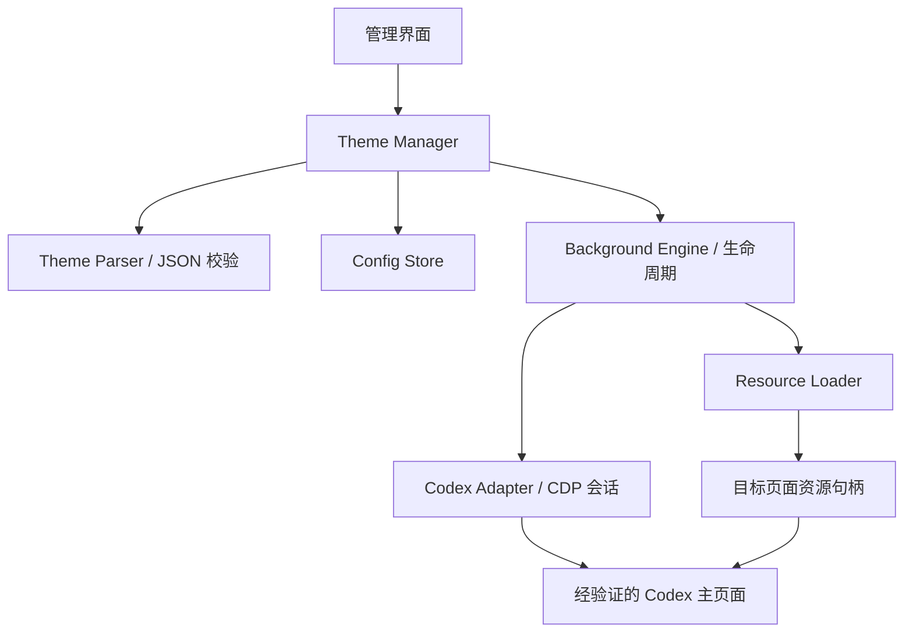

# Codex Theme Engine V1.0 开发任务拆解文档

> V1.0 的交付目标：用户能够自由导入本地图片，并通过独立运行的 Codex Theme Engine，将图片应用为 Codex 桌面客户端的全窗口背景；整个过程不修改 Codex 官方文件。

| 项目 | 内容 |
| --- | --- |
| 项目名称 | Codex Theme Engine |
| 文档版本 | v1.0 |
| 编写日期 | 2026-10-14 |
| 文档用途 | GitHub 项目的第三份核心文档，供开发者拆分 Issue、实施、测试和发布 |
| 建议仓库路径 | `docs/Development/V1-Development-Plan.md` |
| 实施状态 | 开发计划；文中的功能、测试和性能指标尚未实施或实测 |
| 首批平台 | Windows x64；具体 Windows 与 Codex 版本组合由阶段 G0 验证后登记 |

## 目录

- [1. 文档依据与项目原则](#1-文档依据与项目原则)
- [2. V1.0 目标与范围](#2-v10-目标与范围)
- [3. 暂不实现的功能](#3-暂不实现的功能)
- [4. 技术选型与关键验证](#4-技术选型与关键验证)
- [5. 模块、目录与数据约定](#5-模块目录与数据约定)
- [6. 开发阶段与依赖关系](#6-开发阶段与依赖关系)
- [7. 详细任务拆解](#7-详细任务拆解)
- [8. 测试计划](#8-测试计划)
- [9. 性能验证](#9-性能验证)
- [10. GitHub Issue 与 Git 提交规划](#10-github-issue-与-git-提交规划)
- [11. 发布完成标准](#11-发布完成标准)
- [12. V1.5、V2、V3 衔接路线](#12-v15v2v3-衔接路线)
- [13. 风险与实施决策](#13-风险与实施决策)
- [14. 技术参考与维护规则](#14-技术参考与维护规则)

## 1. 文档依据与项目原则

### 1.1 与前两份核心文档的关系

| 文档 | 负责回答的问题 | 本文如何衔接 |
| --- | --- | --- |
| 《Codex Theme Engine PRD v1.0》 | 为谁开发、解决什么问题、功能边界是什么 | 将图片自由导入、全窗口背景、独立引擎等需求转化为可验收任务 |
| 《Codex Theme Engine 技术架构设计文档 v1.0》 | 模块职责、运行时适配、资源与主题生命周期如何组织 | 沿用 Theme Manager、Background Engine、Resource Loader、Theme Parser、Codex Adapter 的模块思路 |
| 本文 | 先做什么、依赖什么、如何判断完成 | 给出任务编号、交付物、验收标准、测试、提交与发布安排 |

编制依据是本次明确提出的需求，以及已提供对话中的架构草案和 PRD 要点。当前上下文未包含 PRD 完整原文件，因此本文不声称已经完成逐条需求审计。项目接入仓库时，应在 T01 核对前两份文档的实际文件路径、版本与需求编号；发现差异时记录并同步修订。

### 1.2 必须贯穿全部任务的原则

1. **保持 Theme Engine 定位。** 引擎负责资源管理、背景渲染、适配与生命周期；图片内容、视觉风格由用户选择。
2. **不修改 Codex 官方文件。** 不改写安装目录、`app.asar`、官方 bundle、preload、可执行文件或官方配置。引擎数据与缓存写入自己的目录。
3. **通过经验证的运行时通道适配。** CDP 是候选接入方式，需要先验证当前发行版是否存在可用通道，不能将特定机器上的端口视为官方接口。
4. **可撤销、可清理。** 每次应用必须能够删除引擎创建的 DOM、样式与资源，撤销引擎自己的覆盖。
5. **兼容失败可解释。** 不支持的版本或资源通道应返回明确状态，保留 Codex 的正常使用能力。
6. **以完整流程验收。** “插入一个背景节点”只是中间结果；导入、应用、窗口适配、切换、恢复和退出清理共同构成 V1.0。

## 2. V1.0 目标与范围

### 2.1 用户流程

```text
启动 Codex 与 Codex Theme Engine
    → 确认客户端可连接
    → 导入本地图片
    → 选择并应用背景
    → 在 Codex 中正常聊天、输入和切换页面
    → 切换其他图片，或关闭主题并恢复原有外观
```

顺序可以互换：Codex 尚未启动时，用户仍然可以导入、管理图片；已启用的主题在客户端进入兼容状态后再应用。

### 2.2 功能需求及追踪

| 编号 | V1.0 必须实现的能力 | 主要任务 | 主要验收用例 |
| --- | --- | --- | --- |
| R01 | 独立运行，不修改 Codex 官方文件 | T00、T01、T16 | F19 |
| R02 | 导入用户自行选择的静态 PNG、JPEG、WebP 图片 | T03、T04 | F01–F05 |
| R03 | 创建、列出、切换和删除本地图片主题 | T02、T09 | F06、F07、F17 |
| R04 | 检测可用连接、识别正确 Codex 页面、报告连接状态 | T05、T06 | F08–F10、F21 |
| R05 | 将同一背景覆盖窗口内容区，包括侧栏、主内容区和输入区 | T07、T08 | F11–F13、F20 |
| R06 | 背景不阻断点击、输入、滚动、拖动与快捷键 | T07、T08、T11 | F14 |
| R07 | 关闭主题和正常退出引擎时清理运行时覆盖 | T10 | F15、F16、F22 |
| R08 | 客户端重载或重启后，按保存的启用状态恢复主题 | T12 | F18 |
| R09 | 异常退出、连接丢失或兼容失败时具备恢复路径 | T10、T12、T13 | F09、F16、F23、F24 |
| R10 | 提供基础管理界面、配置、日志与诊断 | T01、T11、T13 | F08、F25 |

### 2.3 “全窗口背景”的验收定义

背景使用统一的视口坐标，连续覆盖 Codex 主窗口的**客户端渲染内容区**，包括应用自行绘制的顶部区域、侧栏、主内容区、输入区及适配清单中的附属面板。侧栏展开、收起和窗口缩放时，背景位置应保持一致。

操作系统绘制的边框、原生标题栏、文件选择器和独立原生对话框不属于该渲染视口。若某发行版的必要内容区域位于独立 WebContents、iframe 或不可适配表面，必须记录实际边界；未通过必要区域验收的组合不能标记为“全窗口支持”。

V1.0 默认对已确认兼容的 Codex 主窗口应用同一主题。设置页若位于主窗口内，应按同一适配清单检查；独立设置窗口、登录窗口和任意外部网页不自动注入。

### 2.4 支持格式与背景参数

| 项目 | V1.0 约定 |
| --- | --- |
| 图片格式 | 静态 `.png`、`.jpg`、`.jpeg`、`.webp`；须同时通过文件签名、尺寸与解码校验 |
| 显示方式 | `cover` 默认；同时支持 `contain`，空白区域使用用户指定的底色 |
| 定位 | 默认居中，允许设置横向与纵向焦点位置 |
| 可选参数 | 背景透明度、底色；参数需经过类型和范围校验 |
| 用户自由度 | 不限定主题库、图片题材或视觉风格；不强制自动暗化或自动修改文字颜色 |
| 资源保护 | 初始建议单文件 50 MiB、64 百万像素上限，由 G0 结合解码峰值验证；属于可说明、可配置的资源保护策略 |

资源超限必须明确提示；禁止静默替换图片、偷偷改变显示参数或覆盖用户原文件。原图保存，必要的缩放渲染缓存独立生成。

## 3. 暂不实现的功能

| 功能 | V1.0 边界 | 后续方向 |
| --- | --- | --- |
| MP4、WebM 视频背景 | 不实现播放、循环、音轨或硬件解码管理 | V1.5 可选验证，V2 整合 |
| GIF、APNG、动画 WebP | 不作为静态图片静默导入；检测后提示暂不支持 | 与动态背景能力一起设计 |
| SVG、HTML、脚本式背景 | 不加载可执行主题内容 | 后续按独立渲染器与隔离方案评估 |
| `.codextheme` 标准主题包 | V1 只使用内部目录与 JSON 清单 | V2 定义公开包规范、导入与导出 |
| 完整颜色、字体、控件皮肤系统 | 不重做 Codex 的整套视觉系统 | V2 扩展主题 token 和映射适配 |
| 在线市场、下载、分享、账号与同步 | 不建设远程服务 | V3 社区分发能力 |
| Wallpaper Engine 兼容 | 不承诺原生场景、工程格式或创意工坊兼容 | V3 独立研究和 Adapter |
| 多窗口分别选择不同主题 | 多个兼容主窗口使用同一全局主题 | 后续增加窗口级配置 |
| macOS、Linux | 不作为首版发布目标 | Windows 链路稳定后逐平台验证 |
| 开机自启、系统服务、自动更新 | 不作为首版必需功能 | 基础生命周期和发布稳定后评估 |
| 自动对比度判断、强制遮罩、智能选图 | 不实现 | 后续仅作为用户可选能力 |

## 4. 技术选型与关键验证

### 4.1 建议实施基线

以下是本文提出的开发基线，尚不代表仓库已经采用这些技术。T00 验证接入条件，T01 通过 ADR 固化选型与实际依赖版本。

| 层级 | V1.0 建议选型 | 理由与约束 |
| --- | --- | --- |
| 引擎桌面壳 | Electron + TypeScript | 文件选择、桌面生命周期与 CDP WebSocket 处理可以采用同一语言；需计入独立进程的内存成本 |
| 管理界面 | 本地 HTML/CSS + TypeScript | 界面仅需导入、列表、应用与恢复；界面框架可以独立替换 |
| 引擎核心 | 与界面解耦的 TypeScript 模块 | Theme Manager、资源与适配逻辑可测试，并为后续其他桌面壳保留边界 |
| 后台执行 | 首版由引擎主进程协调 | 不额外安装系统服务；较重的图像解码与处理放入受控工作进程 |
| Codex 接入 | CDP Adapter，前提是 G0 验证通过 | 隔离端点发现、会话、运行时操作和版本适配，不绑定官方 bundle 名称 |
| 持久化 | JSON 配置、主题清单与本地文件目录 | V1 无需数据库；配置使用 schema 校验、备份和安全替换写入 |
| 图片校验与处理 | 具备静态帧识别、尺寸读取、PNG/JPEG/WebP 解码能力的库 | 具体实现由 G0 的格式和 Windows 打包验证决定，随后锁定；不能只检查扩展名 |
| 目标渲染 | 引擎创建的背景 DOM + 有范围约束的样式覆盖 | 由 Codex Adapter 提供经验证的宿主位置和表面映射 |
| 自动验证 | 核心逻辑测试 + CDP 模拟端点 + 可控页面夹具 | 真实 Codex 测试另设人工执行流程，不依赖其对所有 CI 机器开放调试通道 |
| 发布 | Windows x64 安装包或便携包 | 至少完成一种经测试的用户分发方式，不把开发环境作为使用前提 |

Electron 管理界面应开启 context isolation 与 sandbox，关闭 renderer 的 Node integration；通过窄化的 IPC 方法访问文件和引擎能力。这些要求作用于**本项目自己的桌面壳**，不要求改动 Codex 的 preload。上下文隔离机制见 [Electron 官方文档](https://www.electronjs.org/docs/latest/tutorial/context-isolation)。

开发环境采用建项时仍受维护的 Node.js LTS、TypeScript 和 Electron 版本，提交锁文件。开发工具使用的 Node.js 版本与 Electron 内置运行时分别记录，不将两者视为相同环境。

Tauri 或原生 Windows 桌面壳可作为后续替代方案。首版不同时维护多个壳；若 Electron 的打包或内存成本无法满足要求，在 G0/T01 阶段形成明确 ADR 后调整。

### 4.2 G0 必须验证的四个前提

| 前提 | 必须得到的证据 | 未通过时的处理 |
| --- | --- | --- |
| A：接入通道 | 指定 Codex 版本和发行渠道存在可重复连接的本机 CDP 通道，且建立方式不改写官方文件 | 发布范围保持未支持；只允许重新研究符合项目边界的接入方式 |
| B：目标识别 | 可区分 Codex 主页面、管理界面、登录页、浏览器标签和其他调试目标 | 不对身份不明的目标注入 |
| C：资源与样式 | 当前策略下，PNG/JPEG/WebP 可成功加载，样式可生效；撤销后资源释放 | 不以关闭 CSP 或降低 Codex 安全配置作为实现手段 |
| D：覆盖与恢复 | 必要区域连续显示背景，交互正常；显式恢复与异常清理都有可复现证据 | 调整适配或限制兼容范围，不能直接进入正式发布 |

前一轮讨论中的端口 `9335`、Node injector 和 CSP 字符串仅是历史环境线索，本文未重新检测它们。既有辅助注入工具是否为接入前提、能否由本项目独立重现，也属于 A 的验证内容。

若接入需要用户在启动时显式添加参数，应先验证该发行版确实接受参数，再记录完整步骤、单实例行为、监听范围与恢复方式。首版不自动结束已有 Codex 进程、不修改系统快捷方式、不安装外部注入依赖。

官方外观文档描述了主题、颜色与字体等设置；这并不能证明存在本项目所需的图片背景或 CDP 扩展接口。相关设置范围见 [OpenAI 官方外观说明](https://learn.chatgpt.com/docs/app/settings#appearance)。本文将运行时适配视为需维护和验证的兼容层。

### 4.3 图片资源通道

图片受 `img-src` 控制，没有该指令时按相应回退规则检查 `default-src`；不能从视频的 `media-src` 推断图片允许加载。样式注入还需单独验证 `style-src` 及其细分策略。依据见 [W3C CSP 图片资源规范](https://www.w3.org/TR/CSP3/#directive-img-src)。

| 候选方式 | 使用条件 | V1.0 决策 |
| --- | --- | --- |
| 通过 CDP 传递图片字节，在目标页面创建 Blob URL | 当前页面允许 `blob:` 图片，传输、解码与释放开销符合预算 | 优先验证；Blob 必须在目标页面的上下文内创建 |
| Data URL | 当前页面允许 `data:` 图片，且经过消息大小与峰值内存验证 | 仅作为有大小限制的备用通道，不把整张图片写入主题 JSON |
| 本地资源服务器 | CSP、源策略、CORS、端口和权限均允许 | 不作为未经验证的默认方案；若采用，必须仅监听本机并限制可访问资源 |
| `file://` 或自定义协议 | Codex 自身会话确实支持且策略允许 | 不假设可用；引擎不能替另一个应用注册其内部协议 |

Electron 的协议注册与会话有关，在引擎自己的会话中注册协议，不等于 Codex 会话也能使用该协议。见 [Electron protocol 文档](https://www.electronjs.org/docs/latest/api/protocol)。

不上传图片到云端来绕过本地加载限制，不调用 `Page.setBypassCSP`，不使用关闭 web security 或 sandbox 的启动参数。所有候选通道都不满足边界时，G0 结论应为当前组合未获支持。

## 5. 模块、目录与数据约定

### 5.1 模块职责



| 模块 | V1.0 职责 | 必须避免的耦合 |
| --- | --- | --- |
| Theme Manager | 导入主题、列表、删除、维护用户的主题选择 | 不直接包含 DOM 选择器或 CDP 命令 |
| Theme Parser | 校验内部 `theme.json`，拒绝未知类型、非法参数与越界路径 | 不提前实现完整 `.codextheme` 生态 |
| Resource Loader | 校验图片、复制原图、生成缓存、创建和释放目标资源 | 不依赖某个固定 Codex 页面全局变量 |
| Background Engine | 协调应用、切换、回滚、恢复和租约 | 不承担端点发现或随意扫描 UI |
| Codex Adapter | 目标识别、CDP 会话、能力检查、表面映射和运行时操作 | 不读写官方安装文件，不以哈希类名作为跨版本接口 |
| Config Store | 保存启用意图、主题引用、连接偏好和配置版本 | 不保存会话 ID、Blob URL 或图片 Base64 |
| Diagnostics | 状态、错误码、脱敏日志与兼容记录 | 不读取或记录聊天正文、账号凭据 |

### 5.2 建议源码目录

```text
Codex-Theme-Engine/
├── README.md
├── LICENSE
├── CONTRIBUTING.md
├── package.json
├── src/
│   ├── main/                  # 引擎桌面壳与主进程
│   ├── preload/               # 本项目界面的窄化 IPC 桥
│   ├── ui/                    # 图片主题管理界面
│   ├── core/
│   │   ├── theme-manager/
│   │   ├── theme-parser/
│   │   ├── resource-loader/
│   │   ├── background-engine/
│   │   └── config-store/
│   ├── adapters/codex/         # CDP 与版本适配
│   ├── injected/               # 运行时背景、样式与自清理逻辑
│   └── diagnostics/
├── tests/
│   ├── unit/
│   ├── integration/
│   └── fixtures/
└── docs/
    ├── PRD/
    ├── Architecture/
    ├── Development/
    │   └── V1-Development-Plan.md
    ├── adr/
    └── compatibility/
```

测试资源只使用自制、明确许可或可再分发图片；不将用户壁纸、原始本机诊断和个人路径提交到仓库。

### 5.3 运行数据目录

```text
%LOCALAPPDATA%/CodexThemeEngine/
├── config/
│   ├── settings.json
│   └── settings.backup.json
├── themes/
│   └── <theme-id>/
│       ├── theme.json
│       ├── assets/background.webp
│       └── preview.webp
├── cache/                     # 可重建的显示尺寸缓存
├── logs/                      # 有轮转与保留上限
└── tmp/                       # 导入事务临时文件
```

`<theme-id>` 由引擎生成，不由图片文件名直接拼成目录名。原图复制进主题目录后，删除或移动外部源图片不影响主题使用。删除主题只操作该主题目录和关联缓存。

### 5.4 内部主题与设置示例

以下示例约束 V1 的内部持久化格式，不构成 V2 的公开包规范。

```json
{
  "schemaVersion": 1,
  "id": "b6e6d5f0-7a4a-4cef-9a70-82ea9d2f8b66",
  "name": "My Wallpaper",
  "background": {
    "type": "image",
    "file": "assets/background.webp",
    "fit": "cover",
    "position": { "x": 50, "y": 50 },
    "opacity": 1,
    "baseColor": "#181818"
  }
}
```

```json
{
  "schemaVersion": 1,
  "theme": {
    "enabled": false,
    "selectedThemeId": "b6e6d5f0-7a4a-4cef-9a70-82ea9d2f8b66"
  },
  "connection": {
    "mode": "manual",
    "host": "127.0.0.1",
    "port": null,
    "reconnect": true
  }
}
```

位置参数范围为 0–100，透明度为 0–1，`fit` 只接受已定义枚举，颜色按明确格式校验。主题路径必须规范化并确认位于主题根目录内，包含重解析点、符号链接和路径穿越的情况也需处理。

`enabled` 表示用户的启用意图，`selectedThemeId` 表示用户选择；每个窗口的实际应用结果保存在运行状态中。连接失效不等于用户关闭主题，应用失败也不能向界面谎报成功。

### 5.5 模块接口约定

| 接口 | 输入与结果 | 生命周期约束 |
| --- | --- | --- |
| `ThemeManager.importImage()` | 本机文件选择结果 → 主题记录 | 校验、复制和清单写入完成后才进入列表；取消或失败清理临时文件 |
| `ThemeManager.activate()` | 主题 ID → 各目标应用结果 | 串行化切换；过期请求不能覆盖较新选择 |
| `ResourceLoader.prepare()` | 主题、目标能力和显示尺寸 → 资源句柄 | 资源绑定目标页面与执行上下文；句柄提供幂等 `dispose()` |
| `CodexAdapter.probe()` | 已配置端点 → 能力与身份检查结果 | 查询端点不等于允许对全部目标注入 |
| `CodexAdapter.attach()` | 已确认目标 → 会话 | 持有事件订阅、请求超时和清理登记表 |
| `BackgroundEngine.apply()` | 会话、主题和资源句柄 → 实际显示确认 | 先准备新资源再替换；失败回滚并释放新资源 |
| `BackgroundEngine.restore()` | 目标或全部会话 → 清理结果 | 可重复调用；只撤销引擎拥有的修改 |

每个目标维护会话 ID、文档代次、主题代次、资源句柄、样式句柄、脚本登记 ID 和租约到期时间。文档刷新或目标关闭后，旧代次的回调不得重新挂载背景。

## 6. 开发阶段与依赖关系

### 6.1 阶段划分

| 阶段 | 任务 | 主要产出 | 进入下一阶段的条件 |
| --- | --- | --- | --- |
| G0：可行性与兼容验证 | T00 | PoC 结果、能力清单、选型依据、风险记录 | 四个接入前提通过，或明确仅可继续独立模块开发的限制 |
| G1：工程与资源基础 | T01–T04 | 可启动引擎、主题目录、资源导入与加载 | 本地主题流程可运行且失败不产生脏数据 |
| G2：接入与渲染闭环 | T05–T08 | CDP 会话、背景注入、全窗口覆盖 | 首个真实兼容组合完成导入 → 显示 → 撤销验证 |
| G3：完整用户流程 | T09–T13 | 切换、恢复、管理界面、重连、异常处理 | 用户流程与退出清理通过，异常有可解释恢复路径 |
| G4：质量与性能 | T14、T15 | 测试结果、性能报告、兼容矩阵 | 必需用例通过，性能满足已冻结预算 |
| G5：分发与发布 | T16、T17 | 用户安装包、使用文档、Release | 新环境安装与恢复流程通过，发布清单完成 |

G0 未解决真实接入时，可以继续实现与接入无关的主题和资源模块，但不能宣称全窗口背景已经实现，也不能通过修改官方文件来绕过阶段条件。

### 6.2 推荐开发顺序

```text
T00 → T01
T01 → T02 → T03 → T04
T01 → T05 → T06
T04 + T06 → T07 → T08
T07 → T10 的基础恢复；T08 + T10 → T09
T09 + T10 → T11
T05～T10 → T12；T01 起持续建设 T13
T11 + T12 + T13 → T14 → T15 → T16 → T17
```

测试应随对应实现进入提交，T14 负责集中补全和回归。T10 的基础恢复必须随 T07 提供，不能等到全部视觉功能写完才补救。

## 7. 详细任务拆解

任务优先级：**P0** 为核心交付或可靠性必需项；**P1** 为首版使用、验证与发布必需项。P1 也必须在 v1.0 发布前完成。下列任务均为待实施。

### T00：接入、资源与覆盖 PoC（P0）

**目标：** 将“可研究的技术路线”转化为指定客户端组合上的可重复证据。

**实施内容：**

- 记录 Windows、Codex 版本、发行渠道、运行入口和已有辅助工具；不将辅助工具的能力归因于 Codex 默认行为。
- 以最小实验验证端点建立、主页面识别、运行时 DOM 与样式操作、三种图片格式加载。
- 验证 `img-src`、样式通道、消息大小、解码峰值和资源释放；只读取验证所需能力信息。
- 在侧栏、主内容区、输入区验证连续覆盖、交互和撤销；验证活动页面的租约自清理可实现。
- 用两次独立启动验证重复性，明确是否需要启动参数以及能否按正常启动恢复。

**交付物：** `docs/compatibility/poc-v1.md`、最小可复现实验、G0 决策与待验证事项。实验资源必须可再分发。

**依赖：** 无；实验脚手架限于验证，不提前建设完整管理界面。

**验收标准：**

- [ ] A–D 四项都有真实证据和操作步骤，未验证事项明确标识。
- [ ] 验证过程中没有改写官方文件或降低 Codex 安全配置。
- [ ] 可显示一张本地图片、完成必要区域检查并撤销。
- [ ] 明确首个支持组合、资源通道、图像处理实现及不可支持的边界。

### T01：项目初始化与工程规范（P0）

**目标：** 建立可启动、可构建、便于贡献的基础工程。

**实施内容：**

- 按模块边界建立工程、脚本、锁文件、基础管理窗口和引擎单实例锁。
- 设置类型检查、格式检查、核心测试入口和 Windows 构建流程；形成 CI 基线。
- 核对 PRD 与架构实际版本和文件路径，建立需求追踪表；记录桌面壳和接入 ADR。
- 设置独立数据根目录、日志轮转和统一错误结构；界面只通过本项目的窄化 IPC 调用核心能力。
- 建立 README 与贡献入口；许可证由维护者在发布前明确确定。

**交付物：** 工程骨架、开发命令说明、ADR、配置与日志基础设施。

**依赖：** T00 的阶段结论；无接入条件时只能启动独立模块实施。

**验收标准：**

- [ ] 干净克隆按 README 能安装依赖、启动和构建。
- [ ] 程序重复启动不会创建多个同时争用主题的引擎实例。
- [ ] 首次运行建立自己的数据目录；关闭窗口行为与真正退出行为区分清楚。
- [ ] 类型检查和 CI 基线通过，不读取或写入 Codex 官方配置。

### T02：主题目录系统与 Theme Parser（P0）

**目标：** 让主题拥有可校验、可列举的持久化结构。

**实施内容：**

- 实现目录创建、主题 ID、清单读写、主题列表和最小 JSON schema 校验。
- 用临时文件和安全替换提交清单；处理损坏配置、缺失资源、重复名称和未知 schema。
- 校验路径的实际解析结果，限制主题资源位于主题根目录内。
- 将“默认外观”表示为主题关闭状态，不复制或伪造 Codex 官方主题文件。

**交付物：** Theme Store、Theme Parser、配置备份与损坏恢复策略。

**依赖：** T01。

**验收标准：**

- [ ] 创建与重启读取结果一致，主题 ID 不受中文名称或文件名冲突影响。
- [ ] 单个损坏主题被标记，其他主题仍可列出与使用。
- [ ] 未知 schema 不被静默重写；主题路径不能逃逸目录。
- [ ] 设置写入失败保留上次可用文件，界面报告失败。

### T03：本地图片导入（P0）

**目标：** 用户选择任意支持的本地静态图片后，生成完整可用的图片主题。

**实施内容：**

- 提供文件选择器；验证权限、签名、MIME、静态帧、尺寸和解码结果。
- 在工作进程实施有文件大小、像素数和超时限制的校验，支持取消。
- 将原图复制到临时主题目录，生成预览、清单并提交；失败清理临时目录。
- 定义重复资源策略：默认可以创建新主题，不覆盖已有主题；通过哈希识别重复只用于提示和缓存复用。

**交付物：** 导入服务、导入进度与错误提示、测试用图片集。

**依赖：** T02，T00 已确定图像处理实现。

**验收标准：**

- [ ] PNG、JPEG、静态 WebP、中文路径、空格路径均可导入。
- [ ] 移动或删除外部源图后，导入的主题仍可加载。
- [ ] 取消、损坏图片、伪装后缀、动画图片和超限文件都不生成可用主题记录。
- [ ] 原文件内容保持不变，重复导入不覆盖其他主题。

### T04：Resource Loader 与目标资源句柄（P0）

**目标：** 将主题目录中的图片转为可在指定 Codex 页面显示的资源。

**实施内容：**

- 实现文件读取、哈希与缓存键；缓存键包括资源、显示尺寸和处理参数。
- 按物理显示尺寸生成必要缓存，保留原图；显示尺寸变化后只更新所需缓存。
- 使用 G0 通过的传输通道，校验分块顺序、消息大小、总大小、取消与超时。
- 每个目标页面单独创建资源句柄和 Blob URL；登记引用、释放以及文档代次。
- 暂不实现视频流、云端存储或主题包解压。

**交付物：** Resource Loader、缓存策略、资源句柄的幂等释放实现。

**依赖：** T03、T00；真实目标传输与 T06 联调，本地加载可先用夹具验证。

**验收标准：**

- [ ] 已导入图片在夹具和 G0 兼容页面均成功解码，失败不挂载空白资源。
- [ ] 资源未写入主题清单或普通日志，页面刷新后旧 Blob URL 不复用。
- [ ] 取消与失败释放新句柄；切换和恢复时旧资源引用数可归零。
- [ ] 缓存有容量上限和淘汰策略，缓存删除后能够重建。

### T05：Codex 发现与连接配置（P0）

**目标：** 明确区分“客户端在运行”“调试端点可连接”和“主页面可适配”。

**实施内容：**

- 实现用户配置的本机端点、超时探测和受限的发现方式；不扫描任意端口区间。
- 使用进程归属、已验证页面来源和能力标记交叉识别目标，不只凭标题或第一个 `page`。
- 区分未启动、无可用端点、端口属于其他应用、版本不支持及多个候选主窗口。
- 限制本机地址与端点重定向；仅返回已确认可操作目标。

**交付物：** 发现器、端点配置、目标清单、连接诊断状态。

**依赖：** T01、T00。

**验收标准：**

- [ ] Codex 未运行、未开放端点和错误端点分别得到正确提示。
- [ ] 浏览器标签、登录页和引擎管理窗口不会被误选。
- [ ] 不写死 `9335`；没有已验证自动发现方法时，手动配置仍可完成流程。
- [ ] 身份确认失败或远程端点被配置时，停止附加并给出原因。

### T06：CDP 会话与 Codex Adapter（P0）

**目标：** 将协议与版本差异集中封装，向核心提供稳定的适配能力。

**实施内容：**

- 封装请求 ID、返回结果、协议错误、请求超时、断连及事件订阅清理。
- 管理目标、执行上下文与文档代次；在支持时使用目标生命周期事件发现新主窗口。
- 封装运行时执行、能力探测、受限样式操作和清理方法；输入按结构化参数传递，避免拼接用户字符串。
- 建立版本适配配置：根宿主、可透明表面、已排除页面、最低能力要求。
- 若使用新文档脚本，保存其登记 ID；恢复时删除，避免刷新后再次注入。

**交付物：** CDP Session、Codex Adapter、兼容映射与模拟端点测试。

**依赖：** T05。

**验收标准：**

- [ ] 超时、协议错误与断连均有确定返回，不永久卡住主题操作。
- [ ] 主窗口以外的目标不执行注入代码；新目标先重新验证身份。
- [ ] 页面刷新时，旧上下文请求被作废；断开时清理全部订阅。
- [ ] 相同配置重复连接不会产生重复会话、脚本登记或监听器。

协议能力以目标实际支持的方法为准。相关机制见 [CDP Target](https://chromedevtools.github.io/devtools-protocol/tot/Target/)、[Runtime](https://chromedevtools.github.io/devtools-protocol/tot/Runtime/) 与 [Page](https://chromedevtools.github.io/devtools-protocol/tot/Page/)；协议规范本身不保证某个 Codex 发行版开放这些能力。

### T07：Background Engine 与基础注入（P0）

**目标：** 在兼容页面创建一个可更新、可撤销、不接管界面行为的背景层。

**实施内容：**

- 使用固定命名空间，例如 `cte-background-root` 与 `cte-*`，创建引擎拥有的背景、底色及样式节点。
- 在经验证的宿主中设置视口定位与明确层叠关系；不依赖单独设置 `z-index: -1` 来保证可见。
- 背景设为不可聚焦、`aria-hidden`、`pointer-events: none`；按需要避免影响应用拖动区域。
- 在图片解码与可显示确认之后挂载；重复应用更新同一实例。
- 随首次注入提供最小 `restore()`，登记节点、样式与资源归属。

**交付物：** 背景注入模块、渲染结果确认、基础恢复。

**依赖：** T04、T06；与 T10 的基础清理一起验收。

**验收标准：**

- [ ] 同一页面反复应用仍只有一个活动背景实例。
- [ ] 图片可见且处于内容后方，点击、输入、滚动和焦点不被遮挡。
- [ ] 不直接替换 React 根节点，不整体重写应用 DOM。
- [ ] 图片或注入失败时撤回本次修改；恢复可删除所有本次创建内容。

### T08：全窗口覆盖与版本表面适配（P0）

**目标：** 将背景从局部可见提升为符合 R05 的连续窗口背景。

**实施内容：**

- 检查根容器、侧栏、主区、输入区和附属面板的实际不透明背景，形成必要表面清单。
- 只在引擎启用标记下覆盖清单中的背景色或表面变量；不使用全局 `* { background: transparent }`。
- 验证 `cover`、`contain`、焦点与底色，窗口缩放、最大化、跨屏和 DPI 变化。
- 保留按钮、选中状态、菜单、焦点指示及页面语义；对于独立表面逐项确认是否可适配。
- 监听明确的宿主变更；必要时使用限定范围且去抖的观察器，避免整页高频扫描。

**交付物：** 全窗口样式适配、表面检查清单、截图与兼容记录。

**依赖：** T07、T00。

**验收标准：**

- [ ] 侧栏、主区与输入区连续显示同一背景，不发生各区域单独缩放。
- [ ] 页面切换、侧栏开合和窗口尺寸变化后，覆盖不残缺、不叠加。
- [ ] 明暗模式和内置外观设置变化后，适配可重新确认且退出后遵循当前官方设置。
- [ ] 必要表面缺失时标记该组合不兼容，不能以局部截图替代全窗口验收。

### T09：主题切换、参数更新与删除（P0）

**目标：** 切换图片与参数时，旧主题保持可用，新主题失败可以回滚。

**实施内容：**

- 实现“准备新资源 → 在目标应用 → 确认显示 → 提交配置 → 释放旧资源”的事务流程。
- 对连续选择采用代次与取消机制，保证最后一次用户操作生效，过期任务只执行清理。
- 多主窗口切换以当前已确认兼容的窗口集合为事务范围；其中一个失败时，尝试回滚其他已修改窗口。
- 将暂时无连接时的主动启用保存为“等待连接”；不能显示为“已应用”。身份或资源校验失败不提交错误主题。
- 删除当前主题前，先保存关闭意图并执行恢复；清理未完成时保留必要资源与错误状态，不误报删除成功。

**交付物：** 切换事务、参数更新、删除流程与各目标状态汇总。

**依赖：** T08、T10 的基础恢复。

**验收标准：**

- [ ] A → B 切换成功后只有 B 活动，A 资源释放；B 失败时 A 恢复可用。
- [ ] 快速连续选择三张图片最终显示最后一张，没有过期请求回写。
- [ ] 多窗口部分失败有回滚结果；无法回滚的目标明确标为异常并等待租约清理。
- [ ] 删除未激活主题不影响当前背景；删除激活主题后回到官方当前外观。

### T10：恢复机制、退出清理与租约（P0）

**目标：** 显式关闭、正常退出和引擎异常终止都有可验证的撤销路径。

**实施内容：**

- 维护引擎修改登记表：DOM、样式、属性、监听器、观察器、定时器、资源与新文档脚本 ID。
- 优先使用可整体移除的有范围样式；必须修改原有属性时，记录原值和本次写入值，仅在仍属于本引擎修改时撤销。
- 区分“关闭主题”和“退出引擎”：关闭主题持久化 `enabled: false`；正常退出清理显示，但保留上次启用意图供下次启动恢复。
- 在显式恢复时停止重注入，移除新文档脚本与样式，再清理节点、资源、观察器和会话引用。
- 在目标页面运行最小租约逻辑：引擎约每秒续租，初始租约建议 3 秒；租约过期自行恢复并停止自身定时器。
- 正常退出等待有界清理结果；页面已关闭时销毁本机引用，不将其误记为残留页面。

**交付物：** 幂等恢复函数、退出协调、目标页面租约与手动恢复说明。

**依赖：** T06、T07；基础版随 T07 实施，完整版在 G3 完成。

**验收标准：**

- [ ] 恢复连续调用两次不报错，背景、作用域标记、样式、资源和监听器均被清理。
- [ ] 正常退出后，仍运行的 Codex 回到其当前内置外观；不覆盖用户期间调整的官方设置。
- [ ] 强制结束引擎进程后，活动页面在 5 秒预算内执行自清理。
- [ ] 后台冻结页面不承诺实时执行定时器；恢复执行时先检查失效租约并清理，不能继续显示过期主题。
- [ ] 关闭主题后刷新或新开主窗口，不会因遗留脚本再次出现背景。

操作系统强杀不会保证执行退出回调，因此不能仅依赖主进程的退出事件。页面定时器被节流、页面销毁或调试通道不可用时，使用清楚的状态和“重载页面或重启 Codex”的兜底说明，不宣称清理已完成。

### T11：基础主题管理界面（P1）

**目标：** 用户通过一个简单窗口完成 V1 全部常用操作。

**实施内容：**

- 展示主题列表、缩略图、当前选择和启用状态；提供导入、应用、删除和关闭主题。
- 提供显示方式、焦点位置、透明度与底色控制；首次使用默认保持图片原有呈现。
- 展示“未连接”“等待连接”“已应用”“部分窗口异常”“需要更新适配”等可理解状态。
- 将端点等连接信息放在连接设置与诊断区；常用流程不要求用户理解 CDP 会话或 Blob URL。
- 支持键盘操作、加载进度和错误提示；默认关闭管理窗口即清理并退出，最小化保持运行。

**交付物：** 管理界面、IPC 方法与状态映射。

**依赖：** T09、T10；界面骨架可从 T01 开始。

**验收标准：**

- [ ] 用户能通过界面完成导入、应用、切换和恢复，不需要修改 JSON。
- [ ] 连接等待与实际应用状态一致，操作失败后能看到明确原因和可执行下一步。
- [ ] 界面长时间处理图片时仍可响应取消，按钮不会触发重复导入或切换竞争。
- [ ] 所有文件与核心操作都经窄化 IPC 校验，界面没有任意执行系统命令的能力。

### T12：重载、重连与多主窗口生命周期（P0）

**目标：** 正常页面变化和客户端重启不会产生重复注入或错误恢复。

**实施内容：**

- 对连接采用 `disconnected → connecting → connected → reconnecting` 状态；不支持与错误状态单独表示。
- 每个目标维护 `ready → applying → active → restoring` 状态，附带文档与主题代次。
- 重连采用有上限的退避与抖动，例如 1、2、4、8 秒后以不超过 30 秒的间隔重试；用户关闭主题或退出后取消对应任务。
- 页面刷新时重新获取上下文、检查能力、加载资源；不复用旧页面的 Blob URL 和对象句柄。
- 新主窗口通过身份与兼容检查后应用全局启用主题；关闭窗口只释放其会话，不影响其他窗口。
- 引擎启动时按保存意图恢复；Codex 未启动则等待，不擅自启动、关闭或重启 Codex。

**交付物：** 连接与目标状态机、重连、文档代次管理和多窗口支持。

**依赖：** T05–T10。

**验收标准：**

- [ ] Codex 刷新或重启后，已启用主题只恢复一次；关闭状态始终保持关闭。
- [ ] 网络式断连模拟、目标关闭和上下文丢失不会生成无限重试或泄漏会话。
- [ ] 第二个兼容主窗口获得同一主题，任一窗口关闭不移除其他窗口背景。
- [ ] 兼容检查失败时停止该目标的应用，界面显示原因；用户可主动重试或关闭主题。

### T13：诊断、异常处理与兼容降级（P0）

**目标：** 开发者能够定位故障，用户能够从故障中恢复。

**实施内容：**

- 建立错误码、阶段、可重试标记和建议操作；区分导入、配置、资源策略、连接、适配与清理失败。
- 日志记录耗时、适配版本、能力结果与清理数量；使用轮转和保留上限。
- 不记录图片字节、聊天正文、账号信息、完整个人路径或带令牌的端点；诊断导出先脱敏并由用户主动触发。
- 对连续应用失败停止自动应用，进入暂停该目标的状态，提供“重试”“关闭主题”“查看诊断”。
- 增加安全启动方式，只启动管理与诊断，不自动恢复上次失败的主题。
- 检测到明确的其他主题引擎冲突时提示处理，不删除其他工具的节点、样式或配置。

**交付物：** 错误目录、日志、诊断导出、安全启动与故障处理文档。

**依赖：** T01 起持续实施，与 T04、T06、T10、T12 联调。

**验收标准：**

- [ ] 可复现故障能定位到阶段及错误码，常用提示不只显示原始协议堆栈。
- [ ] 多次失败不会持续闪烁、无限重注入或拖慢 Codex。
- [ ] 配置损坏能使用备份或关闭主题启动，不覆盖尚未确认可恢复的数据。
- [ ] 恢复失败、部分窗口异常和未兼容状态不会被显示为成功。

建议错误码包括 `CTE_ENDPOINT_UNAVAILABLE`、`CTE_TARGET_UNVERIFIED`、`CTE_ADAPTER_UNSUPPORTED`、`CTE_ASSET_INVALID`、`CTE_RESOURCE_POLICY_BLOCKED`、`CTE_CONFIG_INVALID` 和 `CTE_RESTORE_INCOMPLETE`。

### T14：测试补全、集成与真实客户端回归（P0）

**目标：** 验证完整流程、失败分支与兼容边界，形成发布证据。

**实施内容：**

- 补全第 8 节的自动化与人工用例，重点验证切换回滚、取消竞争、路径边界和退出清理。
- 通过可控页面夹具和模拟 CDP 端点覆盖策略阻断、上下文失效、响应超时和多窗口部分失败。
- 在真实 Codex 的测试聊天和支持组合中执行全窗口、交互、生命周期和恢复检查。
- 将兼容结果按版本、发行渠道与 OS 登记，不把夹具通过视为真实客户端通过。

**交付物：** 自动化结果、真实回归报告、缺陷列表与兼容矩阵。

**依赖：** T11、T12、T13；测试随实现持续建设。

**验收标准：**

- [ ] 所有适用的必需用例通过；未执行与不适用分别有记录。
- [ ] 无未解决的 P0 缺陷，P1 缺陷已修复或明确阻止发布。
- [ ] 真实客户端至少完成一个全流程支持组合及多个兼容主窗口验证。
- [ ] 证据记录实际操作与测量，不预填“通过”。

### T15：性能测量与优化（P1）

**目标：** 证明静态背景不会持续消耗大量资源，切换和恢复没有累积泄漏。

**实施内容：**

- 按第 9 节采集关闭引擎、空闲引擎和启用背景三个基线。
- 测量普通图、4K 图、格式边界、大图拒绝、窗口缩放、多窗口和连续切换。
- 优先解决重复解码、Base64 多份复制、无上限缓存、观察器自触发和未释放句柄。
- 将原始测量、测试配置、指标定义和调整结论写入报告。

**交付物：** `docs/Development/V1-Performance-Report.md`、必要优化与回归结果。

**依赖：** T14。

**验收标准：**

- [ ] 已冻结的适用指标达标，超标有修复或明确阻止发布的结论。
- [ ] 连续切换、导入取消和恢复后没有持续累积的资源句柄或内存趋势。
- [ ] 优化后重新验证受影响的功能，不能以性能优化破坏恢复或全窗口覆盖。

### T16：用户分发包与使用文档（P1）

**目标：** 用户在没有开发工具的新环境中可以使用并撤销引擎。

**实施内容：**

- 生成并测试一种 Windows x64 安装包或便携包，包含所需运行时和图像依赖。
- 文档说明系统要求、已验证版本、接入前提、导入和使用、退出、故障恢复与兼容限制。
- 将内部架构、参数与诊断放入开发或故障说明，常用使用说明围绕用户操作。
- 验证升级、移动便携目录和卸载行为；卸载不默默删除用户主题库，删除引擎数据须由用户明确选择。
- 检查打包产物和运行流程没有改写官方文件，也没有捆绑来源不明的辅助注入工具。

**交付物：** 分发包、使用说明、恢复说明、构建与安装验证记录。

**依赖：** T15、T13；打包可较早做小规模预检。

**验收标准：**

- [ ] 新环境无需 Node.js、编辑器或源码即可启动引擎。
- [ ] 安装、应用、退出、重新启动和卸载路径都有实际记录。
- [ ] 包含兼容矩阵和接入说明，未支持版本不会被宣传为可用。
- [ ] 用户原图与主题库的保留、删除行为明确，许可证及依赖许可已确定。

### T17：v1.0.0 发布准备（P1）

**目标：** 形成可追溯、可复现的首个公开版本。

**实施内容：**

- 完成第 11 节清单，核对 PRD、架构和开发计划是否与最终实现一致。
- 先产生 `v1.0.0-rc.1` 候选包，完成新环境验证与必要修复，再产生正式版本。
- 准备 CHANGELOG、Release 说明、校验值、已知限制及反馈模板。
- 在 Release 中列出“实际支持组合”和“仍在研究的接入范围”，为后续更新兼容性建立入口。

**交付物：** RC 与正式发布资料、版本标签、归档测试证据。

**依赖：** T16，所有发布必需任务完成。

**验收标准：**

- [ ] 发布包可从标记提交复现，构建环境和依赖有记录。
- [ ] Release 的能力描述与兼容证据一致，必需清单全部完成。
- [ ] Issue 模板能收集必要版本和错误信息，不要求上传聊天正文或个人图片。

## 8. 测试计划

### 8.1 测试层级

| 层级 | 覆盖内容 | 执行方式与限制 |
| --- | --- | --- |
| 核心逻辑 | 配置安全写入、路径边界、静态帧识别、导入回滚、资源引用与切换代次 | CI 自动执行，避免只复述实现的断言 |
| 适配集成 | CDP 超时、协议错误、上下文销毁、取消、多窗口回滚、新文档脚本清理 | 模拟端点与可控页面夹具，验证实际消息和清理结果 |
| 页面渲染 | 层叠、背景连续性、表面透明、交互、宿主变更、CSP 阻断 | 可控页面自动验证，再在真实 Codex 上人工复核 |
| 客户端回归 | 真实端点、真实主窗口、页面切换、重启、异常退出 | 在已登记的 Windows/Codex 组合执行，不在普通 CI 中盲连用户客户端 |
| 分发验证 | 安装、首次连接、资源依赖、退出、升级与卸载 | 无开发环境的新用户环境 |

### 8.2 必需功能与故障用例

以下为计划用例，**当前全部待执行**；“预期结果”不表示已经通过。

| 编号 | 场景与操作 | 预期结果 |
| --- | --- | --- |
| F01 | 分别导入 PNG、JPEG、静态 WebP | 三种格式均生成可重启读取并显示的主题 |
| F02 | 导入中文、空格、长路径中的文件，重复名称导入 | 主题 ID 唯一，用户文件不被覆盖；路径支持边界有清楚提示 |
| F03 | 导入后删除或移动外部源图片 | 已导入主题仍然可用 |
| F04 | 损坏图片、伪装扩展名、GIF/APNG/动画 WebP、超限图片 | 按对应原因拒绝，不留下可用清单或未释放工作任务 |
| F05 | 取消导入、读权限不足、空间不足或处理中断 | 保留旧主题，临时数据清理，界面仍可响应 |
| F06 | 在 A/B 图片间切换并修改显示参数 | 成功后仅目标主题活动，资源与参数一致 |
| F07 | 快速 A → B → C；B 解码失败或多窗口之一应用失败 | 最后有效操作生效；失败时回滚并报告各目标结果 |
| F08 | Codex 未启动、无调试端点、端点属于其他应用 | 分别显示正确状态，不执行错误注入 |
| F09 | CDP 超时、协议错误、端点断连 | 有界返回、退避重试，主题操作不永久等待 |
| F10 | 同时存在主窗口、登录页、浏览器页和管理窗口 | 仅已验证兼容的 Codex 主窗口被操作 |
| F11 | 检查顶部应用区域、侧栏、主区、输入区与必要面板 | 使用同一坐标背景，必要区域无原有大面积不透明遮挡 |
| F12 | `cover`、`contain`、焦点、透明度和底色 | 参数正确生效，contain 空白区域符合底色设置 |
| F13 | 缩放、最大化、恢复窗口、侧栏开合、100%/150%/200% DPI 与跨屏 | 背景连续，缩放策略符合设置，界面布局和操作正常 |
| F14 | 输入、复制、文本选择、滚动、快捷键、按钮和窗口拖动 | 操作正常，背景不获取焦点或拦截输入 |
| F15 | 关闭主题、重复恢复、恢复后刷新 | 引擎覆盖清除，不再自动重注入，官方当前外观保持 |
| F16 | 正常退出和强杀引擎；另测冻结页面恢复执行 | 正常退出立即清理；活动页面按租约预算清理；冻结页面恢复执行先检查失效租约 |
| F17 | 删除未激活主题与当前激活主题 | 前者不影响背景，后者先恢复；其他目录与外部原图不受影响 |
| F18 | 重载、重启 Codex 和引擎，分别测试启用及关闭状态 | 按保存意图恢复；旧会话资源不复用，没有重复节点 |
| F19 | 安装、应用、恢复、卸载；在测试期间观察文件写入并对比官方文件哈希 | 除 Codex 自身正常写入外，引擎未改写官方文件或配置，自己的数据位于独立目录 |
| F20 | 打开第二个兼容主窗口并关闭其中一个 | 两窗口使用同一主题，关闭单窗口不影响其他窗口 |
| F21 | 未兼容版本、必要表面缺失、身份标记不匹配 | 停止应用并报告未兼容，不采用全局透明等破坏性兜底 |
| F22 | 启用期间调整 Codex 内置外观，再关闭引擎 | 按当前官方设置显示，不回写旧外观配置 |
| F23 | 分别阻断 `blob:`/`data:` 图片、样式或候选本地资源通道 | 明确策略错误、回滚本次修改，不关闭 CSP |
| F24 | 损坏设置、缺失原图、未知 schema、目录穿越与重解析点 | 备份或安全启动有效；非法路径与格式被拒绝，不静默覆写数据 |
| F25 | 连续失败、安全启动、日志轮转、诊断导出 | 能恢复管理与关闭主题；诊断有效且不含内容数据或个人敏感路径 |

F19 的官方文件哈希对比应在受控环境完成，避免 Codex 自动更新与测试同时进行；文件写入观测应区分引擎行为和 Codex 自身行为。不能仅凭安装包哈希未变就认定没有写入官方配置。

### 8.3 兼容矩阵与测试记录

至少包含以下维度：

- Windows 版本与构建号、x64、DPI、显示分辨率和显示器数量。
- Codex 精确版本、发行渠道、端点建立方式、必要表面与资源通道。
- 明暗模式、侧栏状态、普通窗口与最大化、一个与多个主窗口。
- PNG/JPEG/WebP、横图、竖图、透明图、普通图与 4K 图。

兼容状态采用 `支持 / 部分支持 / 未支持 / 未验证`，只有必要用例通过的组合可以进入“支持”。部分支持必须说明缺失区域或流程，不能作为 R05 完成证据。

每份记录至少包含测试日期、引擎提交或版本、环境、用例编号、操作步骤、预期与实际结果、证据位置和缺陷链接。失败、未执行和不适用分别标识；不适用需说明依据。

## 9. 性能验证

### 9.1 测量方法

在同一机器、同一客户端版本与同一测试聊天中，对比三个状态：

1. **B0：** Codex 运行，引擎未启动。
2. **B1：** Codex 与引擎运行，主题关闭。
3. **B2：** Codex 与引擎运行，启用指定静态图片。

每个状态预热 60 秒，空闲采样 5 分钟，至少重复 3 轮。记录分辨率、DPI、图片格式、压缩大小、像素数、电源模式、GPU、前后台状态及显示窗口数量。

CPU 采用 `进程 CPU 时间增量 / 墙钟时间 × 100%`，一个逻辑核满载记为 100%，多进程求和后可以超过 100%。内存分别记录引擎进程树和 Codex 进程树的 Private Bytes；驻留内存、GPU 进程与显存另行记录，不能将共享 GPU 的变化全部归因于某一个窗口。

夹具可测量 input-to-paint 与渲染耗时；真实 Codex 同时检查输入、滚动和页面切换。性能采集会产生开销，应记录工具与采样频率，不长期开启重型跟踪后再评价正常使用。

### 9.2 初始预算

以下是**建议验收预算，不是现有测量结果**。T00 应确定参考硬件与图片集，在 G2 前冻结预算；若需要调整，必须写明依据并重新评估，不能在失败后无理由放宽阈值。

| 指标 | 建议预算 | 测量口径 |
| --- | --- | --- |
| 引擎静态空闲 CPU | 平均 ≤ 1% 单核 | B2 中引擎进程树；包括租约和诊断的正常开销 |
| Codex 静态空闲 CPU 增量 | B2 相对 B0 平均增加 ≤ 1% 单核 | 同场景 Codex 进程树；B1 作为连接开销补充对照 |
| 引擎稳态内存 | ≤ 250 MiB Private Bytes | 单窗口、4K 静态背景、预热后引擎进程树 |
| Codex 稳态内存增量 | 单主窗口 B2 相对 B0 ≤ 128 MiB | 同一幅 3840×2160 图片，观察进程树和目标 renderer |
| 普通导入耗时 | 1080p 且 ≤ 5 MiB 图片，P95 ≤ 3 秒 | 从确认文件到主题记录就绪；不计文件选择器人工时间 |
| 应用或切换耗时 | 1080p P95 ≤ 1 秒；4K 且 ≤ 10 MiB P95 ≤ 2 秒 | 已连接后开始操作至目标实际确认显示，至少 30 次 |
| 操作响应 | 夹具 input-to-paint 的 P95 增量 ≤ 20 ms | 同一操作 B2 对比 B0；真实客户端再人工复核 |
| 正常恢复耗时 | 活动、可连接主窗口 P95 ≤ 1 秒 | 从恢复请求至运行时覆盖清除 |
| 异常退出清理 | 活动页面 ≤ 5 秒 | 从强杀引擎至失效租约清理；冻结页面另测恢复执行后的清理 |
| 资源累积 | 50 次 A/B 切换并恢复后，活动资源句柄为 0 | Blob、监听器、观察器、脚本登记和会话分别核对 |
| 内存趋势 | 相同资源集第 10 次与第 50 次切换后的稳定样本增长 ≤ 32 MiB | 使用一致的等待与采样方法，再做长时间趋势检查 |

图像解码峰值必须另外测量，不能用文件压缩大小代替解码内存。64 百万像素等边界输入应在工作进程中验证，明确拒绝和取消策略；多窗口内存按各目标资源与共享缓存分别解释，不假设内存完全共享。

### 9.3 必需性能场景

| 编号 | 场景 | 重点检查 |
| --- | --- | --- |
| P01 | 普通静态图保持 30 分钟 | CPU、内存趋势、定时器和观察器；没有持续重解码或无意义重绘 |
| P02 | 4K 图片首次导入、冷应用与缓存后切换 | 各阶段耗时、峰值内存和传输成本分别记录 |
| P03 | 连续切换 50 次并恢复 | 活动句柄、旧 Blob、监听器、新文档脚本与内存回落 |
| P04 | 连续缩放、跨屏和 DPI 切换 | 缓存重建频率、重绘、响应和画质 |
| P05 | 两个主窗口、关闭再重新打开 | 每目标资源是否正确释放，新窗口不重复加载过期实例 |
| P06 | 大图拒绝、处理中取消、资源策略失败 | 峰值受控，工作进程能终止，失败不拖垮界面 |
| P07 | 最小化、后台、冻结后恢复、引擎强杀 | 租约、后台成本和清理时机符合说明 |

报告同时保留 B0/B1/B2 的绝对值与差值，不能只写“占用很低”或“没有卡顿”。性能优化以已证实的问题为依据，优先修复资源释放和重复工作。

## 10. GitHub Issue 与 Git 提交规划

### 10.1 将任务映射到 Issue

以 `T00`–`T17` 为父任务编号；复杂任务可以拆分子 Issue，但必须保留需求、依赖、交付物和验收关联。项目状态建议为 `Backlog → Ready → In Progress → Review → Done`，外部接入条件不足的任务单独标记阻塞原因。

Issue 至少填写以下字段：

```markdown
## 目标
说明用户可见行为或需要验证的技术前提。

## 范围
- 对应需求：Rxx
- 对应任务：Txx
- 前置依赖：Txx / 相关 Issue

## 实施内容
- [ ] 具体可交付工作

## 验收标准
- [ ] 可观察结果或失败恢复行为

## 验证证据
- 自动化结果、人工用例编号、实际环境
- 必要截图、兼容记录或性能数据

## 未完成事项
列出待验证边界与后续 Issue；没有则填写“无”。
```

建议标签包括 `v1.0`、`priority:p0`、`priority:p1`、`area:core`、`area:resource`、`area:adapter`、`area:ui`、`area:test`、`area:release`、`needs-verification`。标签用于筛选任务，不替代依赖和验收说明。

### 10.2 三份核心文档的提交关系

| 顺序 | 提交信息 | 内容 |
| --- | --- | --- |
| 文档 1 | `docs: add PRD v1.0` | 产品需求文档；已存在时保留实际历史 |
| 文档 2 | `docs: add architecture design v1.0` | 技术架构文档；路径以仓库实际结构为准 |
| 文档 3 | `docs: add V1 development plan` | 本文，建议位于 `docs/Development/V1-Development-Plan.md` |

以上是建议规划，不表示本文生成时已经执行 Git 提交或推送。

### 10.3 实现提交建议

每一行代表一个可以审查的逻辑单元，可以按复杂度拆成多个提交；提交顺序需遵守任务依赖。相关测试随实现提交，T14 的提交负责回归与缺口补全。

| 顺序 | 建议提交信息 | 任务与内容 |
| --- | --- | --- |
| C01 | `docs: record Codex integration PoC and compatibility` | T00：可复现的接入与覆盖证据、资源通道和边界 |
| C02 | `chore: initialize theme engine workspace` | T01：工程、启动、构建、CI 与日志基础 |
| C03 | `feat: add theme store and manifest validation` | T02：目录、清单、配置 schema 与备份 |
| C04 | `feat: import local static image themes` | T03：校验、原图复制、预览与导入事务 |
| C05 | `feat: add target image resource lifecycle` | T04：传输、缓存、目标资源句柄与释放 |
| C06 | `feat: discover verified Codex targets` | T05：端点、身份识别和连接状态 |
| C07 | `feat: add Codex CDP adapter and session lifecycle` | T06：会话、上下文、事件及适配映射 |
| C08 | `feat: inject reversible image background` | T07、T10 基础：背景实例、归属登记与恢复 |
| C09 | `feat: cover Codex window surfaces` | T08：必要表面、连续背景与尺寸适配 |
| C10 | `feat: switch and remove image themes safely` | T09：切换、取消、参数和删除事务 |
| C11 | `feat: restore backgrounds on exit and lease expiry` | T10 完整版：退出与异常自清理 |
| C12 | `feat: add image theme manager interface` | T11：导入、列表、应用、关闭与连接提示 |
| C13 | `feat: recover themes across reloads and windows` | T12：重连、文档代次与多窗口 |
| C14 | `feat: add diagnostics and compatibility fallback` | T13：错误、脱敏诊断与安全启动 |
| C15 | `test: cover theme lifecycle and Codex compatibility` | T14：剩余集成、真实回归与兼容记录 |
| C16 | `perf: reduce image copies and release unused resources` | T15：按实测问题实施优化；没有对应问题时不虚构此提交 |
| C17 | `docs: add V1 performance results and user guide` | T15、T16：实测报告、使用和恢复说明 |
| C18 | `build: package Windows x64 release candidate` | T16、T17：打包、校验值与候选发布 |
| C19 | `docs: prepare v1.0.0 release notes` | T17：最终行为、支持范围、已知限制和 CHANGELOG |

开发分支与 PR 应围绕一个可审查结果，例如 `feat/image-import`、`feat/codex-adapter`、`fix/lease-cleanup`。避免将资源导入、全窗口样式和发布打包合成一个难以回滚的大提交。

### 10.4 PR 完成要求

- [ ] 说明具体触发条件、最终行为与相关 Issue/任务。
- [ ] 补充对应验证证据，标明真实客户端版本；没有实测的部分明确写出。
- [ ] 失败路径、资源释放与恢复行为已检查。
- [ ] 未将用户图片、个人路径或聊天数据提交到仓库。
- [ ] 适配、schema 或用户行为变化同步更新对应文档。

## 11. 发布完成标准

v1.0.0 的完成条件是下面清单全部适用项通过，而不只是“程序能够启动”或“能看到一张背景”。

### 11.1 功能与边界

- [ ] 用户可以自由导入支持格式的本地静态图片，不依赖固定主题目录中的预置图片。
- [ ] 导入、列表、应用、切换、参数、删除与关闭主题组成完整流程。
- [ ] 至少一个已登记的 Windows/Codex 组合满足全窗口覆盖定义。
- [ ] 多个兼容主窗口能使用同一主题，交互与页面切换正常。
- [ ] 不修改 Codex 官方文件、配置或用户原图，所有引擎数据独立存储。
- [ ] 未实现功能与必要接入条件在 README 和 Release 中明示。

### 11.2 可靠性与质量

- [ ] 正常退出、显式恢复、引擎强杀和页面恢复执行后的清理通过。
- [ ] 客户端重载、重启、断连与兼容失败的行为符合保存的用户意图。
- [ ] 25 个必需用例的适用项有实际执行结果，所有发布阻塞缺陷解决。
- [ ] CPU、内存、响应、切换、恢复及资源累积满足已冻结预算。
- [ ] 分发包在没有开发环境的机器上完成用户流程验证。

### 11.3 开源交付

- [ ] README、使用指南、故障恢复、贡献说明和 Issue 模板可用。
- [ ] 许可证明确，依赖和测试图片可再分发。
- [ ] PRD、架构与本文已同步到实际交付范围。
- [ ] 有对应提交、版本标签、CHANGELOG、发布包与校验值。
- [ ] Release 包含实际支持组合和未验证范围，没有把兼容研究写成已交付能力。

## 12. V1.5、V2、V3 衔接路线

### 12.1 版本路线

| 阶段 | 核心目标 | 前置条件 | 应沿用的 V1 能力 |
| --- | --- | --- | --- |
| V1.0 | 自由导入静态图片，全窗口显示与可靠恢复 | G0 通过，完整用户流程与发布检查通过 | 本文全部基础模块 |
| V1.x | 持续维护版本适配、修复可靠性和性能 | 有实际反馈与兼容变化证据 | Adapter、诊断、用例和兼容矩阵 |
| V1.5，可选 | MP4/WebM 动态背景试验与小范围发布 | 独立验证媒体策略、资源传输、解码与退出清理 | Background Engine、资源句柄、租约、缓存与会话 |
| V2 | 公开 `.codextheme` 规范、主题导入导出、图片/视频统一清单和可选主题 token | V1 生命周期稳定，包校验与迁移方案确定；视频需完成专项验证 | Theme Parser、主题目录、Config Store、Renderer 接口 |
| V3 | 社区分发、市场/分享与生态适配研究 | V2 包规范稳定，来源、更新与隔离边界明确 | 包管理、版本兼容、Diagnostics 与 Adapter 边界 |

路线表达开发方向，不代表所有阶段已经确认可实现，也不承诺固定发布日期。

### 12.2 V1.5：视频扩展条件

新增 Video Renderer，而不是在图片加载代码中散布视频判断。专项设计至少涵盖：

- `media-src` 与传输通道、缓冲、流式读取及候选格式解码验证。
- 静音、循环、播放失败、页面切换、最小化与后台暂停策略。
- 解码与 GPU 开销，多窗口是否分别解码，以及各实例的资源释放。
- 引擎退出、租约失效、主题切换时停止播放并撤销媒体资源。

视频 PoC 未通过时，V2 的静态主题包能力仍可独立推进，但不能宣传已支持动态主题。

### 12.3 V2：标准主题包与迁移

V1 只实现内部 `theme.json` 和图片目录。V2 需要单独发布包规范，说明清单字段、格式版本、资源清单、预览、作者、许可、能力要求和兼容约束。

V1 到 V2 的迁移必须保留原图和用户参数，升级前备份，失败可回退；主题库应可导出为 V2 包，不能把历史 JSON 直接改后缀当作有效 `.codextheme`。

压缩包导入需处理目录穿越、解压容量、重复主题、未知 schema 和资源校验。任意脚本执行不因“支持主题包”自动进入范围；主题 token 和渲染器能力分别声明并验证。

### 12.4 V3：分发与 Wallpaper Engine 研究

社区分发需要主题来源、授权、预览、版本、兼容声明、下载完整性、更新与回退能力。账号与在线服务按独立需求设计，不提前侵入 V1 本地管理模块。

Wallpaper Engine Adapter 应作为研究项目分层验证：普通图片/视频资源导入、可合法访问的项目元数据、场景与运行时渲染、创意工坊授权和分发方式。支持常见媒体文件只证明资源导入能力，不能作为完整 Wallpaper Engine 工程或运行时兼容的证据。

V3 在验证后选择明确的兼容子集或单独渲染后端；无法支持的格式保留清楚边界。

### 12.5 V1 应留下的扩展点

- 背景类型字段与 Renderer 边界允许以后增加 `video`，但 V1 parser 仍只接受 `image`。
- Resource Loader 返回可释放的资源句柄，支持以后扩展文件、流与媒体缓存。
- Adapter 通过能力结果和版本映射接入，避免核心业务写死某一个 DOM 结构。
- schema 具有版本号，为后续迁移、导入导出和能力检查提供入口。
- 本地 Theme Manager 与在线 Theme Provider 分离，联网功能不会成为本地图片的使用前提。
- 生命周期统一支持准备、应用、撤销和释放，为动态渲染继续沿用同一失败处理路径。

## 13. 风险与实施决策

| 风险 | 对交付的影响 | 处理方式与决策点 |
| --- | --- | --- |
| CDP 在某发行版不可用，或依赖已有辅助工具 | 无法建立真实接入 | T00 明确通道来源与独立复现条件；未解决前不进入支持范围 |
| 更新改变页面结构、表面变量或安全策略 | 注入失败、局部覆盖或资源阻断 | Adapter 版本化与能力探测，停止对不匹配目标应用，新增兼容记录 |
| 图片与样式通道被 CSP 阻断 | 主题不能显示 | 分别验证并记录策略；无合规通道则标为未支持 |
| 原有不透明表面或独立 WebContents | 不能满足全窗口定义 | T08 按必要表面清单验收，避免“局部成功”掩盖缺失区域 |
| CSS 层叠、拖动区域或 React 重建 | 背景消失或交互受影响 | 使用经验证宿主、限定覆盖与低频观察，回归真实交互 |
| 图像解码峰值与重复传输 | 短时卡顿、进程内存过高 | 预检尺寸、工作进程、缓存、取消与有界传输；T15 测峰值 |
| 多窗口失败或过期异步结果 | 显示不一致、旧主题重新出现 | 目标与操作代次、切换回滚、按目标状态报告 |
| 强杀、冻结页面或断连 | 退出回调不能及时清理 | 页面租约、恢复执行检查与重载兜底；按实际调度条件说明清理预算 |
| 其他主题工具同时覆盖页面 | 无法归因或恢复外观 | 分别验证，声明冲突范围；仅清理本引擎拥有的修改 |
| 本机调试端点具有运行时操作权限 | 错误进程连接或过度访问 | 限制端点范围、验证身份、只处理所需能力，不收集内容数据 |

必须记录的 ADR：桌面壳、CDP 接入前提、图片解码实现、资源通道、全窗口表面映射、异常清理与首批支持范围。接入方案需要突破“不修改官方文件”边界时，不应在实现细节中隐式改变项目原则，应保留为未获支持的研究结果。

## 14. 技术参考与维护规则

本文的任务、数据模型、阶段安排和预算为项目实施建议。关于平台和协议的事实以对应官方说明及本项目实际验证为依据：

| 参考资料 | 使用范围 |
| --- | --- |
| [OpenAI 桌面应用外观设置](https://learn.chatgpt.com/docs/app/settings#appearance) | 确认官方文档描述的外观设置范围，不据此推断任意图片或 CDP 接入能力 |
| [Chrome DevTools Protocol](https://chromedevtools.github.io/devtools-protocol/) | 运行时与目标协议定义；实际方法支持仍需探测 |
| [CDP Target](https://chromedevtools.github.io/devtools-protocol/tot/Target/) | 目标发现、附加与生命周期 |
| [CDP Runtime](https://chromedevtools.github.io/devtools-protocol/tot/Runtime/) | 执行上下文、运行时调用与对象释放 |
| [CDP Page](https://chromedevtools.github.io/devtools-protocol/tot/Page/) | 文档生命周期与新文档脚本登记、撤销 |
| [W3C Content Security Policy Level 3](https://www.w3.org/TR/CSP3/) | 图片、媒体、样式与连接策略的区分；浏览器实现需实测 |
| [Electron Context Isolation](https://www.electronjs.org/docs/latest/tutorial/context-isolation) | 本项目桌面壳的上下文隔离与 IPC 边界 |
| [Electron protocol](https://www.electronjs.org/docs/latest/api/protocol) | 协议注册与会话边界，不能跨应用假定可用 |

更新实现或支持范围时，同步维护任务状态、兼容矩阵、使用说明和 CHANGELOG。`tot` 协议文档随上游变化，具体实现应记录验证时的客户端能力与协议版本；文档不能代替 G0 和发布前真实回归。

本次生成只交付开发计划，代码实施、测试执行、Git 提交和 Release 发布均由相应任务后续完成。
