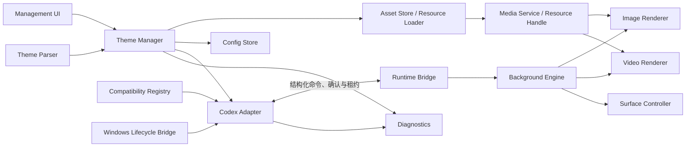

# Codex Theme Engine 技术调研文档 v1.0

| 项目 | 内容 |
| --- | --- |
| 项目名称 | Codex Theme Engine；既有 PRD 中的产品名称为 codexpaper |
| 文档版本 | v1.0 |
| 编写与资料核对日期 | 2026-10-14 |
| 文档用途 | 为宿主接入、媒体渲染和 V1 开发验证提供工程依据 |
| 目标平台 | Windows x64 上的 Codex 桌面客户端 |
| 建议仓库路径 | `docs/Research/Codex-Theme-Engine-Technical-Research-v1.0.md` |
| 研究状态 | 已核对项目原文、官方资料与本机安装包的部分静态信息；运行时接入、渲染和性能实验待执行 |
| 版本路线 | V1 图片与视频开放导入；V2 标准主题包；V3 社区分享与分发 |

推荐继续采用既有架构的**独立控制端 + Codex Adapter + 宿主内单一媒体背景层**。优先调查正式扩展入口；受控 CDP 运行时适配是需要验证的候选路线。客户端资源修改违反项目约束；纯外置 Overlay 无法在不透明宿主内部形成背景，不应作为全窗口实现的默认兜底。

本机安装包已经提供网页资源与 Chromium/Electron 风格的应用证据，但不能据此宣布当前构建允许第三方连接。能否交付 V1，取决于接入、四区域覆盖、图片与视频加载、正常及异常恢复、安装完整性五类证据是否同时成立。图片可以先完成内部里程碑；完整 V1 必须包含视频。

## 目录

- [0 文档依据与范围对齐](#0-文档依据与范围对齐)
- [1 项目背景](#1-项目背景)
- [2 Codex Desktop 技术架构分析](#2-codex-desktop-技术架构分析)
- [3 动态主题实现方案对比](#3-动态主题实现方案对比)
- [4 动态壁纸渲染技术研究](#4-动态壁纸渲染技术研究)
- [5 Wallpaper Engine 类似架构分析](#5-wallpaper-engine-类似架构分析)
- [6 V1 V2 V3 推荐技术路线](#6-v1-v2-v3-推荐技术路线)
- [7 技术风险分析](#7-技术风险分析)
- [8 V1 实验验证计划](#8-v1-实验验证计划)
- [附录 A 证据标识与复核边界](#附录-a-证据标识与复核边界)
- [附录 B 技术参考资料](#附录-b-技术参考资料)

## 0 文档依据与范围对齐

### 0.1 原始文档与内容身份

研究基于 `rgrnb/Codex-Theme-Engine` 的 `main` 提交 `f669e66f962dc808e929a60606e82993664485c1`。已读取本地原文，并用 Git blob SHA 与仓库树逐项核对，三份内容一致。引用对话用于定位资料，未把先前助手的判断当作技术证据。

| 标识 | 原始文档 | 本文使用的主要内容 | Git blob SHA |
| --- | --- | --- | --- |
| P1 | [PRD v1.0](https://github.com/rgrnb/Codex-Theme-Engine/blob/f669e66f962dc808e929a60606e82993664485c1/docs/PRD/Codex-Theme-Engine-PRD-v1.0.docx) | FR 001–016、开放导入、全窗口定义、用户视觉控制、NFR 与验收要求 | `237f3129ff80ef5d615a03744cc43eb26e0f642e` |
| P2 | [Architecture v1.0](https://github.com/rgrnb/Codex-Theme-Engine/blob/f669e66f962dc808e929a60606e82993664485c1/docs/Architecture/Codex-Theme-Engine-Architecture-v1.0.md) | 模块边界、Adapter、资产托管、运行时事务、恢复租约、M0–M4 | `455929d693b55241a6f812e317922e52bfe2de35` |
| P3 | [V1 Development Plan](https://github.com/rgrnb/Codex-Theme-Engine/blob/f669e66f962dc808e929a60606e82993664485c1/docs/Development/V1-Development-Plan.md) | T00–T17、G0 验证、图片开发任务、F/P 用例、分发流程 | `58b71d5071874c48791b0ed09c17c6ad4c15ea82` |

### 0.2 已发现差异与本次决策

三份文档目前存在实际差异，不能声称已全部一致。项目负责人已在本次研究中选择**按 PRD 与架构执行：V1 同时包含图片和视频**。本文保留开发计划中可复用的任务和测试组织，不隐式继承其缩减的产品范围。

| 差异 | PRD 与架构 | 当前开发计划 | 本文采用的结论与同步要求 |
| --- | --- | --- | --- |
| V1 视频 | 视频加载与控制属于 P0 | V1.0 仅图片，视频安排到可选 V1.5/V2 | V1 包含视频；补齐视频任务、生命周期和发布准入 |
| 导入入口 | “所有文件”，按内容与目标实际解码判断 | 静态 PNG/JPEG/WebP 范围与格式拒绝 | 保留开放入口；已验证格式清单说明能力，不作为扩展名白名单 |
| 适配方式 | `cover`、`contain`、`stretch` | 重点定义 `cover`、`contain` 与焦点 | 三种方式均属于 V1；焦点设置作为额外参数单独评估 |
| UI 参数 | 四区域面板不透明度，默认均为 0% | 示例主要提供背景 opacity 与底色 | 沿用 PRD 的四区域参数；不能用父容器 opacity 替代 |
| 窗口范围 | P0 用户选择一个主窗口；多窗口为增强项 | 同一主题覆盖多个兼容主窗口 | 首版 P0 单目标；多窗口另测，不扩大首版必需范围 |
| 数据与路径 | `%LOCALAPPDATA%/codexpaper/`、assetId、规范化 descriptor | `%LOCALAPPDATA%/CodexThemeEngine/`、按主题目录复制图片 | 沿用架构的资产模型与 PRD 数据目录；更名通过 ADR 和迁移处理 |
| 资源传输 | 回环 Media Service 为候选，大文件不整文件 Base64 | 图片优先验证目标 Blob URL | 根据 CSP 与预算选择，不固定 HTTP 服务必然可用 |
| 性能口径 | 整机 CPU 百分点，图片合计额外内存 ≤150 MiB | 单核 CPU，分别预算管理端与宿主，数值不同 | 发布沿用 PRD；保留开发计划的分阶段诊断，但统一统计口径 |

T01 应将这些差异写入 ADR，并同步修订 P3 第 2、3、5、9、11、12 节及对应验收用例。本文只交付研究文档，没有修改既有文件。不得在开发计划尚未更新时，把静态图片 RC 标为完整 V1 发布。

### 0.3 证据等级

| 标签 | 定义 | 可支持的结论 |
| --- | --- | --- |
| 已验证／官方资料 | 已实际查阅的官方或技术维护方文档 | 公开产品能力或平台通用机制，不自动证明 Codex 某构建兼容 |
| 已验证／本机静态 | 本次读取的安装包、元数据与文件内容 | 指定样本包含哪些资源和声明；不证明代码已运行 |
| 推测 | 根据明确证据作出的工程推断 | 可指导实验，需要列出可能不成立的条件 |
| 待验证 | 缺少运行时或测量证据 | 不能写成已支持、已实现、已达标 |

所有性能数值是验收目标或容量估算。全文没有把通用 API 文档、控制端预览或安装包字符串当作真实 Codex 渲染测试结果。

## 1 项目背景

### 1.1 官方外观能力与项目机会

官方设置说明已包含浅色、深色及系统模式、强调色、背景色、前景色、UI 与代码字体，以及自定义主题分享。页面也展示侧栏半透明相关设置。因此，“Codex 只能使用固定浅色/深色主题”不符合当前查阅资料。[OpenAI 官方设置说明][S1]

本项目关注的是本地图片与视频的导入、统一客户区背景、面板不透明度、播放控制、资源托管与可靠恢复。本次查阅的设置说明没有建立足以实现这些需求的第三方媒体背景接入契约；这是限定于所查文档的结论，不等于证明所有未公开接口均不存在。

### 1.2 已有主题方案的研究边界

PRD 和引用对话提及 DSH、Codex Dream Skin 等体验参考。本次没有取得这些方案的确定源码、构建和运行记录，不能判断其是否通过补丁、官方配置、CDP 或其他注入手段实现。也不能将本机安装的 Codex Skin 插件直接认定为同一项目。

后续比较时，应记录方案的仓库与版本、是否修改安装文件、是否依赖辅助工具、实际覆盖区域、资源通道、更新适配方式和恢复证据。效果截图只能证明特定画面，无法证明独立部署、稳定升级或异常清理。

### 1.3 独立 Theme Engine 的工程价值

独立控制端将媒体托管、参数、应用事务与兼容记录放在产品自己的数据目录；宿主差异集中在 Adapter 中。宿主变化不应迫使资源库和包格式重写。V2/V3 可以沿用同一渲染、恢复和安装管线，而无需重新开发播放核心。

“独立”指部署、业务和数据独立。背景显示仍需要宿主接入；单独启动一个程序不会让图片穿透不透明的 Codex 窗口。核心流程应离线工作，无需模型服务或 OpenAI API 密钥。

项目保持以下基线：不修改官方安装文件；主窗口四区域连续背景；不强制遮罩、调暗、模糊或改字色；用户控制视觉参数；更改可撤销；导入失败保留最后成功状态。完整定义沿用 P1/P2。

## 2 Codex Desktop 技术架构分析

### 2.1 本机已验证信息

本次通过 Windows 包注册信息、进程映像路径、ASAR 目录与选定元数据进行只读核查，没有连接调试端口、执行宿主脚本、重启客户端或改写安装包。以下观察只适用于该样本。

| 编号 | 已验证观察 | 来源与解释边界 |
| --- | --- | --- |
| L1 | 包名 `OpenAI.Codex`；MSIX 版本 `26.1007.9446.0`；x64 | Windows 包注册信息；这是安装包版本，不能替代应用内部版本 |
| L2 | 本次 Codex 子进程的父进程映像位于该包的 `app/ChatGPT.exe` | 进程身份核查；不能因子进程名为 `codex.exe` 就把 CLI 当作桌面渲染宿主 |
| L3 | 包含 `chrome.dll`、Chromium 资源；该 DLL 产品版本为 `155.0.8059.40` | 文件元数据；不代表已读取运行时浏览器版本 |
| L4 | 存在 `resources/app.asar`，包内名称为 `openai-codex-electron`，版本 `26.1007.71326`，入口 `.vite/build/early-bootstrap.js` | ASAR 中 `package.json` 的声明；不等于标准 Electron 发行版行为已确认 |
| L5 | `owl-electron-app.json` 声明 `runtimeName: "owl"`；另有 `owl-shell-runtime.json` | 壳与应用打包关系的线索；不能推定 Owl 对 Electron API、启动参数完全兼容 |
| L6 | `webview/index.html` 引用 `./assets/index-373b55c7c328.js`；目录内有 JS/CSS 资源 | 确认存在网页前端资产；未遍历业务代码或验证 DOM 结构 |
| L7 | 打包 HTML 的 CSP 包含下表所列图片、视频和样式策略 | 静态页面声明；实际策略还可能受响应头、运行时导航或其他策略限制 |

本机打包 HTML 的相关 CSP 摘录如下，HTML 实体已解码；只展示与研究相关的部分：

```text
default-src 'none'
img-src 'self' app: blob: data: https:
media-src 'self' app: blob: data: https:
style-src 'self' 'unsafe-inline'
connect-src 'self' blob: <若干明确列出的 HTTPS/WSS 来源>
```

`img-src`、`media-src` 没有显式列出 `http:` 或回环 HTTP 地址；`connect-src` 也没有显式列出回环 HTTP 来源。**推测：默认 HTTP 回环 Media Service 很可能受该策略阻断，不能直接作为此构建的既定资源通道。** Blob 值得优先实验，但静态允许不等于创建、加载、解码和释放已成功。`app:` 协议是宿主声明的来源，独立程序不能据此给宿主注册自己的协议。[W3C CSP 规范][S6]

全包静态图分析曾因一项解包原生模块的完整性声明与文件哈希不一致而停止；放宽为“记录并继续”的后续分析未取得完整结果，本次已停止等待。本文只使用上述有明确读取位置的观察，不声明完整代码图已审计。差异与样本哈希见附录 A；不能据此断言篡改、恶意行为或差异成因。

### 2.2 架构推测与待验证项

| 问题 | 当前判断 | 等级 | 验证方式 |
| --- | --- | --- | --- |
| 是否存在网页 UI | 已存在 HTML、JS、CSS 资源 | 本机静态已验证 | E1 再确认主工作窗口实际载入页面与客户区边界 |
| 是否为标准 Electron 客户端 | Electron 风格应用资源与 Owl/Chromium 壳并存，不能直接等同标准 Electron | 架构关系推测 | E1 核实运行时与目标协议；必要时继续分析固定入口及壳边界 |
| 是否采用 React | 本次未确认；不能从 `.vite` 或交互形式推定 | 待验证 | 定位实际前端入口及 React 渲染调用；依赖缺失也不能排除被打包的 React |
| 是否采用 WebView2 | 本次证据未建立这种判断，也没有完成排除 | 待验证 | 识别实际窗口与渲染子进程及相关运行库 |
| 是否存在原生 UI | 系统非客户区、原生对话框与内部网页可同时存在 | 部分待验证 | 为顶部区域、菜单、子窗口、嵌入表面逐项登记归属 |
| 是否可注入 CSS/JS | 通用 Chromium/Electron 机制可作为候选 | 待验证 | 使用已确认的受控连接做最小、自有节点实验，随后恢复 |
| 是否可加载本地媒体 | 打包策略提供 Blob 等线索，回环 HTTP 存在阻断风险 | 待验证 | 分别验证图片、视频、fetch、样式和范围读取 |
| 是否开放 CDP | 本次未探测；历史端口 `9335` 不能作为当前证据 | 待验证 | 验证发行渠道、启动流程、监听地址、目标身份与协议能力 |

React、Electron、WebView 和原生 Windows 不是互斥的同一层级选型：React 是 UI 库，Electron/Owl/WebView 是承载方式，原生窗口是 OS 表面。研究应分别确认窗口、网页与运行时，而不是只寻找一个框架名称。

### 2.3 接入必须验证的权限与生命周期

Electron 文档描述 `--remote-debugging-port`，但打包应用可能限制、过滤或不使用该参数。Node 主进程 `--inspect` 也不等于能控制主窗口网页。[Electron 命令行说明][S2]

E1 应建立“安装渠道与构建 → 进程 → 窗口 → 页面 target → execution context”的关联。页面标题可能与浏览器标签相同，端口也可能属于另一应用；仅用名称或 URL 子串不能完成身份确认。已有实例可能吞掉新启动参数，须在独立测试环境记录单实例行为。

本项目不通过改写 preload、关闭沙箱、关闭 web security、绕过 CSP 或重新打包宿主获得通道。调试端口与资源服务分别核查实际监听地址；资源令牌不保护 CDP。没有符合约束的接入时，将该构建标记为未支持，保留本地资源管理能力。

## 3 动态主题实现方案对比

### 3.1 方案 A 客户端资源修改

修改 ASAR、CSS bundle、主脚本或 preload，理论上能在应用初始化和内部组件附近添加背景，控制范围较深。其成本包括安装完整性、更新覆盖、资源哈希或签名、模块重打包和版本回滚。即使只替换 CSS，仍然修改了官方资源。

该方案违反 P1/P2“不修改官方安装文件”的硬约束，不能进入 V1 实现。只读分析资源可用于理解布局，不构成修改授权，也不应把补丁工具作为产品必需前置依赖。

### 3.2 方案 B 独立 Overlay Theme Engine

Overlay 可以使用独立透明窗口显示图片或视频，并同步位置、大小、DPI、可见性与 Z 顺序。Windows 分层窗口支持 alpha 合成，但透明的是 Overlay 自身，不会自动改变另一应用内部的绘制层级。[Windows 窗口与分层窗口说明][S4]

按普通 alpha 合成理解，`最终颜色 = α前层 × 前层颜色 + (1 − α前层) × 后层颜色`：

- 背景窗口放在 Codex 后方，而 Codex 像素完全不透明时，后方背景不可见。
- Overlay 放在 Codex 上方时，图片或视频覆盖文字与控件；降低 Overlay alpha 会混合整幅画面。
- 设置点击穿透解决输入命中，不解决视觉遮挡。
- 降低整个 Codex 窗口 alpha 会同时影响文字和控件，无法实现只调整四区域面板背景的需求。

上述结论是基于合成机制的工程推导；具体样本仍应通过 E2 截图验证。它足以说明纯外置窗口无法保证 PRD 的“媒体在内容下方、面板可独立调节、文字保持宿主行为”。若通过宿主适配先使内部表面透明，方案已成为依赖接入的混合架构。

窗口同步还需处理客户区与外框差异、最大化和最小化、跨 DPI 显示器、前后台切换、其他窗口遮挡、虚拟桌面、窗口销毁和任务栏行为。顶层置顶窗口可能覆盖无关应用。Electron 自身的透明窗口也有平台和调整大小等限制，不能把透明和穿透视为同一个参数。[Electron 透明窗口说明][S5]

Overlay 适合管理界面预览、独立播放窗口或窗口同步对照实验。E2 可以成功证明窗口追踪机制，却仍判定其不能满足全窗口背景；这不是实验失败。

### 3.3 方案 C 宿主运行时适配与 Electron 注入

在经验证的宿主网页内部放置一个媒体层，并为四个主区域添加范围明确的背景表层覆盖。背景与 UI 共享视口，媒体位于交互内容下方，能够沿用原生媒体解码与合成机制。

Electron 的 `webContents.insertCSS()`、`removeInsertedCSS()`、`executeJavaScript()` 描述应用自身对其页面的控制。这些 API 不能由另一个独立 Electron 程序直接取得 Codex 的 WebContents。跨应用需要正式入口或经验证的协议连接；通过修改宿主主脚本调用 API 会退回方案 A。[Electron webContents 文档][S3]

CDP Adapter 的候选流程为：

```text
识别受支持的目标构建与页面
  → 附加正确 target 和执行上下文
  → 验证媒体与样式通道
  → 安装带会话所有权和租约的固定 Runtime Bridge
  → 准备候选媒体并确认首帧、区域和交互
  → 提交配置并释放旧媒体
  → 关闭、断连或租约失效时恢复
```

CDP Runtime 提供执行与上下文相关机制；实际方法、协议版本和目标支持须探测。命令使用结构化参数，禁止把用户名称、路径和主题字段拼成执行脚本。只运行产品自有固定逻辑，不执行主题作者代码。[CDP Runtime 参考][S17]

背景节点使用独立命名空间，不进入宿主布局流，不接受焦点或指针事件。层叠值根据目标 stacking context 确定；盲目使用负 z-index 可能被根背景遮挡，使用极大正值则可能盖住内容。面板参数只作用于背景表层，不能修改整个父节点 opacity，也不能使用“所有 div 都透明”的选择器。

宿主组件重建可能移除节点或标记，适配器应观察有限根节点、合并变化并幂等恢复。无需依赖 React 私有 Fiber；若实际页面采用 React，背景不应成为其业务状态或组件内部对象的一部分。

### 3.4 比较结论

| 维度 | A 资源修改 | B 纯外置 Overlay | C 运行时适配 |
| --- | --- | --- | --- |
| 满足不修改安装文件 | 不满足 | 可满足 | 有符合约束的通道时可满足 |
| 媒体位于宿主交互内容下方 | 可实现但依赖补丁 | 不透明宿主下不能保证 | 内部层级验证通过后可实现 |
| 四区域不透明度独立控制 | 可实现但依赖补丁 | 无法由纯外置窗口实现 | 需逐区域适配与验证 |
| 图片与视频播放 | 取决于修改后的运行时 | 独立窗口可播放 | 取决于目标媒体能力与资源通道 |
| 更新维护 | 重打包、完整性与补丁重做 | 窗口行为与 OS 兼容 | 协议、DOM、CSP 与区域映射维护 |
| 主要故障 | 启动或更新损坏、恢复成本高 | 遮挡、层级、追踪和交互问题 | 无接入、策略阻断、覆盖失效、清理残留 |
| V1 角色 | 排除实施 | 对照与预览 | 首选候选，须通过 M0 |

应先调查正式入口，未来可用时替换 Adapter，不改业务与资源核心。当前没有证据证明正式入口或 CDP 已满足全部要求，因此“推荐 C”是研究决策，不是兼容承诺。

## 4 动态壁纸渲染技术研究

### 4.1 资源支持与验证矩阵

V1 采用开放单文件导入，文件选择器保留“所有文件”。格式名用于组织测试；成功条件是文件内容识别、目标实际解码和显示确认，不是扩展名命中。容器与编码需要分别检查。[媒体容器说明][S7]

| 资源 | V1 至少验证的样本 | 主要工程问题 | V2 规范方向 |
| --- | --- | --- | --- |
| PNG | 1080p、4K、透明通道、损坏样本 | 解码峰值、alpha 与下层基础色 | 标准静态图片之一 |
| JPG/JPEG | 横图、竖图、方向元数据、4K | 方向、色彩、非透明背景 | V1 必测；是否进入标准包格式需冻结，当前 PRD 候选未列入 |
| WebP | 静态、透明、动画、损坏样本 | 静态与动画识别、实际目标能力 | 标准包采用静态 WebP |
| MP4 | H.264 AVC、8 bit 4:2:0；有/无 AAC 音轨 | MP4 不保证内部是 H.264；首帧、seek、循环与解码后端 | H.264 组合为候选标准视频 |
| WebM | VP9、8 bit 4:2:0；有/无 Opus 音轨 | 目标编码与硬解支持、循环、缓冲 | VP9 组合为候选标准视频 |
| 其他媒体 | 无常见扩展名的有效文件、GIF、APNG、其他编码 | 开放入口与实际解码结果分离 | 合规标准包另定，旧资源保留 legacy |

动画图片按 PRD 归 Image Renderer：解码成功可展示，但不承诺未经验证的逐帧暂停。不能把开发计划中的“一律拒绝动画图片”直接作为 V1 产品规则。网页、脚本、工程包和可执行文件不因“所有文件”入口成为支持对象。

V1 不自动转码、不静默改色、裁剪、降分辨率或降帧。资源保护通过空间检查、像素与解码预算、超时和可取消任务实现；预算在 M0 冻结并解释原因，不能把开发计划的候选 50 MiB/64 百万像素直接冒充 PRD 已确认限制。

### 4.2 资源读取通道与 CSP

资源通道应抽象为 `Media Service → 可释放的会话资源句柄`，不要求业务层知道 URL、端口或对象 URL。管理界面预览成功不能证明宿主能加载相同地址。

| 通道 | 条件与优点 | 局限与本次验证顺序 |
| --- | --- | --- |
| 目标页面 Blob URL | 在目标上下文创建；静态 CSP 提供允许线索；资源无需上传云端 | 优先验证图片及短视频；需测完整字节暂存与 Blob 的峰值内存 |
| 仅回环媒体服务 | 可流式读取、Range、取消；适合较大视频 | 图片/媒体 CSP、混合内容、源与实际访问均需通过；本机打包策略提示 HTTP 路线有阻断风险 |
| Data URL | 小样本测试简单 | 编码膨胀及多份字符串复制；不作为高清视频或大图默认通道 |
| `file://` 或宿主自有协议 | 若实际目标会话提供可用路径，可减少转移 | 不假设跨应用可用；不修改宿主协议处理器或安装资源 |
| HTTPS 服务 | 仅在已有可信本地条件且策略允许时研究 | 不能通过忽略证书错误或改写信任设置来兜底；不作为 V1 已定前提 |

图片检查 `img-src`，视频检查 `media-src`，脚本请求检查 `connect-src`，样式检查适用的 `style-src` 及细分指令；缺失时按规范回退，不能相互代替。还需核对实际页面的全部有效策略与源，多个策略可能叠加收紧。[W3C CSP 规范][S6]

Blob URL 应在 Codex 目标上下文内生成，独立管理程序里的对象 URL 不能直接被认为可跨上下文共享。可通过固定桥接分块转移受控字节，逐块确认、限制在途消息并支持取消；不能一次发送整文件巨型 Base64 参数。分块只能控制消息峰值，不能消除完整文件的最终驻留成本。

若采用回环服务，必须仅绑定经核实的 `127.0.0.1` 或 `::1`，按 assetId 查找授权媒体，不开放任意路径、目录列表、代理或上传。访问凭据限当前会话和资源，失效后不能继续读取；媒体元素不能随意附加自定义请求头，鉴权方式须专项设计并防止令牌进入日志。Origin/Host 校验与源策略按实际页面测试，不使用宽泛允许掩盖问题。

视频服务需正确实现 `Content-Type`、长度、`Accept-Ranges`、合法 Range 的 `206` 与 `Content-Range`、不可满足范围的 `416`、连接关闭和取消；不把一个范围请求重新读取成整文件。跨源时是否需要 CORS、预检或额外响应头取决于具体访问方式，须实测。[HTTP 范围请求说明][S10]

所有通道都失败时停止该构建适配。租约清理和资源释放测试必须与传输方式一起完成，不将“URL 可以打开”视为资源管线通过。

### 4.3 图片渲染与全窗口表面

每个目标窗口只维护一个连续媒体层，以主客户区视口为坐标系，覆盖侧栏、主内容、网页绘制的顶部区域及输入区域。原生非客户区、系统菜单、文件选择器和独立子窗口不属于覆盖承诺。内嵌浏览器内部、审批浮层和菜单保持各自宿主表层行为。

图片完成解码和尺寸确认后再准备应用。`cover` 保持比例并裁切，`contain` 完整显示并保留基础底色，`stretch` 按宽高拉伸；侧栏收缩只改变遮挡区域，不重新为每个面板铺图。窗口与 DPI 变化应触发有限的尺寸更新，不持续重建图片。

静态图片没有逐帧渲染循环。图像缓存采用明确上限与引用管理，原始媒体不被缓存替代或删除。若生成显示缓存，应记录来源与渲染尺寸、保留原图，不静默改变用户的最终画质选择。

四区域不透明度仅改变背景色 alpha 或独立表层，保留文字、按钮、边框和交互状态。默认四区域均为 0%，保持 PRD 的无强制遮罩原则。需要较高可读性时由用户主动提高面板不透明度。

### 4.4 视频播放与首帧确认

首选目标运行时的 HTMLVideoElement，避免 JavaScript 自建解码器、每帧 Canvas 读回或媒体帧经控制消息传送。初始化先设静音、循环与显示参数，再设置资源；`preload` 只是提示，不能作为内存预算保证。

| 阶段 | 必须确认的事实 | 不能替代的信号 |
| --- | --- | --- |
| 预检 | 类型、视频轨、宽高、时长及目标能力 | 扩展名或仅 MIME 声明 |
| 元信息 | 可读取视频元信息，宽高有效 | `loadedmetadata` 不代表已经解出视频帧 |
| 解码 | 有实际可呈现的视频帧 | `canPlayType()`、`canplay` 或 API 返回成功不能单独证明显示 |
| 展示 | 媒体层与四区域映射就绪，首帧在正确目标中确认 | 控制端预览或后台隐藏元素的状态 |
| 提交 | 最新请求、配置写入和回执对应同一会话 | 已发送命令不等于已应用 |

支持 `requestVideoFrameCallback()` 时，用其回调与元信息确认帧进入呈现管线，结合目标状态回读和首次截图核实可见层级。该接口不保证回调与屏幕扫描精确同步，也不证明画面未被不透明层盖住；截图与人工区域检查仍是 E3/E4 的证据。[视频帧回调说明][S9]

自动播放受阻时进入已加载暂停状态，提供用户播放入口，不重复强制启动或伪造手势。默认静音与循环；用户主动取消静音后才允许声音。音轨识别不以一个浏览器私有属性作为所有运行时的通用保证，无音轨状态需结合预检和实际播放验证。

### 4.5 GPU 加速与性能差异

Wallpaper Engine 官方资料说明其视频默认利用 GPU 解码，也记录了录屏 hook、多 GPU 拷贝及高负载引起卡顿的情况。其视频后端还存在 DirectShow/LAV 等可选路径。因此“Wallpaper Engine 必然流畅、普通 HTML 视频必然卡顿”不是可靠结论。[Wallpaper Engine 视频性能说明][S11]、[视频后端说明][S12]

流畅度取决于解码、拷贝、合成、媒体编码与调度链路。以下为工程推导，不是对 Wallpaper Engine 内部源码的复现：

| 卡顿来源 | 观察依据 | 优先处理 |
| --- | --- | --- |
| 编码或像素格式无法硬解 | 解码后端、CPU 增量、能力提示和掉帧 | 验证 H.264/VP9 的具体 profile、bit depth、尺寸与设备，不只看文件后缀 |
| 每帧 CPU 读回或跨进程复制 | 跟踪中出现频繁帧传送、内存带宽和 CPU 峰值 | 直接使用媒体元素和合成；控制消息只传参数与状态 |
| 多面板重复播放同一视频 | 多个播放器、独立解码会话 | 单窗口一个活动播放器，最多一个候选播放器 |
| 过量透明混合与滤镜 | GPU 合成压力、绘制范围与层数增加 | 保留单背景层，不增加默认模糊、全屏滤镜或额外动画 |
| 主线程被管理逻辑占用 | 长任务、参数更新或观察器频繁触发 | 媒体预检放入工作任务，合并 DOM 观察与更新 |
| 跨 GPU 或多屏行为 | DWM、共享/专用显存与目标 GPU 变化 | 分设备、驱动、跨屏条件测试，报告实际瓶颈 |
| 视频循环边界或缓冲问题 | 循环点黑帧、停顿、seek 与 Range 行为 | 持续复用同一播放器，测试文件头布局与循环边界 |

`MediaCapabilities.decodingInfo()` 的 `supported`、`smooth`、`powerEfficient` 可用于预判；浏览器可能在缺少设备历史统计时乐观报告，不能把这些字段当作硬件解码的最终证据。[媒体能力接口说明][S8]

硬解判断应记录可取得的媒体诊断/系统跟踪中的解码器或后端，并交叉观察 Video Decode、CPU、GPU 与帧统计。WebGL renderer 名称或低 CPU 本身不能证明视频硬解。无法取得后端证据时标记“未确认”，仍报告可测的播放结果。

### 4.6 内存与高分辨率容量估算

下列是像素存储量的算术估算，排除 stride 对齐、驱动表面、解码队列和运行时管理开销，不是实际内存测量：

| 项目 | 估算公式 | 估算结果 |
| --- | --- | --- |
| 1080p RGBA 单表面 | `1920 × 1080 × 4 / 1024²` | 约 7.91 MiB |
| 4K RGBA 单表面 | `3840 × 2160 × 4 / 1024²` | 约 31.64 MiB |
| 4K 8 bit 4:2:0 单表面 | `3840 × 2160 × 1.5 / 1024²` | 约 11.87 MiB |
| 4K30 RGBA 每帧一次 CPU 拷贝 | `31.64 × 30` | 约 949 MiB/s 数据量，未计其他拷贝 |

压缩文件 5 MiB 不代表解码只占 5 MiB。活动与候选媒体、预览、传输缓冲、解码队列和 GPU 表面可能同时存在。Base64 字节量通常约为原数据的 4/3，再叠加字符串和协议复制，尤其不适合大视频。

图像解码预算按像素数、峰值和取消行为建立；视频优先采用经验证的流式通道。Blob 回退必须分别测分块缓冲、合并和播放峰值。如果唯一可用视频通道无法满足预算，就记录问题并停止发布该组合，不能只因静态图成功而宣称完成 V1。

先以单窗口 1080p30 视频建立基准，再扩展 4K、60 fps、HDR 和多窗口。GPU 合成加速与视频硬解是不同能力；开启 Electron 硬件加速不等于目标编码、透明窗口或每台 GPU 都有高效路径。V1 不静默降级用户媒体，性能不适时提示暂停或选择其他资源。

### 4.7 循环与生命周期

循环复用同一视频元素和资源句柄，不在每次 `ended` 时重新导入、重新复制或创建播放器。至少观察三轮循环，并记录是否存在黑帧、重复帧、停顿与声音异常。素材首尾画面不连续和播放器等待应分别判断，不能通过隐藏测试结果声称“无缝”。

用户暂停、最小化、锁屏和休眠分别进入暂停原因集合。只有全部自动原因解除且用户没有主动暂停时才恢复；普通失焦默认不暂停。关闭循环后在结束状态保留最后帧，重新播放行为需单独定义。

正常关闭按所有权停止媒体、撤销样式和节点、释放对象 URL、资源授权、监听器、观察器及连接。候选加载失败不影响旧背景；连续请求只允许最新代次提交。配置提交失败必须回滚显示，不能留下“当前显示新背景、重启恢复旧背景”的状态。

异常恢复沿用架构的 2 秒续租、连续 10 秒无续租触发清理。休眠、冻结和后台节流可能停止执行：恢复执行时先核实租约，不保证运行时完全停止期间按墙钟完成清理。活动页面应按 PRD 目标实测；不能靠关闭全局后台节流、播放静音音轨等手段规避生命周期问题。

## 5 Wallpaper Engine 类似架构分析

### 5.1 可借鉴的组织方式

公开资料体现了不同壁纸类型、属性配置、性能设置和资源优化方法。场景壁纸、视频壁纸和网页壁纸不是同一种播放器；复杂场景工程不能简化成一个 MP4 文件。本文归纳的是可借鉴的职责模型，没有完成 Wallpaper Engine 二进制或内部源码分析。

| 可借鉴能力 | 本项目对应模块 | 实施方式 |
| --- | --- | --- |
| 媒体与展示分离 | Image/Video Renderer + Codex Adapter | Renderer 决定显示什么，Adapter 决定在哪里显示 |
| 配置化作品 | Theme Parser + ThemeDescriptor | 属性采用声明式字段与范围验证，不直接执行作者脚本 |
| 资源库与版本 | Asset Store + Theme Manager | 内容哈希去重、引用管理、版本与本地覆盖分开 |
| 暂停与后台策略 | Lifecycle Controller + Windows Bridge | 用户意图和自动暂停原因分开，恢复不覆盖主动暂停 |
| 作者性能反馈 | Creator Tool + 诊断 | 展示尺寸、像素、编码、峰值和播放结果，不只给“优化”按钮 |
| 内容发现与分发 | V3 Theme Provider | 下载产出 V2 标准包，沿用本地校验与应用事务 |

Wallpaper Engine 的用户属性机制可将预设参数映射到壁纸；其纹理优化资料说明压缩文件与显存用量不同；网页壁纸也可读取用户配置的帧率限制。这些机制可启发工具设计，但本项目 V1 不自动压缩原图或降低视频帧率。[用户属性说明][S14]、[纹理优化说明][S13]、[网页壁纸帧率说明][S20]

### 5.2 Theme Package 与 Creator Tool

V2 沿用 PRD 的 ZIP 兼容 `.codextheme` 候选格式，只有一个必需清单 `theme.json`；资源与预览使用包内相对路径，作者、版本和许可信息位于清单。不另设重复 `metadata.json`，不携带作者机器路径、缓存、令牌或目标窗口 ID。

包按“限额预检 → 暂存解包 → Schema、路径与媒体校验 → 资产注册 → 原子安装 → 预览 → 应用”处理。用户本地参数覆盖作者默认，作者默认覆盖引擎默认。启用、目标、启动恢复、声音授权和后台策略属于本机配置。

Creator Tool 应先提供媒体选择、四区域预览、参数编辑、元数据、许可声明和包导出，复用 Theme Parser；其输出必须在干净机器往返导入。自由脚本编辑器、任意 CSS 与 HTML 运行不属于已确定方案。

### 5.3 直接调用与外部资源互通

Wallpaper Engine 官方命令行支持打开壁纸、暂停/播放，以及用 `playInWindow` 在独立窗口显示。这证明存在外部控制能力，但没有证明能把其画面嵌入 Codex 客户区、共享 GPU 纹理或只在宿主内容下方绘制。[Wallpaper Engine 命令行控制][S15]

| 互通层级 | 当前可成立的研究判断 | 尚需验证 |
| --- | --- | --- |
| 独立播放窗口 | 官方命令行提供该能力 | 实机窗口行为、实例控制、停止与生命周期；不能代替 Codex 内部背景 |
| 普通图片/视频文件 | 可经本项目媒体管线尝试导入 | 资源取得和使用范围、编码、预检与目标播放 |
| `project.json` 属性 | 可以研究描述与属性映射 | 版本、字段、依赖与可迁移子集，不直接当作本项目主题清单 |
| 场景工程或 `scene.pkg` | 未建立兼容性 | 场景运行时、材质、着色器、依赖、交互与资源授权 |
| 网页/脚本壁纸 | 不属于 V1/V2 白名单资源 | 若未来立项，需要独立隔离模型和明确能力边界 |
| Steam Workshop | 有 Steamworks UGC 机制可研究 | 应用身份、平台配置、访问与发布条件、作者许可和分发范围 |

Steam Workshop 以应用和 UGC 项目组织内容，独立创作应用发布到另一个应用的 Workshop 需要相应配置。本项目不能仅凭掌握 Workshop ID 就假定具备下载、发布或重新分发能力。[Steam Workshop 实现指南][S16]

V3 可先做本项目标准包的分享与安装。Wallpaper Engine 适配另设研究任务，优先限定为用户可使用的普通媒体或明确兼容子集，不阻塞基础社区功能。

## 6 V1 V2 V3 推荐技术路线

### 6.1 总体技术结构

沿用 P2 的模块化本地架构，以 TypeScript 为业务与契约候选语言，Electron 为独立管理程序候选外壳。具体版本在 M0/T01 后冻结；宿主使用什么壳与本项目管理程序使用什么壳分别记录。



管理界面不写宿主选择器；Parser 不建立调试连接；Adapter 不解析市场包；媒体不经模型服务。资源服务的实现可切换，资产标识、业务事务和渲染生命周期保持稳定。

管理端壳的空闲内存应在锁定选型前测量。开发计划允许更高的管理端内存预算，与 PRD 的合计额外内存目标不一致；不能因为选用 Electron 就直接豁免 PRD。达不到目标时，在 M0 评估精简界面或替代外壳，并形成 ADR。

### 6.2 V1 开放图片与视频导入

| 阶段 | 交付内容 | 准入与退出条件 | 对应既有任务 |
| --- | --- | --- | --- |
| M0 接入验证 | 构建身份、可用入口、四区域映射、媒体与样式通道、恢复和完整性 | 图片及至少一个视频样本均可加载；正常与异常恢复有证据 | P3 T00/G0；新增视频通道验证 |
| M1 图片里程碑 | 托管导入、统一媒体层、三种适配、四区域不透明度 | 4K 图片、DPI、窗口变化、交互与切换回滚通过 | T02–T10 中的资源和渲染任务 |
| M2 视频里程碑 | 首帧、播放暂停、静音循环、结束状态、Windows 生命周期 | MP4/WebM 编码矩阵、1080p30、循环及释放通过 | 将 P3 可选 V1.5 视频设计纳入 V1 必需任务 |
| M3 完整用户流程 | 列表、预览取消、应用事务、持久化、启动恢复、错误提示 | FR 001–016 与恢复流程完成 | T09–T13，补齐视频状态与资源句柄 |
| M4 验证与分发 | 真机回归、性能与稳定性、兼容表、安装包和使用说明 | PRD AT 01–20、NFR 准入通过；能力描述与实测相符 | T14–T17，并同步修订图片专用用例 |

数据目录沿用 `%LOCALAPPDATA%/codexpaper/`，资产按内容哈希托管；原文件不会因导入或删除条目而被修改。配置采用备份、验证与原子替换。持续缓存与暂存可回收，正式媒体不可当作缓存删除。

核心模型沿用 `AssetRecord`、`LibraryEntry`、`ThemeDescriptor`、`UserConfig`、`RuntimeSession` 和 `CompatibilityRecord`。P3 的按主题目录 JSON 需转换为这些模块契约，不能同时维护两套互不一致的当前主题真相。

请求携带 `sessionId`、`targetId`、`contextGeneration` 和 `requestId`。旧上下文、已取消请求和过期回执不能提交。事务维持一个活动媒体与一个候选媒体，提交配置成功后释放旧资源；失败保留旧资源或明确报告恢复状态。

V1 不交付标准包导出、市场、账号、云同步、转码、Wallpaper Engine 工程运行或作者脚本。多窗口便利能力为 P1，单窗口成功不能作为多窗口预算与兼容证据。

### 6.3 V2 标准主题包与配置规范

V2 的价值是资源可移植、字段可验证、版本可升级，不是第一次加入视频。先冻结 Schema、媒体组合、许可引用与包限额，再实现导入导出、作品版本和旧资源迁移。

沿用 PRD/P2 草案：静态 PNG/WebP，MP4 H.264 与 WebM VP9；候选包限额为压缩后 500 MiB、解包后 1 GiB、100 个文件、100 倍解压倍率、64 KiB 清单。所有数值和编码组合须验证后冻结，不能用于冒充 V1 原始单文件格式规则。

V1 非标准资源升级后保留 `legacy`。用户主动生成标准主题时校验合规性，必要转换生成新副本；原条目和原文件保留。结构版本、作品版本、引擎版本、适配器版本和本地配置版本分别管理。

V2 通过标准：干净机器无需作者路径即可导入应用；导入导出往返一致；旧资源仍可用；恶意或超限包不能写出暂存目录或污染现有库；失败不破坏已安装版本。

### 6.4 V3 社区分享与在线生态

新增目录、搜索、预览、下载、安装、发布和作品更新。Theme Provider 只取得 V2 标准包，沿用同一校验与应用流程。下载不自动激活，旧版本在新版校验与提交成功前保留；本地已安装主题继续离线使用。

内容哈希校验传输完整性，不能证明作者身份。若引入签名，另定发布者身份、信任根、轮换与撤销。账号、收费、评分、托管、治理与运营指标在 V3 立项时定义，不预先写进本地渲染核心。

V3 通过标准：断网、下载中断、包损坏和更新失败继续使用旧主题；作品元数据、版本和兼容信息一致；作者发布产物仍是同一个公开包格式。Wallpaper Engine 研究可并行立项，不能被描述为已确定全兼容功能。

## 7 技术风险分析

风险等级按是否阻断首版判断；下面均为需要处理的风险，不代表问题已在产品中发生。

| 风险与触发条件 | 影响 | 处理方式 | 验证与发布决策 |
| --- | --- | --- | --- |
| RSK01 发布构建没有符合约束的接入通道 | 无法在宿主内部显示背景 | 优先正式入口，验证受控运行时连接；保持管理与显示分离 | E1 未通过则阻止该构建发布支持；不改安装文件兜底 |
| RSK02 Owl/Chromium 对 Electron 通用参数或 API 存在差异 | 启动参数失效或目标不可操作 | 登记渠道、壳和协议能力，不硬编码标准 Electron 行为 | E1 保存实际启动和目标结果，未知能力不宣称支持 |
| RSK03 更新改变 DOM、表层变量或 CSP | 背景消失、局部覆盖、资源阻断 | 版本化 Adapter、区域映射与兼容记录；未知构建停止自动应用 | 每个新构建重跑接入、四区域和恢复回归 |
| RSK04 回环 HTTP 或 Blob 媒体被有效策略阻断 | 图片或视频不能加载 | 分指令测试资源通道；替换句柄实现；不绕过策略 | E3/E4 证明目标实际加载；视频通道失败阻止完整 V1 |
| RSK05 纯 Overlay 被误用作背景实现 | 媒体盖住文字或不可见 | 用 E2 对照验证合成边界；Overlay 仅用于适合的独立显示场景 | 无法满足四区域与文字行为时判定路线不适用 |
| RSK06 标题区域、独立 WebContents 或嵌入表面不可覆盖 | “全窗口”变为局部背景 | 逐表面记录坐标、层级和归属，限定真实客户区边界 | PRD 必需四区域任一失败，不能列为完整支持 |
| RSK07 解码、传输、候选媒体或预览产生峰值 | 卡顿、内存预算超标、崩溃 | 工作任务预检、有界缓存、取消、单活动/单候选、测 Blob 与流式峰值 | E5 分阶段采样；超标修实现，不只测稳态 |
| RSK08 GPU 硬解缺失、多 GPU 拷贝或高合成负载 | CPU/GPU 高占用、掉帧 | 编码与设备矩阵，后端证据，减少重复解码与全屏效果 | 至少两类 GPU 交叉验证，4K/多窗口另列能力 |
| RSK09 自动播放受阻、无音轨、循环边界停顿 | 状态不准确、黑帧或意外声音 | 区分已加载暂停与播放；默认静音；复用播放器；明确音轨状态 | E4 覆盖阻止播放、有/无音轨、三轮循环和结束状态 |
| RSK10 快速切换或保存失败导致旧请求提交 | 显示、配置和“正在使用”不一致 | 请求与上下文代次、取消、准备提交回滚、回读确认 | E3/E4 故障注入，旧回执不能改变最后成功状态 |
| RSK11 控制端强杀、断连或页面冻结 | 背景、样式与资源残留 | 目标租约、幂等清理、恢复执行先核实过期；保留用户恢复入口 | 活动页面按预算验证；冻结/休眠结果单列，不虚报已清理 |
| RSK12 用户更改官方外观或其他主题工具同时覆盖 | 恢复时覆写新设置或产生冲突 | 所有权标识、仅撤销本引擎覆盖；不固定恢复为旧浅色/深色 | 启用期间调整官方外观后恢复，分别测试工具冲突 |
| RSK13 端点身份误判或调试监听范围过宽 | 操作无关页面、超出必要访问边界 | 身份关联、仅本机访问、限定自有节点和状态；不采集聊天内容 | E1 失败目标、监听地址及诊断检查是准入条件 |
| RSK14 包路径、解压量、来源或下载更新不可控 | 污染资源库、跨目录写入、版本损坏 | V2 暂存校验与原子安装；V3 完整性、来源和旧版本回退 | V2/V3 各自准入，不能靠渲染器处理不可信包 |
| RSK15 现有开发计划继续按图片版执行 | 漏交视频、参数和 PRD 验收 | T01 同步差异表、任务与性能口径；用 FR/AT/NFR 追踪 | 完整 V1 发布前核查三份文档与实际能力 |

对不支持构建的停止应用是兼容策略，不等于回避产品目标。资源修改、缩小必需覆盖范围、自动降低画质和强制遮罩均不能替代未通过的要求。

## 8 V1 实验验证计划

### 8.1 实验组织与当前状态

实验使用独立测试环境和不含真实业务内容的页面/聊天。样本采用自制或可使用的图片、视频，记录内容哈希、尺寸、编码、时长与帧率。预先保存用户配置与恢复步骤；本节是后续执行计划，没有预填“通过”。

| 实验 | 主要问题 | 依赖 | 本次状态 | 建议证据文件 |
| --- | --- | --- | --- | --- |
| E1 客户端架构与接入检测 | 目标是谁、通道是否可用、监听范围与策略是什么 | 无 | 已完成 L1–L7 有限静态核查；运行时部分未执行 | `docs/Research/experiments/E1-Host-Integration.md` |
| E2 透明 Overlay Demo | 窗口同步是否成立，纯 Overlay 能否满足视觉层级 | 可控测试窗口；实际 Codex 对照独立记录 | 未执行 | `docs/Research/experiments/E2-Overlay-Control.md` |
| E3 图片与全窗口背景 | 通道、四区域、交互、事务与恢复是否成立 | E1 接入通过 | 未执行 | `docs/Research/experiments/E3-Image-Background.md` |
| E4 视频与播放生命周期 | 首帧、循环、暂停、解码与释放是否成立 | E1 与 E3 核心机制通过 | 未执行 | `docs/Research/experiments/E4-Video-Background.md` |
| E5 性能与稳定性 | 是否满足 PRD，瓶颈与可发布范围是什么 | E3/E4 功能完成 | 未执行 | `docs/Research/experiments/E5-Performance.md` |

上述路径是建议的后续实验记录位置，不是本次已生成的文件。技术验证可按 PRD 的 M0 估算 3–5 个开发工作日排期；未知接入问题可能使估算失效，不承诺固定完成日期。

### 8.2 E1 Codex 客户端架构与接入检测

**假设：** 指定发布构建存在无需修改官方文件的本机接入方式，可以操作正确的主窗口网页。

**操作：**

1. 固定 Windows 构建、架构、安装渠道、MSIX 与应用版本、壳/浏览器版本；保留安装文件哈希与必要签名状态记录。发现版本变化重新建立基线。
2. 对安装包做有限只读分析，定位入口、网页资源、有效策略候选；本次静态信息仅作为起点。
3. 调查正式入口是否满足媒体背景与恢复；若不足，在测试环境验证受控 CDP 启动和目标发现，明确单实例行为与辅助工具依赖。
4. 核实调试监听地址、所属进程和启停。没有端点、端点属于其他应用、只有主进程 inspector、多个 target 等分别记录。
5. 建立目标窗口与页面上下文映射，登记顶部、侧栏、主区、输入区，以及浮层、子窗口与嵌入页面的边界。
6. 在已确认 target 上仅添加产品自有测试节点和范围样式，立即清理并回读；观察重载和上下文销毁。若登记新文档脚本，保存登记 ID 并验证可移除。[CDP Page 参考][S19]
7. 比较前后受保护安装文件；在避免自动更新干扰的环境区分本项目写入与宿主正常数据变化。

**通过标准：** 通道可独立重复建立；目标身份可靠；仅本机可达；测试覆盖可撤销；不会改写官方安装文件或降低安全策略。宿主接受参数但没有 UI target、只有主进程可连接、需要未说明补丁等均不算通过。

**停止条件：** 必须改包、关闭安全机制、连接身份不明页面或扩大监听范围才能继续。结论登记为该组合未支持；可控页面原型可以继续，但不得替代真实目标证据。

### 8.3 E2 创建透明 Overlay 窗口 Demo

**假设：** 外置窗口可以跟随目标；其视觉合成结果是否满足全窗口要求，需要对照。

**操作：**

1. 建立显示文字与输入控件的不透明测试窗口，以及自有透明媒体窗口；固定两窗口的客户区和坐标。
2. 分别测试媒体窗口在目标后方、前方、不同 alpha、输入穿透状态。截图记录可见媒体、文字和控件，不只记录鼠标是否能点击。
3. 测目标移动、缩放、最大化、最小化、跨屏与 100%/125%/150%/200% DPI，核实客户区和外框差异。
4. 测前后台、其他应用遮挡、虚拟桌面及目标销毁；媒体窗口应隐藏或释放，不残留在无关应用上方。
5. 在实际 Codex 上做只读视觉对照，记录宿主不透明性与图层现象。若需要宿主内部透明适配，另标为混合方案并继承 E1 门槛。

**通过标准分开记录：** 窗口跟随与生命周期 Demo 可通过；“纯 Overlay 满足 V1 背景”只有媒体在文字下方、四区域可独立调节且恢复可靠才可判通过。若后层不可见、前层盖字或全窗口文字一起变透明，判定纯 Overlay 路线不适用。

**交付证据：** 各合成位置截图、窗口追踪记录、DPI 与前后台结果、采用/排除理由。无需为了演示成功改变 PRD。

### 8.4 E3 加载图片与验证全窗口背景

**假设：** 受控资源句柄与单媒体层能在指定 target 连续覆盖四区域，并完整恢复。

**操作：**

1. 使用带网格、四角标记和色条的 PNG/JPEG/WebP；覆盖 1080p、4K、竖图和 alpha。另加无扩展名有效文件、损坏文件与中文/空格路径。
2. 分别验证目标 Blob、回环服务等候选通道，记录有效 CSP、实际错误、加载耗时、峰值与释放，不绕过阻断。
3. 完成托管、解码、预览、候选准备、显示确认和配置提交；把删除/移动外部源文件后的可用性纳入检查。
4. 检查三种适配、四区域 0%/50%/100% 不透明度、侧栏折叠和窗口变化。使用同一网格确认区域间背景连续。
5. 检查输入、选择、复制、滚动、按钮、快捷键、拖动、窗口控制和审批浮层；检查原生区域与嵌入内容的边界说明。
6. 连续 A→B→C、B 解码失败、取消与保存失败，验证最后有效请求、旧资源保留和配置回滚。
7. 测关闭、重复恢复、退出、控制端强杀、断连、重载和官方外观期间变化；检查所属节点、样式、URL 与监听句柄。

**通过标准：** 必测图片样本与四区域在真实 Codex 目标中通过；没有交互遮挡；失败保持最后成功状态；恢复保留宿主当前外观；安装文件未改变。只显示聊天区或只在管理端预览成功均不算通过。

**追踪：** PRD FR 002/003/005–007/009–015；开发计划 F01–F19、F21–F25 中适用部分。动画图片和多窗口规则按第 0 节调整后再执行，不继承冲突预期。

### 8.5 E4 加载视频背景与生命周期

**假设：** 至少 MP4 H.264 与 WebM VP9 的测试组合在指定目标可播放，且共享图片管线的事务与恢复。

**操作：**

1. 固定编码、profile、bit depth、像素格式、分辨率、帧率、码率、时长、音轨和文件哈希。基准采用 60 秒、1080p30、≤200 MiB 样本；纯音频与不支持编码作为反例。
2. 独立验证元信息、视频轨、目标解码、首帧与四区域可见性；分别记录 Blob 与流式通道的准备、缓冲、首帧、seek 和峰值。
3. 测默认静音循环、用户取消静音、无音轨、播放暂停、恢复位置与循环关闭后的最后帧。至少观察三轮循环，区分素材跳变和播放器停顿。
4. 模拟自动播放受阻、资源中断与解码失败；确认加载暂停状态、播放入口、错误提示和旧背景保留。
5. 测最小化、锁屏、休眠、普通失焦、用户主动暂停后恢复，以及暂停原因叠加。复核当前帧和声音没有意外变化。
6. 记录可取得的解码后端、Video Decode 与帧统计；扩展 4K、60 fps、跨屏及不同 GPU，不能用基准结果直接宣称扩展支持。
7. 图片→视频→图片反复切换、快速取消、重载、强杀与恢复；确认仅一个活动媒体，没有孤立播放器或持续声音。

**通过标准：** 指定视频组合首帧、播放控制、三轮循环、暂停策略和释放全部通过；自动播放阻断可恢复，不虚报播放；主窗口交互保持正常。硬解无法证实时标记未确认，流畅结果与后端证据分别报告。

**追踪：** PRD FR 004/008/013/016、AT 08/09/12/13/15。本实验属于完整 V1 必需验证，不再归为可选 V1.5。

### 8.6 E5 性能、资源与稳定性

参考环境沿用 PRD：Windows 11 x64、至少四核 CPU、16 GiB 内存、SSD、记录具体型号与驱动的集成 GPU、1920×1080 主窗口。至少两台不同 GPU 类型设备交叉验证。扩展分辨率、显示器和多窗口另设测试行。

使用同一静态测试聊天/工作场景，避免模型生成、安装更新与其他宿主任务同时改变基线。记录以下状态：

| 状态 | 用途 |
| --- | --- |
| B0 Codex 运行，引擎未启动 | 测宿主基础成本 |
| B1 引擎运行，背景关闭 | 测管理壳、连接和租约成本 |
| B2 启用 4K 静态图片 | 测完整图片成本与交互影响 |
| B3 启用 1080p30 视频 | 测完整动态背景成本 |
| B4 视频按最小化/锁屏策略暂停 | 测自动暂停和恢复成本 |

每轮预热后采样，B0/B1/B2/B3 同场景至少记录 30 分钟，保留绝对值与差值，并重复至少三轮。另测导入、传输、解码和切换峰值；不要用稳态数据代替峰值。应用计时排除人工选择与文件复制，报告冷/热缓存，热缓存每样本至少 20 次。

| PRD 指标 | 验收目标 | 本实验测量方法 |
| --- | --- | --- |
| NFR 001 图片应用 | 热缓存 p95 ≤2 秒 | 从应用请求到目标确认显示；图片已托管 |
| NFR 002 视频首帧 | 热缓存 p95 ≤3 秒 | 元信息、帧与可见层级确认后停止计时 |
| NFR 003 参数更新 | p95 ≤200 ms | 请求至目标适配/表层参数确认 |
| NFR 004 输入与滚动 | p95 延迟相对基线增加 ≤20% | 固定操作，使用夹具测量并补真实客户端回归 |
| NFR 005 CPU | 图片平均增量 ≤5 个百分点；视频 ≤10 个百分点 | 整机容量 100% 口径；分别报告进程树与整机对照 |
| NFR 006 内存 | 控制端与目标合计额外：图片 ≤150 MiB，视频 ≤350 MiB | 冻结一致的进程树口径；Private Bytes、工作集、GPU/共享内存分别记录 |
| NFR 007 连续视频 | 30 分钟掉帧比例 ≤1%，无持续卡死或黑屏 | 累计帧计数差值、循环边界和实际画面共同检查 |
| NFR 008 恢复 | 用户恢复 p95 ≤2 秒；活动运行时异常租约 ≤10 秒触发 | 请求/强杀至目标清理；冻结与休眠单列实际执行条件 |
| NFR 009 稳定性 | 8 小时无引擎导致崩溃，预热后内存无持续增长 | 图片与视频、切换、重载及生命周期组合，保留趋势 |
| NFR 010 释放 | 关闭后 5 秒内释放媒体等资源；50 次切换无持续累积 | 句柄、URL、授权、监听器和恢复后内存趋势 |

CPU 若使用进程 CPU 时间换算，设逻辑处理器数为 `N`，统一为 `CPU% = ΔCPU秒 / (Δ墙钟秒 × N) × 100`；多进程求和。开发计划的单核口径应先换算，不能与整机百分比直接比较。B1−B0 与 B2/B3−B1 分别解释控制端和媒体成本，B2/B3−B0 用于完整增量评估。

内存先固定采样工具、进程归属与 Private Bytes 等口径，再计算完整控制端加目标增量；GPU 共享内存与专用显存单列，避免与系统内存重复计数。不能把宿主其他任务增长全部算为背景开销，也不能排除独立管理壳来满足 PRD 合计预算。

目标支持 `getVideoPlaybackQuality()` 时，可按稳定测量区间计算 `ΔdroppedVideoFrames / ΔtotalVideoFrames`，排除未开始播放、主动暂停与不适用阶段；记录计数重置和循环行为。`requestVideoFrameCallback().presentedFrames` 的缺口是回调未观察到的呈现，不直接等同于解码掉帧。接口不可用或计数无效时标记不可测，补可复现证据，不填 0%。[播放质量接口说明][S18]、[帧回调说明][S9]

输入/滚动指标无法在真实 Codex 稳定取得时，标为未测；夹具只能验证本项目逻辑和估计开销，不能独自代替 PRD 真机准入。优化优先处理重复解码、巨型消息、无界缓存、DOM 观察自触发和资源残留，受影响功能回归后再接受优化。

### 8.7 实验记录与决策输出

每份报告至少保存：实验 ID、日期、引擎提交/原型版本、宿主渠道与构建、Adapter 版本、OS/DPI/显示器、CPU/GPU/驱动、电源模式、媒体哈希与编码、通道与有效策略、步骤、预期和实际、失败阶段、原始测量与证据位置、清理结果、结论和下一项动作。

状态使用“通过／失败／未执行／不适用”，不适用说明原因。兼容清单可区分“支持／部分支持／未支持／未验证”；部分支持不能作为完整 V1 准入。

| 决策 | 条件 | 行动 |
| --- | --- | --- |
| 继续实现 V1 | E1 接入成立，E3/E4 核心渲染与恢复成立 | T01 更新开发计划，按 M1–M4 实施 |
| 当前构建暂不支持 | 无符合约束入口、四区域或媒体通道不成立 | 保留证据和本地管理，重新研究正式入口或其他构建 |
| 仅图片原型完成 | E3 通过，E4 未通过 | 作为内部里程碑，补视频验证，不发布为完整 V1 |
| 可进入 V1 发布 | FR 001–016、AT 01–20、NFR、完整性与分发验证通过 | 交付兼容表、媒体矩阵、性能报告、恢复说明与安装包 |
| 可启动 V2 | V1 渲染、事务与恢复稳定 | 冻结包规范和迁移，不重建渲染核心 |

## 附录 A 证据标识与复核边界

### A.1 输入资料身份

P1/P2/P3 的 Git blob SHA 见第 0 节。读取副本的 SHA-256 如下，文件名在仓库中虽有更名，内容身份已核对：

```text
PRD:
433c2d99bda6d92d486155ccf3b44849322e590dd8032689cd9d0cb525729610

Architecture:
4f54428409412da599518a080ace136d1b44473c3f202ed2d8b8834ed3625e31

V1 Development Plan:
0f36ba509804fff78955d5a16b07e9671d41fee30949d4c85cc5fdb79972bda9
```

PRD 已读取正文和表格；本文按需求名称与 FR/AT/NFR 编号引用，未使用未经渲染复核的页码。L1–L7 是本文观察编号，不是保留工具记录的证据 ID。

### A.2 本机静态样本

```text
MSIX identity: OpenAI.Codex_26.1007.9446.0_x64__2p2nqsd0c76g0
Application metadata: openai-codex-electron 26.1007.71326
Chromium DLL file metadata: 155.0.8059.40
Declared runtime name: owl
Artifact: app/resources/app.asar
Artifact bytes: 567412548
Artifact SHA-256:
356c13dc715816436fa1cf31e9f77863f62ea7b7cacc465b397313246eb29325
```

复核方法：读取 Windows 包信息与当前进程映像归属；读取 DLL 版本；解析 ASAR 索引并只读取 `package.json`、`webview/index.html` 等选定内容；核对 `owl-electron-app.json` 和 `owl-shell-runtime.json`；对原始文件计算哈希。未执行包内代码，也未接入调试目标。

完整图分析报告的原生解包成员差异为：

```text
Logical entry:
node_modules/@worklouder/device-kit-oai/node_modules/@serialport/bindings-cpp/build/Release/bindings.node

Declared SHA-256:
4d3b67fa49119a3e8349823b29680b62b6826966a06a9e575a48b39c8f574103

Observed companion SHA-256:
bdfce27c876ef913f36cc4d61c7277a8fe7e9905a8cc62b4038e7e413d7d52cf
```

这项差异只证明声明与当前 companion 文件不一致；没有完成成因判断或安装包签名/来源审计。它不妨碍把直接读取的元数据列为有限观察，但不能将此次分析描述为完整的完整性验证。后续深度分析应保留该差异或重新取得明确身份的样本，不能静默忽略。

本机路径中的用户目录、进程 ID、聊天与个人资源没有纳入共享文档。公开包元数据和应用内路径用于重复核查，不代表第三方支持或 OpenAI 官方接口承诺。

## 附录 B 技术参考资料

以下资料于 2026-10-14 实际查阅。参考分为官方产品说明、平台机制和 Wallpaper Engine 公开文档；平台机制不能代替指定 Codex 构建的实验。`latest` 与 CDP `tot` 会变化，编码和实现冻结时重新核对目标版本。

| 编号 | 资料 | 本文引用范围 |
| --- | --- | --- |
| S1 | [OpenAI Settings][S1] | 基础主题、颜色、字体、自定义主题分享与侧栏外观 |
| S2 | [Electron Supported Command Line Switches][S2] | 渲染调试参数与 Node inspector 的区别 |
| S3 | [Electron webContents][S3] | 应用自身 CSS/JS 操作 API，不能假定跨应用直接可用 |
| S4 | [Microsoft Window Features][S4] | 分层窗口和 alpha 合成的机制依据 |
| S5 | [Electron Custom Window Styles][S5] | 透明窗口与平台限制 |
| S6 | [W3C Content Security Policy Level 3][S6] | 图片、视频、连接、样式指令与回退规则 |
| S7 | [MDN Media container formats][S7] | 容器、编码与实际媒体能力的区别 |
| S8 | [MDN MediaCapabilities.decodingInfo][S8] | 支持、流畅和能效预判及其限制 |
| S9 | [MDN requestVideoFrameCallback][S9] | 帧呈现回调与统计含义 |
| S10 | [MDN HTTP range requests][S10] | 流式媒体与范围响应 |
| S11 | [Wallpaper Engine Video performance][S11] | 默认 GPU 解码、录屏 hook 与多 GPU 性能问题 |
| S12 | [Wallpaper Engine LAV and DirectShow][S12] | 可选视频后端与 WebM 循环相关说明 |
| S13 | [Wallpaper Engine Texture Optimization][S13] | 压缩文件、纹理尺寸与显存成本 |
| S14 | [Wallpaper Engine User Properties][S14] | 配置驱动的作者属性 |
| S15 | [Wallpaper Engine Command Line Controls][S15] | 独立窗口与外部控制，不能据此推定嵌入接口 |
| S16 | [Steam Workshop 实现指南][S16] | UGC 应用身份与独立创作应用配置 |
| S17 | [Chrome DevTools Protocol Runtime][S17] | 执行上下文与运行时命令候选机制 |
| S18 | [MDN getVideoPlaybackQuality][S18] | 播放帧计数与掉帧测量 |
| S19 | [Chrome DevTools Protocol Page][S19] | 页面生命周期与启动脚本登记、清理候选机制 |
| S20 | [Wallpaper Engine FPS Limiter][S20] | 网页壁纸读取帧率配置的机制 |

[S1]: https://learn.chatgpt.com/docs/reference/settings#appearance
[S2]: https://www.electronjs.org/docs/latest/api/command-line-switches
[S3]: https://www.electronjs.org/docs/latest/api/web-contents
[S4]: https://learn.microsoft.com/en-us/windows/win32/winmsg/window-features
[S5]: https://www.electronjs.org/docs/latest/tutorial/custom-window-styles#transparent-windows
[S6]: https://www.w3.org/TR/CSP3/
[S7]: https://developer.mozilla.org/en-US/docs/Web/Media/Guides/Formats/Containers
[S8]: https://developer.mozilla.org/en-US/docs/Web/API/MediaCapabilities/decodingInfo
[S9]: https://developer.mozilla.org/en-US/docs/Web/API/HTMLVideoElement/requestVideoFrameCallback
[S10]: https://developer.mozilla.org/en-US/docs/Web/HTTP/Guides/Range_requests
[S11]: https://help.wallpaperengine.io/en/videos/performance.html
[S12]: https://help.wallpaperengine.io/en/videos/lav.html
[S13]: https://docs.wallpaperengine.io/en/scene/performance/texture.html
[S14]: https://docs.wallpaperengine.io/en/web/customization/properties.html
[S15]: https://help.wallpaperengine.io/en/functionality/cli.html
[S16]: https://partner.steamgames.com/doc/features/workshop/implementation?language=schinese
[S17]: https://chromedevtools.github.io/devtools-protocol/tot/Runtime/
[S18]: https://developer.mozilla.org/en-US/docs/Web/API/HTMLVideoElement/getVideoPlaybackQuality
[S19]: https://chromedevtools.github.io/devtools-protocol/tot/Page/
[S20]: https://docs.wallpaperengine.io/en/web/performance/fps.html

| 文档版本 | 日期 | 修订内容 |
| --- | --- | --- |
| v1.0 | 2026-10-14 | 核对现有文档与仓库内容；明确 V1 图片与视频基线及开发计划差异；记录本机有限静态证据、三类实现方案、媒体管线、演进路线、风险和实验准入 |
