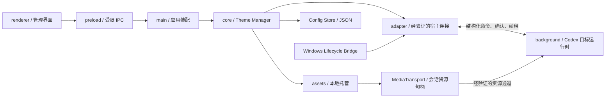

# Codex Theme Engine 技术选型与开发环境设计文档 v1.0

| 项目 | 内容 |
| --- | --- |
| 产品名称 | codexpaper |
| 技术架构 | Codex Theme Engine |
| 文档版本 | v1.0 |
| 编写及资料核对日期 | 2026-10-14 |
| 目标产品版本 | V1 开放背景导入版 / Dynamic Background Engine |
| 首版平台 | Windows 11 x64；其他系统及架构分别验证 |
| 面向读者 | 桌面开发、宿主适配、媒体渲染与测试开发者 |
| 文档状态 | 技术选型与工程设计；宿主接入、媒体通道及性能仍需实验验证 |
| 建议仓库路径 | `docs/Technical/Codex-Theme-Engine-Technology-Selection-v1.0.md` |
| 核对仓库 | `rgrnb/Codex-Theme-Engine` |
| 核对提交 | `bd7d896daeb2b7fdc9ec5d1e8495f384e37fa36f` |

**选型结论：V1 首选 Electron + TypeScript，管理界面采用 React，开发构建采用 electron-vite，分发打包采用 electron-builder。背景播放优先使用经验证的 Codex 目标页面内的图片、视频元素。** 正式工程在 Phase 0 通过宿主接入与资源预算门槛后冻结依赖版本；Electron 不是宿主兼容性证明，也不能豁免 PRD 的内存要求。

## 1. 文档目的

本文把现有产品要求和架构转化为开发决策，确定 V1 的控制端技术栈、媒体实现、工程目录、开发环境、实施阶段与工程规范，为后续编写 Codex 开发启动 Prompt 提供依据。

本文区分三类内容：

- **产品基线**：沿用 PRD 与 Architecture，开发实现必须满足。
- **本次选型**：确定控制端与工程工具的首选组合，说明选择理由与替代条件。
- **待验证事项**：Codex 接入、Owl 行为、目标媒体加载与真实性能；没有实验报告时不得写成已支持。

### 1.1 已核对的文档

本次实际读取了以下四份原文；PRD 从仓库中的 Word 文件提取正文。引用对话仅用于定位项目背景，不作为运行时证据。

| 文档 | 内容身份与用途 |
| --- | --- |
| [PRD v1.0][P1] | 产品范围、FR 001–016、NFR 001–010、AT 01–20，是功能及发布目标的依据 |
| [Architecture v1.0][P2] | 独立控制端、模块契约、宿主内媒体层、两阶段应用、租约恢复与 M0–M4 |
| [V1 Development Plan v1.1][P3] | T01–T21、G1–G7、图片与视频开发、循环、性能与分发任务 |
| [Technical Research v1.0][P4] | 有限静态样本证据、方案比较、资源通道风险及 E1–E5 实验 |

开发计划在当前仓库的文件名为 `Codex-Theme-Engine-V1-Development-Plan-v1.md`，正文版本为 **v1.1**。本文使用该正文版本，链接指向实际存在的文件。技术调研的部分差异分析引用较早开发计划，不能当作当前 v1.1 的完整现状。

### 1.2 原文差异与执行基线

四份文档的版本路线已经明确，但尚有局部差异。本文按 PRD 与 Architecture 落实产品约束，保留开发计划的任务组织，不把冲突要求并入实现。

| 差异 | 当前材料中的表现 | 本文采用的基线及同步事项 |
| --- | --- | --- |
| 视觉处理 | 开发计划 §2.3、T08 和渲染模块仍要求遮罩或明度处理 | 无强制遮罩、调暗、模糊、改色或改字色；同步删除这些默认处理要求 |
| 显示参数 | 开发计划侧重 `cover`，未完整列出四区域参数 | 实现 `cover`、`contain`、`stretch`；侧栏、主面板、顶部、输入容器不透明度独立控制，默认均为 0% |
| 导入范围 | 开发计划存在扩展名筛选表述 | 保留“所有文件”入口，按内容与目标解码判断；必测格式不是导入白名单 |
| 本地管理 | 开发计划允许仅保留当前资源 | 实现 PRD 的简单资源列表、重命名、删除、预览与取消；不建设在线资源库 |
| 接入修改 | 开发计划列出客户端资源修改候选 | 排除修改官方安装文件的路线，即使有备份也不符合产品基线 |
| 性能 | 开发计划含视频内存 400 MiB、交互增幅 10%、10 分钟采样等目标 | 发布以 PRD/P2 的 350 MiB、20%、至少 30 分钟口径为准；更严格的优化目标与补充测试另列 |
| WebM 编码 | 开发计划要求 VP8；调研列 VP9 候选 | V1 保留 VP8 必测组合，另测 VP9；V2 标准包编码另行冻结 |

正式生成开发 Prompt 前，将上述差异写入 ADR，并同步开发计划对应条目与文档链接。本文没有改写四份原文；不能以“技术选型已完成”宣称所有文档已无差异。

## 2. 项目定位

### 2.1 产品与架构的关系

| 名称 | 定位 |
| --- | --- |
| **codexpaper** | 面向用户发布的产品，安装包、管理界面与产品版本使用此名称 |
| **Codex Theme Engine** | 内部技术架构，由资源、配置、背景、主题业务与宿主适配模块组成 |
| **Codex Desktop** | 被适配的宿主客户端，独立于本产品维护与升级 |

V1 实现类似 Wallpaper Engine 的本地图片与动态视频背景体验：用户导入媒体，在一个选定的 Codex 主工作窗口客户区形成连续背景，控制适配方式、面板不透明度、启停及视频播放。Wallpaper Engine 是体验参考；其工程、脚本和 Workshop 兼容不属于 V1。

OpenAI 公开说明已包含主题、颜色及字体设置，插件文档描述了技能、MCP 与可选 UI 等能力。**本次查阅的公开资料未建立满足本项目全窗口媒体背景的第三方接入契约**，因此不得从“支持插件”推导出“插件可改变任意宿主背景”。[官方外观说明][S1]、[官方插件架构][S2]

### 2.2 V1 必须保持的产品范围

1. 图片和视频均为 V1 必需能力；图片原型只是中间成果。
2. P0 管理一个用户选定的主窗口，连续覆盖侧栏、主内容、网页顶部区域与输入区域。原生非客户区、系统对话框、独立子窗口和嵌入浏览器页面内部不纳入覆盖承诺。
3. 资源按原始字节托管，默认视频静音、循环开启；支持暂停、恢复、循环关闭后保留末帧。无音轨时禁用静音操作并说明状态。
4. 四区域参数只改变面板背景表层，不降低文字或按钮不透明度；不自动处理壁纸亮度和文字颜色。
5. 不改写 `app.asar`、官方资源、主脚本、安装目录或更新文件；运行时覆盖必须可撤销。
6. 导入、预览、应用、持久化、关闭和恢复在本机完成，无需模型服务、OpenAI API 密钥或云端上传。
7. 候选加载失败、取消或提交失败时保留或恢复最后成功背景；“已应用”必须由正确目标的渲染确认与配置提交共同支持。

V2 增加标准主题包与导入导出，V3 增加分享及分发生态。V1 不实现市场、账号、云同步、自动转码、任意脚本壁纸或第三方代码执行。详细范围沿用 [PRD §7–8][P1] 和 [Architecture §11][P2]。

## 3. 技术路线选择

### 3.1 比较对象与前提

比较的是 **codexpaper 独立控制端的实现技术**，不是替换 Codex 客户端。无论选 Electron、Tauri 还是 WPF，都必须单独验证宿主接入；不能通过给独立程序更换框架获得未经证实的 Codex 接口。

以下比较为基于框架机制的工程判断，不是同设备性能实测排名。

| 维度 | Electron + TypeScript | Tauri 2 + Web 前端 / Rust | C# WPF |
| --- | --- | --- | --- |
| Windows 兼容性 | 可建立受支持版本的 Windows 控制端；主进程和窗口 API 易于管理，仍需实测安装、DPI 与原生依赖 | Windows 使用 WebView2，需管理系统 WebView 与 Rust/MSVC 工具链 | 面向 Windows 的原生桌面框架，适合系统事件与 Win32 互操作 |
| 视频渲染能力 | Chromium 媒体元素适合预览及原型，具体编码和硬解仍须验证 | 管理端通过 WebView2 播放，媒体行为受其版本及设备影响 | 可使用 `MediaElement` 等多媒体能力，格式仍依赖实际媒体后端 |
| Web 技术生态 | TypeScript、React、HTML/CSS 可覆盖管理界面与宿主网页运行时代码 | Web UI 可复用，但本地业务和系统桥接通常新增 Rust 边界 | 管理 UI 以 XAML/C# 为主；宿主网页媒体层仍需 JS/TS，形成两套运行环境 |
| 开发效率 | 与 Architecture 已建议的 TS 业务契约吻合，开发调试与构建链集中 | 熟悉 Rust 时可高效开发；当前架构需要处理额外跨语言契约 | 熟悉 .NET 的团队可快速完成原生管理端；网页运行时适配仍需单独工程化 |
| 后续主题扩展 | 容易共享描述、验证规则和预览逻辑；不能因此开放任意主题代码 | 同样可采用声明式主题与 Web 预览，需要保持 Rust/TS 契约一致 | 声明式主题可实现；Web 预览与宿主渲染复用成本相对更高 |
| 资源预算 | 随控制端分发浏览器运行时，须尽早测空闲及峰值内存 | 系统 WebView 可减少随应用分发的浏览器体积；内存是否达标必须测量 | 原生管理界面可作为预算替代候选；不能无实测宣称更省内存 |
| V1 结论 | **首选；通过 Phase 0 后冻结** | 控制端预算未达标时的备选 | Windows 原生集成成为主要瓶颈时的备选 |

框架事实依据：[Electron 窗口与运行环境][S3]、[Tauri WebView 版本][S4]、[Tauri Windows 前置依赖][S5]、[WPF 概述][S6]、[WPF 多媒体][S7]。表中的效率、复用成本和备选顺序是本项目的选型判断。

### 3.2 推荐 Electron + TypeScript 的理由

采用 Electron + TypeScript，主要因为现有 Architecture 已按 TS 契约组织主题业务、资源索引、Adapter 与浏览器运行时。统一类型定义和构建方式能减少跨模块数据转换，管理预览可以复用图片、视频渲染逻辑，开发者也可在同一工具链内定位事务、界面与媒体问题。

React 只用于管理界面。宿主内 Background Engine 使用精简 TypeScript + DOM/CSS，避免为背景层额外装载 React 或依赖宿主 React 内部对象。核心业务不导入 Electron 窗口组件，使后续替换管理端外壳时保留资源库、模型与适配契约。

**Electron 的首选地位有两项准入条件：**宿主内图片与视频背景可行；完整控制端加宿主增量满足 PRD，特别是图片额外内存 ≤150 MiB、视频 ≤350 MiB。若管理端常驻开销已经使预算不可达，Phase 0 内完成精简与 Tauri/WPF 对照，形成替代 ADR 后再正式初始化工程。不能将管理端从统计中排除，也不能直接放宽 PRD。

### 3.3 Codex 接入路线与窗口方案

| 路线 | 本文决策 | 验证条件 |
| --- | --- | --- |
| 正式扩展入口 | 优先调查；确实满足需求时采用 | 明确入口、目标范围、媒体与恢复契约；不能仅凭插件列表判定可用 |
| 受控 CDP 运行时适配 | 当前首选技术验证候选，隔离于 `adapter/` | 指定构建允许连接、目标身份正确、仅本机可达、媒体与四区域适配成功、正常及异常恢复可重复 |
| 外置 Overlay / 背后窗口 | 仅用于预览与窗口跟随对照实验 | 纯外置窗口不能保证媒体位于不透明 Codex 内部文字下方；若要使宿主透明，仍须通过运行时适配门槛 |
| 修改安装资源或重打包宿主 | 排除 V1 实施 | 与 PRD 的安装完整性约束冲突 |

独立 Electron 程序不能直接取得另一个应用的 `webContents`。通用 `remote-debugging-port` 与 CDP Runtime 文档只说明候选机制，不证明 Codex/Owl 的发行构建开放同样入口；主进程 Node inspector 也不能替代渲染页面目标。[Electron 启动参数][S8]、[CDP Runtime][S9]

默认设计不将媒体窗口跨进程嵌入 Codex，不使用全局置顶来维持背景，也不通过 `SetParent` 强行改变宿主窗口关系。Windows 窗口事件用于检测与生命周期同步；跨进程窗口重设父级还涉及 DPI 与样式边界。[Win32 SetParent][S10] 若所有符合约束的宿主路线失败，记录该构建不支持并继续研究，不能把独立播放器作为 V1 完成证明。

## 4. V1 推荐技术栈

### 4.1 技术组合与版本策略

| 层次 | 推荐选择 | 实施要求 |
| --- | --- | --- |
| 编程语言 | TypeScript；启用 `strict` | 共用模型与命令契约；系统原生代码仅在明确需要时引入 |
| 独立桌面框架 | Electron 的受支持稳定版本 | Phase 0 使用候选，通过后锁定精确版本；宿主 Owl 版本单独登记 |
| 管理界面 | React + TypeScript + CSS Modules / CSS 变量 | 小型单页面；设置、预览、库列表与恢复入口，不引入完整主题商城 |
| 宿主背景运行时 | TypeScript 编译为产品自有浏览器 JS；DOM/CSS | 单一媒体层；不依赖 Electron/Node 全局对象或宿主框架私有 API |
| 开发构建 | electron-vite + 兼容的稳定 Vite | 分别构建 main、preload、renderer，额外生成无 Node 依赖的宿主 runtime bundle |
| 打包分发 | electron-builder 稳定版；当前稳定文档为 v26 | Windows x64 用户级安装；开发期可输出便携测试包，RC 验证干净安装与卸载 |
| 开发 Node.js | **Node.js 24.x LTS** | 初始化时固定一个最新修补版本，在 `.node-version` 和 CI 中一致使用 |
| 包管理 | **pnpm**；本次官方文档的稳定线为 12.x | Phase 1 固定精确版本到 `packageManager`，提交唯一 `pnpm-lock.yaml` |
| 运行时数据校验 | Zod | 校验配置、索引、描述及 IPC 负载；宿主 bundle 只保留必要校验 |
| 本地存储 | UTF-8 JSON + Node.js 文件 API | 版本化、备份、临时写入与原子提交；V1 不需要数据库服务 |
| 日志 | 统一 Logger 接口 + 本地 JSON Lines 文件 | 控制端集中写入和轮转，宿主只发送结构化脱敏事件 |
| 测试 | Vitest + 真实宿主集成/兼容测试 | 自动化覆盖事务、状态和故障恢复；解码、层级与安装必须实测 |
| 代码质量 | TypeScript 检查、ESLint、Prettier | 与实际选定 TS/React 版本配套，作为 CI 检查 |

依据：[Node.js 发布与 LTS 状态][S11]、[electron-vite 构建入口][S12]、[electron-builder 稳定文档][S13]、[pnpm 安装及兼容表][S14]、[Zod][S15]、[Vitest][S16]。Node.js 24 用于开发和构建；安装后的 Electron 使用其自带 Node/Chromium，用户不必另装开发 Node.js。系统 Node 版本不替代 Electron runtime 版本记录。

具体 Electron、React、TypeScript、Vite 和工具补丁版本在 Phase 0 后形成一组可重复构建的依赖快照。正式 `package.json`、锁文件和 CI 不使用浮动 `latest`；升级依赖后需复跑受影响的兼容及恢复用例。选择稳定文档时注意 electron-builder 网站首页存在未发布的 next 文档，不能误当作当前稳定版本。

### 4.2 图片与视频处理方案

**图片：**原文件按内容哈希复制到托管目录，完成类型识别、尺寸检查与实际解码后可应用。目标使用单个图片元素，按 `cover`、`contain`、`stretch` 渲染；保留 alpha，留白与透明下层使用宿主基础背景色。静态图不运行持续帧循环。PNG、JPEG、静态 WebP 与 4K 图片是必测样本，不是扩展名白名单。

**视频：**使用目标页面的 `HTMLVideoElement` 与其实际媒体解码路径，默认静音、循环；不自建 JS 解码器，不逐帧读回 Canvas，不跨控制消息传输视频帧。V1 不默认引入 FFmpeg、VLC 或转码服务；预检不足以识别音轨、编码时，评估可取消的独立探测工具，记录依赖与体积后再引入。

必测基线为 MP4/H.264 和 WebM/VP8，另测调研中的 WebM/VP9。有无音轨、损坏文件、纯音频和伪扩展名分别测试。容器可识别、`canPlayType()` 非空和 `loadedmetadata` 都不能单独证明已显示首帧。[媒体能力预判][S17]

首帧确认结合实际视频帧、目标层级/区域回读与首次视觉核验；可用时使用 `requestVideoFrameCallback()` 辅助。播放质量可用 `getVideoPlaybackQuality()` 采集掉帧，但回调间隔不能直接当作解码掉帧。[帧回调][S18]、[播放质量统计][S19] 管理预览成功不代表 Codex 目标可解码；硬件合成与视频硬解分别确认，低 CPU 或 WebGL 型号不构成硬解证据。

单目标最多一个活动媒体和一个准备中的候选。切换采用准备、可回滚显示、配置提交、释放旧媒体的流程；通过会话、上下文代次和请求编号淘汰过期回执。媒体失败、配置写入失败与回滚失败分别报告。[Architecture §4、§7–9][P2]

### 4.3 资源传输与宿主策略

保留 `Media Service / MediaTransport` 抽象，业务层仅取得可释放的会话资源句柄。以下顺序源于已有研究，不代表通道已通过实验：

| 通道 | V1 处理方式 |
| --- | --- |
| 目标页面 Blob URL | 先验证图片与视频样本；必须在目标上下文生成；测分块暂存、合并、解码与切换峰值 |
| 回环 HTTP 媒体服务 | 作为流式候选；仅在目标有效 CSP 与实际读取允许时采用；视频验证 Range、取消及令牌生命周期 |
| 目标已有文件/协议通道 | 仅使用已经验证可达的入口；独立程序不能替宿主注册 `app:` 或其他协议 |
| Data URL | 可用于小实验，不作为大图或视频默认传输 |

Technical Research 的指定静态样本记录了 Owl/Chromium 壳及媒体策略线索，其中回环 HTTP 未被明确允许，故不得照搬 Architecture 的回环服务候选为已定通道。**这是对既有报告的引用，本次未独立检查安装包或有效运行时策略。** 分块传输可以限制在途消息，不能消除完整视频 Blob 的最终驻留成本。[Research §2.1、§4.2][P4]

分别核对图片 `img-src`、视频 `media-src`、读取 `connect-src` 与适用样式策略，不能互相代替。[W3C CSP][S20] 不关闭 CSP、Web 安全或沙箱，不忽略证书错误。所有合规通道均失败或视频峰值超预算时，停止该构建的发布适配。

### 4.4 配置与资源存储

沿用 PRD 路径，配置与资产不进入 Codex 安装目录：

```text
%LOCALAPPDATA%/codexpaper/
├── config.json
├── config.backup.json
├── library/index.json
├── assets/<content-hash>/source
├── cache/previews/
├── adapters/
├── logs/
└── temp/
```

主题版本目录在 V2 启用。Electron 自身缓存如需单独配置，使用产品目录下专属子目录，不能把宿主缓存纳入产品资产或混写 `config.json`。

- `config.json` 保存 `configVersion`、启用意图、活动条目、区域设置、循环、静音、暂停意图、启动恢复和后台策略。
- `library/index.json` 保存资产、条目与引用关系；实际路径只由 Asset Store 解析。
- `sessionId`、调试端口、短期凭据、窗口句柄、播放位置和租约属于会话状态，不进入共享描述或永久恢复依据。
- 配置和索引由单一写入队列管理；临时写入、校验、同目录替换并保留有效备份。资产完成发布后才提交索引引用，失败撤销本次暂存内容。
- 删除条目不改写用户原文件；共享资产无引用且无活动会话使用后才能回收。迁移先备份，较新结构不得被旧程序覆盖。

默认安装后背景关闭，成功应用后开启；启动恢复只在用户启动产品、配置有效及宿主重新验证通过时执行。系统登录自启动默认关闭，属于 P1。

## 5. V1 项目目录结构设计

采用单仓库、模块化单体。目录是现有架构职责在 Electron 工程中的实现映射，不能因更名形成另一套核心模型。

```text
codexpaper/
├── README.md
├── AGENTS.md
├── package.json
├── pnpm-lock.yaml
├── pnpm-workspace.yaml
├── .node-version
├── .editorconfig
├── .gitattributes
├── electron.vite.config.ts
├── electron-builder.yml
├── tsconfig.node.json
├── tsconfig.web.json
├── tsconfig.host.json
├── resources/                         # 产品图标、安装资源
├── src/
│   ├── main/                          # 启动、窗口、IPC 注册、退出协调
│   ├── preload/                       # 管理界面的受限桥接 API
│   ├── renderer/                      # React 管理界面、预览、设置
│   ├── core/
│   │   ├── contracts/                 # 共用模型、命令、回执、错误
│   │   ├── theme-manager/             # 应用业务、准备/提交/回滚
│   │   ├── config-store/              # 写入、备份、校验、迁移
│   │   └── state/                     # 启用意图、请求与会话状态
│   ├── assets/                        # 导入、哈希、托管、引用与预检
│   ├── media-service/                 # 可替换资源通道、授权和释放
│   ├── background/
│   │   ├── runtime/                   # 编译到宿主的自有 Runtime Bridge
│   │   ├── renderers/                 # 图片与视频 prepare/mount/dispose
│   │   ├── surface/                   # 四区域背景表层参数
│   │   └── lifecycle/                 # 播放意图、暂停原因、租约清理
│   ├── adapter/
│   │   ├── contracts/                 # 沿用架构 CodexAdapter 契约
│   │   ├── discovery/                 # 目标身份、构建及页面识别
│   │   ├── cdp/                       # 经验证后启用的 CDP 候选实现
│   │   └── compatibility/             # 构建、区域映射、能力记录
│   ├── theme/                         # 内部描述校验；V2 才扩展包解析
│   ├── platform/windows/              # Windows 事件与必要原生桥接
│   ├── diagnostics/                   # Logger、采样与脱敏诊断
│   └── utils/                         # 少量通用纯函数
├── tests/
│   ├── unit/
│   ├── integration/
│   ├── compatibility/
│   └── fixtures/                      # 有来源及许可说明的测试媒体
├── scripts/                           # 构建、环境检查与诊断脚本
├── work/                              # 不进入分发的原型与临时报告
├── docs/
│   ├── PRD/
│   ├── Architecture/
│   ├── Development/
│   ├── Research/
│   ├── Technical/
│   └── decisions/                     # ADR 与冻结记录
└── .github/workflows/                 # Windows 检查及构建
```

`out/`、安装包输出、临时原型、用户媒体与本地配置不提交。原生桥接的源码和工具链仅在 Phase 0 证明确有必要时加入，不为未来功能提前创建可执行插件系统。

### 5.1 模块映射与依赖方向

| 现有 Architecture 模块 | 工程目录 | 边界 |
| --- | --- | --- |
| Management UI | `renderer/` | 经 preload 调用业务，不访问宿主页面或任意路径 |
| Theme Manager / Config Store | `core/` | 管理事务与持久状态，不包含 DOM 选择器 |
| Theme Parser | `theme/` | V1 只校验内部描述；不交付 `.codextheme` 导入导出 |
| Asset Store / Resource Loader | `assets/` | 内容识别与托管，不承担播放 |
| Media Service | `media-service/` | 返回可释放句柄，不假定 HTTP 唯一可用 |
| Codex Adapter / Compatibility Registry | `adapter/` | 集中管理目标、协议及构建差异 |
| Host Runtime / Background Engine | `background/` | 无 Node 依赖，在正确目标中显示、回执和清理 |
| Windows Lifecycle Bridge / Diagnostics | `platform/windows/`、`diagnostics/` | 系统事件与诊断，避免读取宿主业务内容 |



`main/` 负责装配，不堆积核心业务；管理端 IPC 和宿主协议是两个独立边界。`core/contracts` 是规范模型来源，Adapter 特有类型不能变成第二套 `ThemeDescriptor`。宿主 bundle 在构建中检查不得包含 Node/Electron 文件系统权限。

## 6. 开发环境要求

### 6.1 系统与硬件

| 项目 | 开发及首版验证要求 |
| --- | --- |
| 操作系统 | Windows 11 x64，使用仍受支持的系统构建并记录版本；Windows 10、ARM64 等不默认进入产品支持范围 |
| 参考硬件 | 至少四核 CPU、16 GiB 内存、SSD、记录型号与驱动的集成 GPU；补一台独立 GPU 设备交叉验证 |
| 显示环境 | 1920×1080 主窗口；测试 100%、125%、150%、200% 缩放、最大化、跨屏及窗口恢复 |
| 开发运行时 | Node.js 24.x LTS、固定 pnpm、固定 Git 版本；CI 与本地版本一致 |
| 原生编译 | 仅需自编译 Node-API/Windows 模块时安装 MSVC C++ Build Tools、匹配 Windows SDK 与所选构建链所需 Python |
| 宿主样本 | 明确安装渠道、包构建、应用版本、实际壳/浏览器版本、Adapter 版本和目标窗口 |

Windows 11 是产品首版测试基线，不是对 Electron、Tauri 或 Codex 所有可运行系统的概括。开发 Node.js 与所选 Electron 自带 Node.js 分别记录。GUI 与宿主验证在真实 Windows 会话中完成，不能仅凭 WSL、容器或无窗口 CI 的成功证明桌面兼容。

### 6.2 IDE、Git 与调试工具

推荐 VS Code，配置 TypeScript、ESLint、Prettier 和主进程/管理界面调试任务；熟悉 JetBrains 的开发者可使用 WebStorm。只有进入 WPF 备选或原生桥接开发时再引入对应 Visual Studio 工具链。

Git 使用 UTF-8 文本与统一 LF，`.gitattributes` 管理文本换行和二进制媒体。提交源码、锁文件、测试定义、构建配置与文档；个人路径、用户数据、调试凭据、安装包和大型性能录屏放在仓库外或明确的产物存储位置。

调试工具按用途选择：

| 任务 | 工具与使用边界 |
| --- | --- |
| 控制端界面与性能 | Electron DevTools、Performance/Memory；仅调试产品自身窗口 |
| 主进程与预检任务 | VS Code 调试、结构化阶段日志、可取消任务跟踪 |
| 宿主适配 | 通过已验证入口识别的正确页面目标；不把普通 Chrome 或 Node inspector 当作宿主 UI |
| 进程及窗口身份 | Windows 任务管理器、Process Explorer、必要时 Spy++ 或只读窗口枚举 |
| CPU/内存/GPU | Windows Performance Recorder/Analyzer、系统计数器与媒体后端诊断；记录进程树和统计口径 |
| 显示与恢复 | 四区域截图、循环边界记录、关闭/重载/强制终止与租约恢复记录 |

Technical Research 曾记录包版本 `26.1007.9446.0`、Owl 声明等有限静态观察，作为实验线索保留，不写成“所有 Codex 均为标准 Electron”。开始开发时重新核对目标；不能沿用历史端口、选择器或样本版本作为当前事实。[Research §2][P4]

### 6.3 环境冻结与启动约定

Phase 1 应交付 `docs/Technical/Development-Environment.md`，登记实际 OS、CPU/GPU、Node、pnpm、Electron、内嵌 Chromium/Node、前端与打包工具的精确版本和初始化选择。开发入口、锁文件及 CI 使用同一组版本。

工程建立后统一暴露以下命令；本表是待实现的工程约定，不代表仓库目前已有脚本：

| 命令 | 用途 |
| --- | --- |
| `pnpm install --frozen-lockfile` | 按已提交快照安装依赖 |
| `pnpm dev` | 启动产品管理端开发环境 |
| `pnpm typecheck` | 分别检查 Node、管理界面及宿主 runtime |
| `pnpm lint` / `pnpm format:check` | 规范检查 |
| `pnpm test` | 纯逻辑、状态、事务及故障恢复自动化 |
| `pnpm build` | 构建控制端与宿主 bundle |
| `pnpm package:win` | 输出 Windows x64 测试安装包 |
| `pnpm diagnose` | 输出脱敏环境与产品状态；不自动接入或重启宿主 |

初次生成锁文件使用普通安装，随后校验冻结安装。若 pnpm 阻止 Electron/原生依赖的必要安装脚本，应明确审核并配置所需包，记录在项目配置中，不全局放开所有依赖脚本。[pnpm 构建脚本配置][S21]

## 7. V1 开发实施方案

下面按本次要求组织 Phase 0–5，同时保留既有 M0–M4 与 T01–T21 的任务含义。Phase 编号用于技术实施组织，不覆盖原开发计划编号。

### 7.1 Phase 0：技术验证

**目标：**在正式搭建产品前，证明符合 PRD 的宿主接入、图片/视频显示、资源通道与外壳预算可行。对应 M0、T01–T06 和 E1–E5 的前置实验。

执行步骤：

1. 固定目标安装渠道、构建、进程、主窗口、页面与壳版本，形成“已观察 / 推测 / 待验证”记录。
2. 调查正式入口；若不足，再验证受控 CDP，分别检查监听范围、实例行为与正确页面上下文。需要特殊启动时保留用户主动操作流程，不自动结束其现有工作。
3. 用最小产品自有 runtime，在真实目标验证图片、MP4/H.264、WebM/VP8，补测 VP9；逐项核对四区域、三种适配和面板背景参数。
4. 验证目标 Blob/资源读取方案及视频传输峰值；检查真实有效策略，不仅检查静态 HTML。
5. 验证输入、滚动、菜单、审批对话框和窗口控制；关闭恢复与强制终止后的目标侧租约清理必须可重复。
6. 在受控自动更新条件下核对安装文件前后哈希；记录原生标题栏边界。
7. 测 Electron 控制端空闲、管理 UI 打开/关闭、图片与视频总增量；若预算不可达，在本阶段完成外壳替代对照。

**交付：**架构身份报告、真实 Codex 图片/视频演示、资源通道记录、恢复与完整性证据、预算可行性数据和技术 ADR。

**进入条件：**至少一个明确构建通过核心接入、媒体与恢复门槛，外壳预算可行。失败时继续实验或更换控制端方案；不把独立预览或透明窗口 Demo 算作通过。

### 7.2 Phase 1：项目初始化

**目标：**将已验证方案落成可构建、可调试、可打包的工程，对应 T06 的工程冻结及后续产品任务基础。

初始化 TS/React Electron 工程，按第 5 节建立职责边界；锁定依赖和环境；配置三个 TS 执行环境、宿主 bundle、类型化 preload、配置写入、日志与 Windows CI。构建最小管理窗口与固定运行时消息，不提前开发 V2 包或 V3 分发。

**交付：**工程骨架、环境文档、锁文件、基础检查和测试包。

**进入条件：**开发启动、检查、构建和打包可重复；发布构建不依赖本机源码绝对路径或开发服务器。

### 7.3 Phase 2：Background Engine 开发

**目标：**把原型渲染封装为可恢复的背景核心，对应 M1/M2 的渲染契约及 T07–T12 的公共逻辑。

实现图片/视频渲染器、Surface Controller、Runtime Bridge、应用事务与资源句柄释放。保留一个活动媒体和一个候选；用请求编号与上下文代次控制并发。状态覆盖准备、活动、暂停、结束、恢复和失败；用户意图与实际状态分开保存。

四区域参数只作用于背景表层，支持三种适配且不默认遮罩。候选失败、提交失败和取消均验证旧背景保留；正常清理与重复清理幂等。

**交付：**背景核心、管理预览复用接口、状态/事务自动化测试及初步目标运行记录。

**进入条件：**纯逻辑测试通过，已验证宿主中不存在重复播放器、过期提交或不可清理覆盖。Mock 和预览只补充验证，不能替代 Phase 0 的真实证据。

### 7.4 Phase 3：Codex Adapter 验证与工程化

**目标：**对 Phase 0 已成功的接入方案完成产品级兼容与故障验证，对应 T02、T04–T06、T14–T15。

工程化目标发现、能力握手、兼容记录、版本化区域映射与重连。未知构建停止应用但保留导入、预览、关闭与恢复入口；重载后递增上下文代次，不直接复用旧页面标识。重连沿用架构的退避和最长 60 秒窗口，耗尽后等待用户重试。

Windows 事件首先使用产品 `powerMonitor` 的锁屏/休眠信息与已验证目标可见性信号；确有缺口时引入最小 Win32 事件桥接，限制在目标身份、窗口状态和 DPI，避免高频窗口轮询或强制改变宿主层级。[Electron powerMonitor][S22]

验证路由重建、侧栏折叠、主窗口销毁、DPI 跨屏、宿主外观变更及与其他主题工具的所有权冲突。控制端每 2 秒续租、目标连续 10 秒未续租触发清理；计时冻结与休眠后必须先检查过期租约。

**交付：**可复现 Adapter、首个兼容记录、生命周期与异常恢复报告。

**进入条件：**正确目标映射、四区域连续背景、交互和清理均通过。恢复失联时明确显示未确认，不根据发送命令成功虚报恢复。

### 7.5 Phase 4：图片/视频背景产品闭环

**目标：**完成 FR 001–016 的用户流程，对应 M1–M3 与 T07–T15。

交付单文件开放导入、原字节复制和哈希去重、简单资源列表、重命名与删除、预览/取消、应用/关闭、三种适配与四区域设置。视频加入首帧确认、播放暂停、静音循环、末帧、无音轨说明及自动播放受阻后的用户播放入口。

持久化最后成功配置及暂停意图；窗口最小化、锁屏和休眠形成独立暂停原因，全部自动原因解除且没有用户暂停才恢复。普通失焦默认不暂停；用户主动停止后不能因窗口恢复重新启用。导入文件移动或删除后使用托管副本。

**交付：**图片和视频完整原型、管理界面、错误与恢复流程、功能矩阵。

**进入条件：**PRD P0 用户流程及开发计划相关用例通过；真实 Codex 中图片和两类基线视频均可展示，不能以图片闭环替代完整 V1。

### 7.6 Phase 5：性能优化、稳定性与发布

**目标：**完成 M4、T16–T21，基于产品 RC 数据判断发布，而非只完成构建。

按第 7.7 节采样并修复实际瓶颈，优先消除重复解码、整文件复制峰值、无界缓存、持续 DOM 重扫和多余合成。循环复用播放器，至少测试 100 次已知无缝样本循环；延续开发计划 P95 ≤67 ms、最大 ≤100 ms 的补充循环目标，但与 PRD 基线分开记录。

验证最小化/恢复 30 次、关闭/重开 10 次、休眠/唤醒 5 次，另完成 8 小时稳定性、快速切换、故障注入、干净安装、退出与卸载恢复。关闭管理 UI 后释放预览播放器，保持必要控制会话；此优化不排除管理端进程预算。

发布前核对 FR 001–016、AT 01–20、兼容矩阵、媒体编码矩阵、NFR 与恢复完整性；合格媒体/构建组合各重复应用 10 次。至少两类 GPU 设备交叉验证，10 名首次使用者至少 9 名在 3 分钟内完成导入与应用。

**交付：**RC 安装包、原始性能数据、兼容和恢复报告、用户说明、已知限制与发布记录。任何核心接入、视频、安装完整性或恢复失败均阻断相应构建的 V1 发布。

### 7.7 性能基线与测量方法

以下数值沿用 PRD 与 Architecture，是**验收目标**，尚无本次实测结果。

| 编号 | 指标 | V1 目标 |
| --- | --- | --- |
| NFR 001 | 已托管图片应用时延 | 热缓存 P95 ≤2 秒 |
| NFR 002 | 已托管视频可见首帧 | 热缓存 P95 ≤3 秒 |
| NFR 003 | 适配/面板不透明度反馈 | P95 ≤200 ms |
| NFR 004 | 固定输入/滚动延迟 | P95 相对背景关闭增幅 ≤20% |
| NFR 005 | 整机 CPU 平均额外占用 | 图片 ≤5 个百分点；1080p30 视频 ≤10 个百分点 |
| NFR 006 | 控制端与目标相关进程合计额外内存 | 图片 ≤150 MiB；视频 ≤350 MiB |
| NFR 007 | 30 分钟连续视频 | 掉帧比例 ≤1%；无持续卡死或黑屏 |
| NFR 008 | 用户关闭/恢复、异常租约 | 恢复 P95 ≤2 秒；异常租约 ≤10 秒触发清理 |
| NFR 009 | 8 小时稳定性 | 无引擎导致崩溃；预热后内存无持续增长 |
| NFR 010 | 关闭/切换回收 | 关闭后 5 秒内释放媒体、URL、句柄；50 次切换无线性增长 |

参考机为 Windows 11 x64、至少四核/16 GiB/SSD、明确型号与驱动的集成 GPU，1920×1080 单目标。静态图样本为 ≤20 MiB 的 4K 图，视频为 ≤200 MiB、60 秒、1080p30；另以开发计划的 SDR、8-bit、4:2:0 及 ≤8 Mbps 样本组织编码测试。样本范围用于比较，不变成文件选择入口限制。

记录 B0（同场景 Codex、产品未运行）、B1（控制端空闲且背景关闭）、B2（图片）、B3（视频）。B2/B3−B0 用于完整增量，B1−B0 解释控制端成本；不能只使用 B2/B3−B1 满足 PRD。各场景同条件预热、至少采样 30 分钟并重复三轮；应用计时排除文件选择与复制，热缓存每样本至少 20 次。导入、Blob 传输、解码和切换峰值单列。

CPU 按整机容量 100% 归一化，相关进程求和。若由 CPU 时间换算，`CPU% = ΔCPU秒 / (Δ墙钟秒 × 逻辑处理器数) × 100`。内存先冻结工具、进程归属及工作集等统一口径，同时记录 Private Bytes 趋势；不能混用两种数值达标。GPU 解码、合成、共享及专用显存分别报告，避免简单相加或重复计入系统内存。

开发计划的视频 CPU ≤5 个百分点、交互增幅 ≤10% 可保留为更严格优化目标，GPU 与循环指标作为补充；其视频 400 MiB 和 10 分钟采样不能替代上述发布预算与时长。4K 视频、60 fps、HDR 和多窗口另做扩展验证，不静默降帧、压缩或改写原文件。不可测指标注明缺口，不填零或虚报通过。

### 7.8 后续 Codex 开发 Prompt 的依据

开发启动指令应要求按以下顺序执行：

1. 读取 PRD、Architecture、Development Plan v1.1、Research 和本文，建立需求/任务/验收追踪；同步第 1.2 节差异。
2. 先完成 Phase 0，输出身份、接入、媒体、恢复、安装完整性与预算证据；证据不足时停留验证阶段。
3. 通过门槛后按首选栈冻结依赖并初始化工程；遵循第 5 节权限和模块边界。
4. 逐阶段交付图片与视频完整闭环，报告实际测试、失败项与限制，不提前进入 V2/V3。
5. 不假设 Codex 背景 API、默认 CDP 端口、跨应用 `webContents` 或任意协议可用；不修改宿主安装文件，不强制视觉处理。
6. 最终以真实 Codex 画面、P0/NFR/恢复数据及可安装 RC 判断 V1 完成；没有数据时明确标记未验证。

## 8. 工程规范

### 8.1 Git 提交与版本管理

采用一套演进代码库，禁止复制 V1/V2/V3 三套产品目录。主分支保持可构建，功能与修复使用短期分支，如 `feat/background-engine`、`fix/adapter-reconnect`、`docs/technology-selection`。

提交采用 Conventional Commits：`feat`、`fix`、`refactor`、`perf`、`test`、`docs`、`build`、`ci`、`chore`；scope 按模块，如 `feat(background): add video pause reasons`。一个提交聚焦一个可审查变化，不混入用户媒体或个人配置。重大契约变化注明迁移与兼容影响。

PR 说明应描述触发场景、最终行为、验证与限制；涉及宿主适配时登记构建、Adapter 版本、四区域/恢复结果。产品标签使用 `v1.0.0` 等语义版本，文档版本、适配器版本和主题结构版本分别管理。

### 8.2 代码组织与执行边界

- `core` 与 `theme` 保持可测试的业务/数据职责，Electron、DOM 与 Windows 行为通过接口隔离。
- preload 仅暴露明确命名的操作；IPC 检查来源、类型、范围与取消，不暴露任意脚本、系统命令或文件读取。
- 产品管理界面采用 `contextIsolation: true`、`nodeIntegration: false`、可用的 sandbox 与最小 CSP；宿主原有安全设置不被改变。[Electron 安全建议][S23]
- runtime 是固定产品逻辑，媒体名称、路径和主题字段通过结构化参数传递，不拼接到可执行脚本；不执行主题作者代码。
- 选择器、构建匹配和区域映射集中于 `adapter`；不依赖 React Fiber，不全局扫描/透明化所有元素。
- 每个异步操作具有超时、取消及所有权，命令包含会话/目标/上下文代次/请求编号；恢复、释放和重试幂等。
- 自动化重点覆盖状态转移、过期请求、配置提交、引用回收与故障恢复。真实宿主解码、DPI、层级和视觉效果不能只用 Mock 通过。

### 8.3 日志规范

统一 `debug`、`info`、`warn`、`error`。记录时间、模块、阶段、错误码、请求/会话标识、构建与 Adapter 版本、脱敏资产标识及耗时；不要逐帧输出普通日志。宿主事件经受控通道汇总，产品日志落在自己的 `logs/`。

默认不记录完整来源路径、媒体内容、聊天、输入、工作目录或短期令牌。敏感错误先归类并脱敏，不直接保存完整调试协议报文。日志保留上限沿用 PRD 的 7 天或 20 MiB，先达到任一上限即清理或轮转；不自动上传。诊断导出由用户主动发起，说明范围并允许取消。

建议错误分类为 `HOST_UNSUPPORTED`、`HOST_TARGET_MISMATCH`、`HOST_DISCONNECTED`、`MEDIA_CHANNEL_BLOCKED`、`MEDIA_DECODE_FAILED`、`FIRST_FRAME_TIMEOUT`、`CONFIG_COMMIT_FAILED`、`RESTORE_UNCONFIRMED`。名称为本产品内部规范，不是 Codex 官方错误码。

### 8.4 配置与生命周期规范

`UserConfig`、`LibraryEntry`、`ThemeDescriptor`、`RuntimeSession` 和 `CompatibilityRecord` 沿用 Architecture 契约。配置版本、描述版本、未来主题 Schema、作品版本、引擎和 Adapter 各自管理。

`enabled` 和用户暂停意图不被自动暂停覆盖；运行状态必须来自当前会话。正常退出先停止候选/活动媒体、撤销所属覆盖、释放授权与 URL、关闭连接，再退出控制端。恢复只撤销仍属于本会话的改动，不覆盖用户期间修改的官方主题。

异常恢复由目标 runtime 自行维护租约，不能依赖已经终止的控制端。系统休眠或页面冻结时不保证按墙钟执行清理，恢复执行后先核对租约；如果实测不能满足活动目标的 PRD 清理要求，该构建不得通过发布准入。[Architecture §10][P2]

### 8.5 工程决策与证据管理

在现有 ADR 001–008 后追加选型、控制端预算、资源通道、Windows 事件桥接与基线统一记录，避免复用编号覆盖旧结论。每份 ADR 写明上下文、候选、决定、证据、代价、状态与重评条件。

实验和兼容报告登记日期、产品提交、安装渠道/构建、实际 runtime、OS/DPI、GPU/驱动、媒体哈希/编码、步骤、预期/实际、原始测量位置、恢复结果和结论。由旧文档引用的静态观察标记为“已有报告证据”，本次没有复测的内容不得标记“本次已验证”。

## 9. 技术风险

| 风险 | 影响 | 对策与验证 | 阻断条件 |
| --- | --- | --- | --- |
| Codex 接入不确定性 | 无正式背景契约；调试入口不可达或目标错误 | Phase 0 分别验证正式入口/CDP、目标身份和会话恢复；未知构建不应用 | 没有符合约束的接入时，不发布该构建适配 |
| Electron / Owl 行为差异 | 通用参数、API 或协议能力与样本不一致 | 产品 Electron 与宿主 Owl 分别登记；运行时能力探测；按构建维护 Adapter | 必需能力缺失或错误目标无法排除 |
| 媒体通道被阻断 | HTTP、文件或对象 URL 在预览成功但宿主失败 | 分别测有效 CSP、目标上下文 Blob、视频范围与生命周期；不关闭策略 | 图片或视频无可用且预算合格的通道 |
| Electron 控制端预算 | 壳、管理 UI、预览或候选内存使 PRD 超标 | Phase 0 测完整增量；释放不用的预览；必要时对照 Tauri/WPF | 图片 >150 MiB 或基线视频 >350 MiB 且未解决 |
| 视频性能与硬解差异 | 编码、驱动、多 GPU 或软件回退导致 CPU、掉帧和合成超标 | 基线编码/设备矩阵、真实后端与帧统计、单播放器、峰值及 8 小时测试 | 必测视频、交互或 NFR 不达标 |
| Windows 窗口层级与 DPI | 外置窗口遮挡 UI、跨屏错位、背景覆盖其他应用 | 优先宿主内统一视口；外置方案只作对照；事件驱动生命周期，测试客户区与 DPI | 四区域无法连续显示、抢焦点或覆盖无关应用 |
| 宿主更新与 DOM 重建 | 区域失配、覆盖被移除或旧请求误提交 | 精确构建兼容记录、有限观察器、代次与幂等恢复，新构建重跑回归 | 未知构建自动接入，或区域缺失仍报告成功 |
| 故障恢复与计时节流 | 进程终止后残留背景、播放或样式 | 目标侧租约、所有权清理、暂停原因、冻结/唤醒测试 | 正常恢复或活动目标异常清理无法确认 |
| 资源与配置一致性 | 导入半成品、切换后配置失配、删除共享资产 | 哈希托管、引用管理、准备提交回滚、备份和原子持久化 | 用户原文件受损、资产误删或成功状态虚报 |

### 9.1 正式编码前必须冻结的事项

1. 首个支持的宿主构建、安装渠道、窗口/页面目标与接入条件。
2. 控制端外壳预算是否合格，及 Electron/Node/pnpm/构建工具的精确依赖组合。
3. 图片和视频的目标资源通道、在途限制、峰值预算与释放策略。
4. 四区域定位、背景层叠关系、三种适配和不透明度参数行为。
5. 自动播放受阻、无音轨、循环结束、系统暂停与用户暂停的状态契约。
6. 目标侧租约、正常恢复、后台计时和安装完整性证据。
7. 性能采样工具、进程归属、CPU/内存口径与第 1.2 节文档差异的同步修订。

未冻结内容继续作为实验项，不编造正式接口或版本兼容承诺。未来正式入口可通过新增 Adapter 替换连接方式，保留业务、资产、渲染与配置管线。

## 附录 A：项目原文与技术资料

项目原文链接固定到本次核对提交；技术资料于 2026-10-14 实际查阅。官方和维护方资料说明通用机制，不替代指定 Codex 构建的实验。`latest`、CDP `tot` 与软件版本会更新，正式冻结时再次核对。

| 分类 | 资料 |
| --- | --- |
| 项目基线 | [PRD][P1]、[Architecture][P2]、[Development Plan v1.1][P3]、[Technical Research][P4] |
| 官方公开能力 | [外观设置发布说明][S1]、[插件架构][S2] |
| 候选桌面框架 | [Electron BrowserWindow][S3]、[Tauri WebView][S4]、[Tauri 前置依赖][S5]、[WPF][S6]、[WPF 多媒体][S7] |
| 宿主与窗口 | [Electron 启动参数][S8]、[CDP Runtime][S9]、[Win32 SetParent][S10]、[Electron powerMonitor][S22] |
| 开发工具 | [Node.js LTS][S11]、[electron-vite][S12]、[electron-builder v26][S13]、[pnpm][S14]、[Zod][S15]、[Vitest][S16]、[pnpm 构建脚本配置][S21] |
| 媒体与执行边界 | [canPlayType][S17]、[requestVideoFrameCallback][S18]、[getVideoPlaybackQuality][S19]、[CSP][S20]、[Electron 安全][S23] |

[P1]: https://github.com/rgrnb/Codex-Theme-Engine/blob/bd7d896daeb2b7fdc9ec5d1e8495f384e37fa36f/docs/PRD/Codex-Theme-Engine-PRD-v1.0.docx
[P2]: https://github.com/rgrnb/Codex-Theme-Engine/blob/bd7d896daeb2b7fdc9ec5d1e8495f384e37fa36f/docs/Architecture/Codex-Theme-Engine-Architecture-v1.0.md
[P3]: https://github.com/rgrnb/Codex-Theme-Engine/blob/bd7d896daeb2b7fdc9ec5d1e8495f384e37fa36f/docs/Development/Codex-Theme-Engine-V1-Development-Plan-v1.md
[P4]: https://github.com/rgrnb/Codex-Theme-Engine/blob/bd7d896daeb2b7fdc9ec5d1e8495f384e37fa36f/docs/Research/Codex-Theme-Engine-Technical-Research-v1.0.md
[S1]: https://learn.chatgpt.com/docs/changelog
[S2]: https://developers.openai.com/plugins/concepts/plugins
[S3]: https://www.electronjs.org/docs/latest/api/browser-window
[S4]: https://v2.tauri.app/reference/webview-versions/
[S5]: https://v2.tauri.app/start/prerequisites/
[S6]: https://learn.microsoft.com/en-us/dotnet/desktop/wpf/overview/
[S7]: https://learn.microsoft.com/en-us/dotnet/desktop/wpf/graphics-multimedia/multimedia-overview
[S8]: https://www.electronjs.org/docs/latest/api/command-line-switches
[S9]: https://chromedevtools.github.io/devtools-protocol/tot/Runtime/
[S10]: https://learn.microsoft.com/en-us/windows/win32/api/winuser/nf-winuser-setparent
[S11]: https://nodejs.org/en/about/previous-releases
[S12]: https://electron-vite.org/guide/
[S13]: https://www.electron.build/v26/
[S14]: https://pnpm.io/installation
[S15]: https://zod.dev/
[S16]: https://vitest.dev/guide/
[S17]: https://developer.mozilla.org/en-US/docs/Web/API/HTMLMediaElement/canPlayType
[S18]: https://developer.mozilla.org/en-US/docs/Web/API/HTMLVideoElement/requestVideoFrameCallback
[S19]: https://developer.mozilla.org/en-US/docs/Web/API/HTMLVideoElement/getVideoPlaybackQuality
[S20]: https://www.w3.org/TR/CSP3/
[S21]: https://pnpm.io/settings
[S22]: https://www.electronjs.org/docs/latest/api/power-monitor
[S23]: https://www.electronjs.org/docs/latest/tutorial/security

## 附录 B：修订记录

| 版本 | 日期 | 内容 |
| --- | --- | --- |
| v1.0 | 2026-10-14 | 核对四份仓库原文；确定 Electron + TypeScript 首选路线及替代门槛；定义环境、目录、Phase 0–5、工程规范、PRD 性能基线和待验证风险；列出开发计划残余差异 |
